# Neural-Symbolic NLP: a small transformer from scratch, Semantic Loss and Hard Mask Logit

A from-scratch TypeScript pipeline (no ML libraries) that climbs from a rule-based chatbot to a GPT-style transformer, plus a design for adding a symbolic layer on top.

The pipeline climbs from a rule-based chatbot to a GPT-style transformer in TypeScript with no ML libraries. [w3cj/how-llms-work](https://github.com/w3cj/how-llms-work) is the reference architecture: same five stages, and no code copied. Software architecture with UML diagrams is in [`docs/architecture.md`](docs/architecture.md), and the chapter-by-chapter write-up in [`docs/progress/`](docs/progress/README.md).

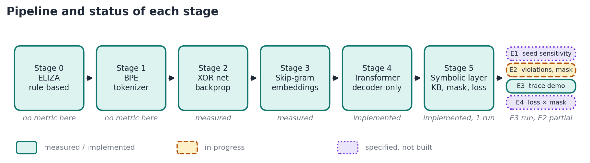

*Teal = built (stages 2–3 measured, stage 4 implemented). Violet = designed, not built. Border style repeats the colour for greyscale.*

| Stage | What                               | State                                                                     |
| ----- | ---------------------------------- | ------------------------------------------------------------------------- |
| 0     | ELIZA pattern-matching chat        | Works                                                                     |
| 1     | BPE tokenizer                      | Works                                                                     |
| 2     | XOR network, 2→4→1 with backprop | Works, measured                                                           |
| 3     | Skip-gram word embeddings          | Fixed (was collapsed), measured                                           |
| 4     | Decoder-only transformer           | Done (forward, backward, Adam, top-p generation, multi-threaded training) |

Every number measured in this project comes from code, not typed in by hand: XOR and the seed comparison from `bun tests/ieee-data.ts`, the civil-law Skip-gram from the saved model (`.data/embedding-weights.json`). Figures quoted from papers are attributed to them.

### XOR: same function, unrelated weights

A single layer cannot learn XOR (loss 0.2845 → 0.2842). A 2→4→1 network can. Four seeds, same data and settings:

| Epochs           | Seed 42 | Seed 1  | Seed 2                           | Seed 3  |
| ---------------- | ------- | ------- | -------------------------------- | ------- |
| 500 (final MSE)  | 0.0144  | 0.0227  | **0.1506** (not converged) | 0.0110  |
| 5000 (final MSE) | 0.00028 | 0.00027 | 0.00031                          | 0.00022 |

At 5000 epochs all seeds compute the same function, but the first hidden unit's weights differ completely (for example `[5.84, −1.49, 6.18, −0.28]` for seed 42 against `[0, −6.50, −1.93, 5.29]` for seed 1).

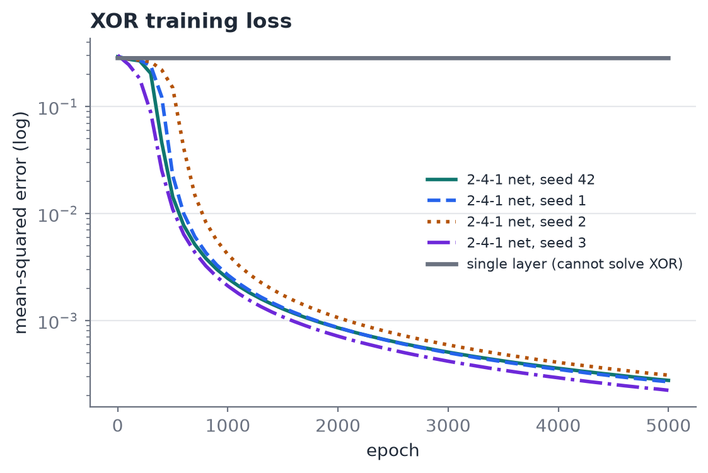

### Skip-gram: the civil-law vocabulary, and a wrong answer

The first version gave every word pair cosine 1.0. Five independent bugs were the cause: an off-by-one in the sampling table, a missing positive update, the wrong row updated for negatives, a wrong analogy sign, and a corpus join that never lower-cased. The fix was first checked on a toy corpus of fairy tales. That corpus is gone: the model now trains only on England & Wales civil-dispute text (222 definitions plus 34 dispute stories, 401 sentences; vocab 924 whole-word tokens from 5000 BPE merges; dim 32, window 2, 17,142 training pairs; 10,000 epochs; seed 42).

| Pair                | Cosine | Pair                 | Cosine |
| ------------------- | ------ | -------------------- | ------ |
| buyer / customer    | 0.76   | defendant / tenant   | 0.54   |
| seller / buyer      | 0.74   | claimant / defendant | 0.44   |
| claimant / creditor | 0.69   | trader / consumer    | 0.42   |
| landlord / tenant   | 0.59   | trader / court       | −0.02 |
| creditor / debtor   | 0.58   | judge / contract     | −0.13 |

Words that share sentences end up close: the consumer-rights roles (buyer, customer, seller) form one cluster, and the claimant sits next to the creditor because most claims in the corpus are debt claims. But the analogies fail. None of the five returns a role word:

| Query                          | Expected | Returned (cosine)  |
| ------------------------------ | -------- | ------------------ |
| landlord − tenant + consumer  | trader   | *renters* (0.57) |
| trader − consumer + tenant    | landlord | *return* (0.65)  |
| claimant − defendant + debtor | creditor | *whether* (0.61) |
| creditor − debtor + defendant | claimant | *between* (0.58) |
| seller − buyer + customer     | supplier | *proves* (0.72)  |

The model learned co-occurrence, not the relation "the party who supplies or lends, against the party who receives or owes".

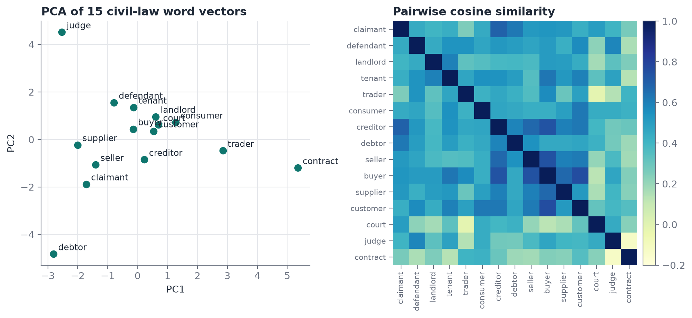

*Drawn by `docs/images/make_civil_law_figures.py` from `.data/embedding-weights.json`. The script recomputes the five analogies and prints them, so the table above can be checked against the saved vectors.*

### Four seeds: the geometry agrees, the coordinates do not

*Measured on the earlier toy corpus (`bun tests/ieee-data.ts`); not yet re-run on the civil-law corpus.*

| Measure (6 seed pairs)                               | Range          |
| ---------------------------------------------------- | -------------- |
| Cosine of the*same word* across seeds              | −0.28 to 0.09 |
| Correlation of the*pairwise geometry* across seeds | 0.977 to 0.984 |
| Analogies correct (our answer key)                   | 5/7 to 6/7     |

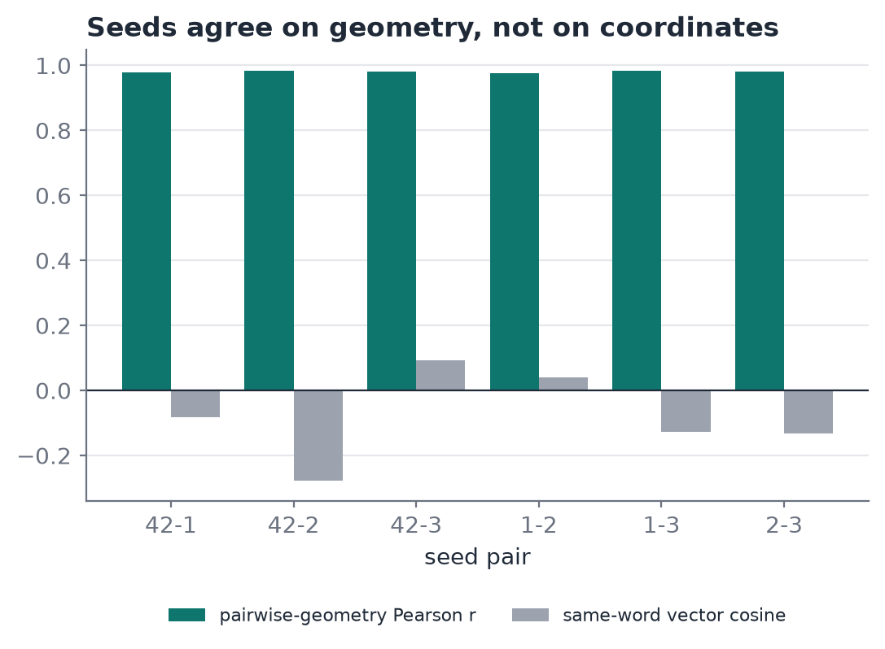

This cuts against a strong reading of "random weights". The learned *function* is stable across seeds; the *weights* are not. So the internal solution is neither unique nor designed, and you cannot read a reason off it. Stability also does not mean correctness: the *lion* error appears on every seed.

### The transformer

Each token gets a query, key and value; attention weights are `softmax(QKᵀ/√d_k + M)V` with a causal mask `M`; several heads run in parallel; a feed-forward net refines each token; blocks stack.

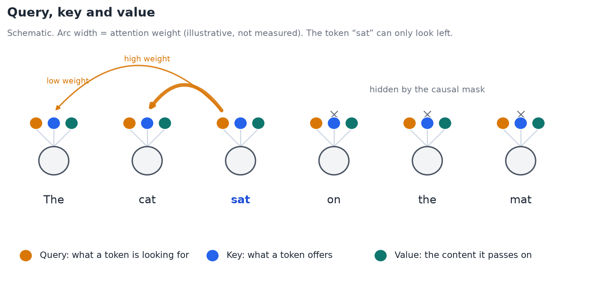x

Pre-LN block, as built in GPT-2:

```
x'  = x  + MHA(LN1(x))
x'' = x' + W2 · ReLU(W1 · LN2(x') + b1) + b2
```

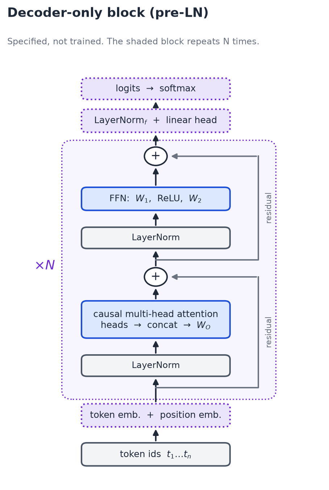

Config: context 32 (training windows of 16 tokens), d = 32, 2 heads, feed-forward width 128, 1–6 layers (default 2), Adam lr 0.001, one full-batch step per epoch. That is **12,704 parameters per block**. With the whole-word BPE vocabulary built from the civil-law text (937 tokens, 1781 merges) the model has 87,401 parameters at 2 layers and 138,217 at 6. Training signal is next-token cross-entropy, nothing else.

Implementation, in `src/routes/train-transformer/`:

| File                 | Role                                                                                                                                     |
| -------------------- | ---------------------------------------------------------------------------------------------------------------------------------------- |
| `matrix.ts`        | `matmul`, `matmulTransA/B`, Xavier init, seeded `rand` on flat row-major `Float32Array`s                                         |
| `transformer.ts`   | LayerNorm, causal multi-head attention, FFN, block forward/backward, cross-entropy, Adam, top-p generation                               |
| `weigth-layout.ts` | Packs all weights into one `SharedArrayBuffer`; zero-copy views for every thread                                                       |
| `train-worker.ts`  | Worker thread: forward + backward on its slice of sequences, gradients into shared memory                                                |
| `train.ts`         | BPE vocab, sliding windows, spawns `cpus − 2` workers, sums gradients, Adam step, samples, checkpoints every 100 epochs to `.data/` |
| `index.ts`         | `POST /train-transformer`, streams `init`, `epoch` and `done` events over SSE                                                    |

**Verification gates** (`tests/train-transformer.test.ts`, 5 pass): finite-difference gradient check (error < 10⁻³), initial loss ≈ ln V, overfit a single sequence, causal-mask test, same seed gives same weights.

**Bugs found and fixed.** The gates needed three forward/backward fixes in `transformer.ts`, made on 2026-11-02 (see [architecture §9](docs/architecture.md#9-defects-found-while-drawing-the-diagrams)): the first residual multiplied instead of adding (line 494), attention skipped the token itself (`j < i`, line 482), and the gradient for K used `K` instead of `Q` (line 668). Older weights stay in `.data` but are not loaded, because filenames now carry `MODEL_VERSION`.

### The reasoning gap

- **The objective has no notion of truth.** It rewards sounding like the corpus.
- **Weights come from a random start.** XOR and Skip-gram above show equal behaviour from unrelated weights.
- **"Pure emergent, not designed" means opaque.** Attention maps show where the model looked, not a justification it could be held to.
- **More layers do not change the objective.** Whether reasoning emerges at scale is open. We claim only that nothing in *this* small model asks for it or exposes it.

**Further limits of the semantic loss** (from the literature; nothing here has been run on this transformer). Xu et al. (2018) report that 69.89% of test predictions satisfied the constraint on grid paths and 55.28% on preference rankings: large gains, far from complete. A missing rule constrains nothing and a wrong one is trained in. Even with correct constraints, the generalisation benefit comes with a bias toward a suboptimal model (Wang et al., 2023).

**The two sources of randomness also stay.** None of the five mechanisms (M1 hard logit mask, M2 soft bias, M3 reasoning trace, M4 verifier, M5 semantic loss) removes either one:

| Source                          | Where                                                                     | What the approach does to it                                                                                                                                                                     | What is left                                                                                                                 |
| ------------------------------- | ------------------------------------------------------------------------- | ------------------------------------------------------------------------------------------------------------------------------------------------------------------------------------------------ | ---------------------------------------------------------------------------------------------------------------------------- |
| **Weight initialisation** | Xavier init from the seeded `rand` (`matrix.ts`)                      | The semantic loss constrains outputs, not coordinates, so it adds a term to training that still starts from random weights. The mask, trace and verifier never touch the weights.                | Seeds still end at unrelated weights, as XOR shows above, and may disagree more among allowed tokens (Zombori et al., 2024). |
| **Top-p sampling**        | The draw in `generateText` (`transformer.ts`), from the same `rand` | The semantic loss changes the probabilities drawn from, and the mask removes banned tokens before temperature and top-p. The draw itself stays. The verifier only checks text after it is drawn. | The next token is still picked at random from whatever remains in the nucleus.                                               |

Two ways of removing them only appear to work. Fixing the seed makes a run repeatable, not justified: seed 42 is no more correct than seed 1. Greedy decoding removes the draw, but the output is then one fixed point of one seed's distribution, so the disagreement between seeds is still there, just out of sight. The only route that removes them from an output's content is to stop the network authoring it (a formal query, a reasoner and a template), which gives up generation and still repeats every KB error.

Removing all uncertainty would be the wrong goal anyway, because language has many acceptable continuations and ambiguity is a normal feature of it (Piantadosi et al., 2012; Holtzman et al., 2020).

### Mechanisms and the taxonomy

In the terms of Sheth et al., **lowering** compresses symbolic knowledge into the neural side, **lifting** lifts neural output into symbols.

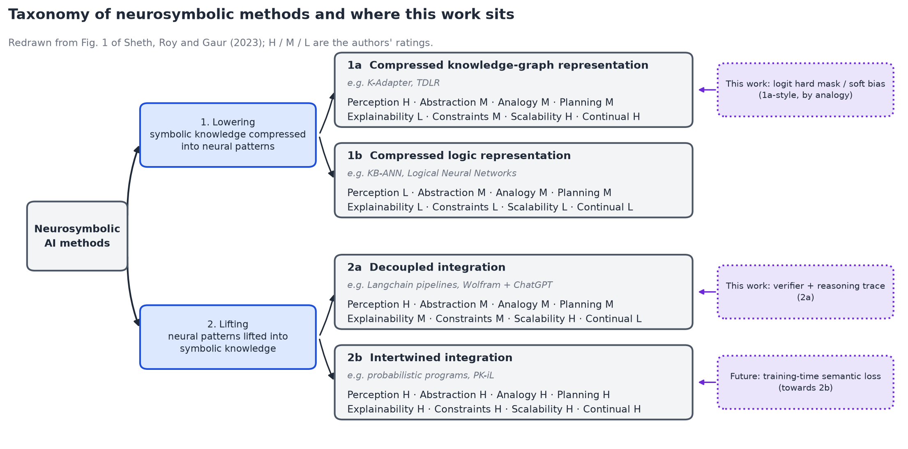

| Mechanism          | What it does                                                                          | Position                      |
| ------------------ | ------------------------------------------------------------------------------------- | ----------------------------- |
| M1 Hard logit mask | Sets logits of knowledge-base-violating tokens to −∞ before temperature and softmax | 1a-style lowering, by analogy |
| M2 Soft bias       | Adds +λ to tokens the knowledge base supports                                        | 1a-style lowering, by analogy |
| M3 Reasoning trace | Per step: rules fired, tokens blocked, probability mass before and after              | Part of 2a                    |
| M4 Verifier        | Parses generated text into triples, checks them against the knowledge base            | 2a decoupled lifting          |
| M5 Semantic loss   | Training term rewarding mass on allowed tokens                                        | Toward 2b                     |

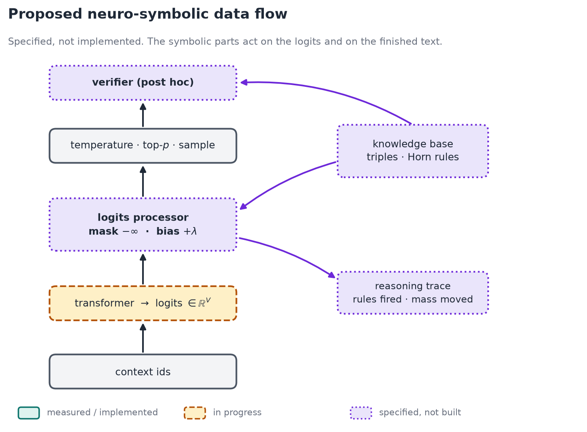

**What this does not do.** A mask is not understanding. It blocks a class of outputs and leaves the weights unchanged. The trace explains the symbolic decision, not the network's internal computation.

### PRE TRAINING: the baseline before the symbolic layer

This is the reference point for comparison. Everything here was trained by next-token or context prediction alone, with **no** knowledge base, mask, bias, trace, verifier or semantic loss. When the neuro-symbolic layer is built, the same commands and settings are run again and compared with this section. The Skip-gram was recorded on 2026-10-31 on the working tree of commit `c42da07`. The transformer was recorded on 2026-11-02 with the source at commit `f4a3926`.

**Skip-gram (stage 3)**, from the `/train-embed` page with the words `claimant defendant landlord tenant`: 10,000 epochs (the route's default), seed 42.

| Corpus          | Value    |
| --------------- | -------- |
| Sentences       | 401      |
| Vocabulary      | 924      |
| Dimensions      | 32       |
| Window          | 2        |
| Training pairs  | 17,142   |
| Loss at epoch 0 | 4.102625 |

| Word      | Five nearest neighbours (cosine)                                          |
| --------- | ------------------------------------------------------------------------- |
| claimant  | creditor 0.69, remoteness 0.67, limitation 0.67, evidence 0.66, test 0.64 |
| defendant | noise 0.69, loser 0.66, authorities 0.64, hearing 0.62, talking 0.62      |
| landlord  | tenant 0.59, protect 0.59, higher 0.57, thought 0.57, loss 0.56           |
| tenant    | income 0.67, area 0.66, disputed 0.64, buyer 0.63, price 0.62             |

| Pair                  | Cosine |
| --------------------- | ------ |
| landlord ↔ tenant    | 0.59   |
| defendant ↔ tenant   | 0.54   |
| claimant ↔ defendant | 0.44   |
| defendant ↔ landlord | 0.44   |
| claimant ↔ tenant    | 0.43   |
| claimant ↔ landlord  | 0.40   |

Analogies: 0 of 5 correct (the table is in the Skip-gram section above).

<details>
<summary>Screenshots of the run</summary>

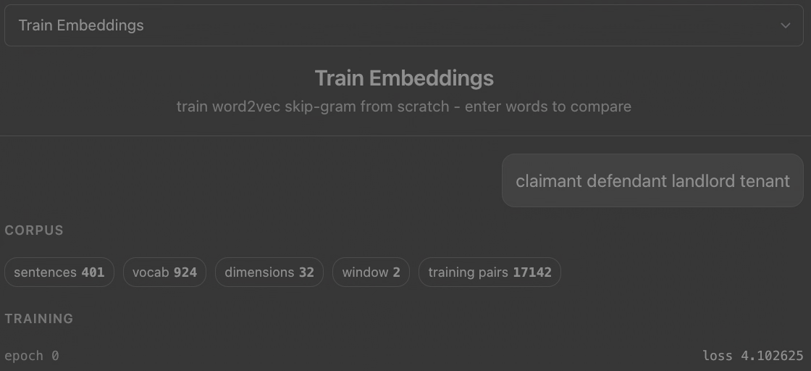
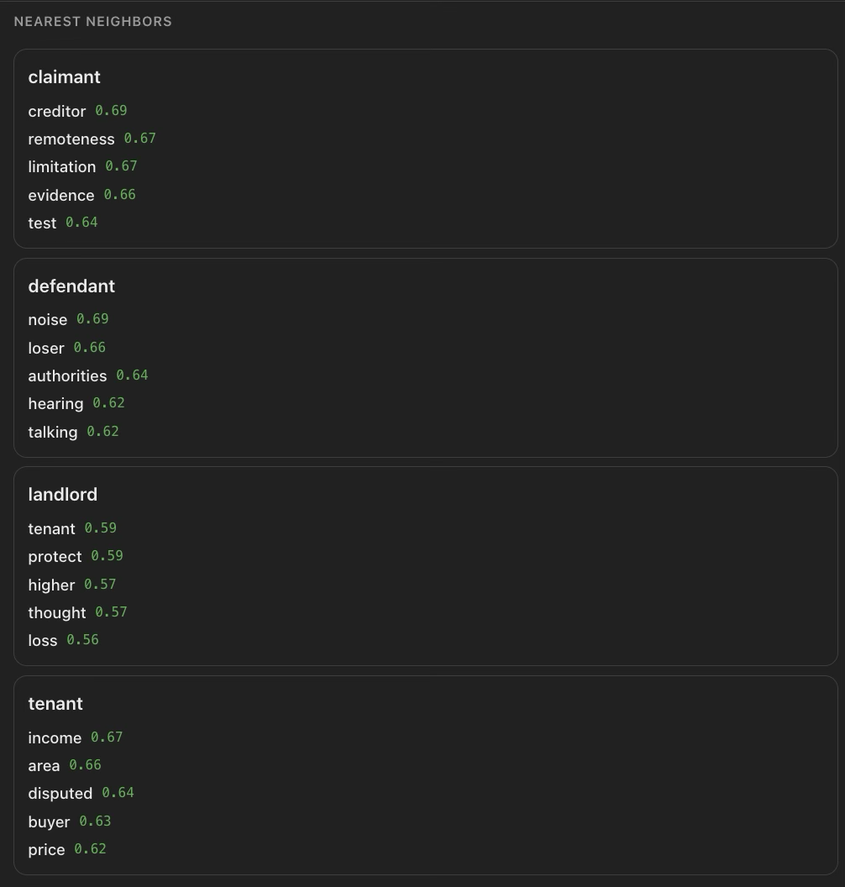
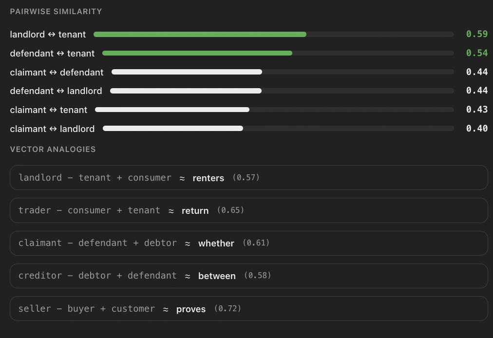

</details>

**Transformer (stage 4)**: 2000 epochs, 2 layers, temperature 1, top-p 0.6, 20 tokens, seed 42, sent from the Train Transformer page as `2000 1 0.6 2 20` (about 86 minutes, estimated from checkpoint timestamps). This replaces the earlier 300-epoch run, as the guardrail below requires, because `transformer.ts` and the vocabulary have changed.

| Measure                                  | Value                                                                |
| ---------------------------------------- | -------------------------------------------------------------------- |
| Training text                            | 256 items (222 definitions + 34 stories)                             |
| Vocabulary                               | 937 tokens (1781 BPE merges, one token per word or punctuation mark) |
| Parameters                               | 87,401                                                               |
| Training windows                         | 5,374 windows of 16 tokens                                           |
| Loss at epoch 0                          | 6.868 (ln 937 = 6.843, a uniform guess, as expected)                 |
| Loss at epochs 100, 300, 500, 1000, 1500 | 4.850, 2.217, 1.051, 0.391, 0.287                                    |
| Lowest logged loss                       | 0.248 at epoch 1980                                                  |
| Final loss, epoch 2000                   | 0.2489 (perplexity ≈ 1.28)                                          |
| Held-out loss                            | Not measured for this run: it trained on all 256 items               |

Sample at epoch 2000, prompt `the claimant is`:

> the claimant is the person who brings a claim. the defendant is the person who answers a claim. the claimant asks

**This loss shows memorisation, not generalisation.** The whole sample above is an unbroken stretch of the training text. As the loss falls, the samples turn into copies:

| Epochs     | Samples | Generated tokens copied, mean | Samples entirely copied |
| ---------- | ------- | ----------------------------- | ----------------------- |
| 0–300     | 31      | 0.0%                          | 0                       |
| 310–500   | 20      | 5.5%                          | 0                       |
| 510–1000  | 50      | 79.7%                         | 0                       |
| 1010–1500 | 50      | 99.5%                         | 15                      |
| 1510–2000 | 50      | 100%                          | 38                      |

A token counts as copied if it sits inside a run of 8 or more tokens found verbatim in the training token stream. Samples are the ones saved every 10 epochs in the weights file's history.

Weights: `.data/transformer-weights-e2000-l2-d32-h2-ff128-ctx32-cbf9d5315-v4.json`. Replaying them through the cached path gives a final loss of 0.248851.

<details>
<summary>Screenshots of the run</summary>

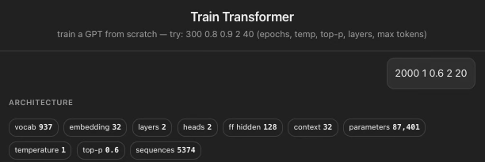
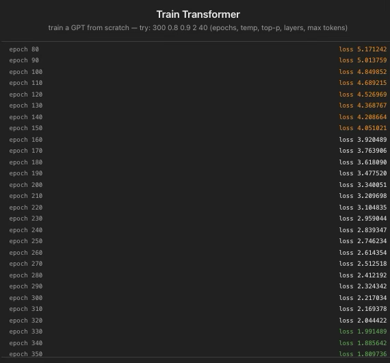
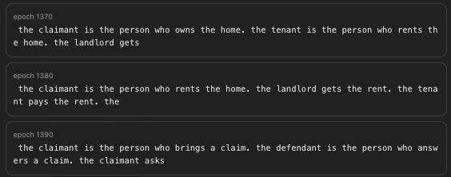
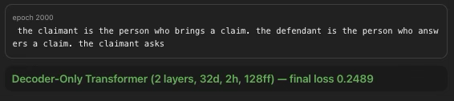

</details>

<details>
<summary>Superseded baseline: 300 epochs, with defects D1–D3 present (2026-10-31)</summary>

Kept as the record of the transformer before its fixes. Do not compare new runs with it. It ran headless through `trainTransformer` at temperature 0.8, top-p 0.9 and 40 tokens (710 s on 10 cores), on commit `c42da07`.

| Measure               | Value                        |
| --------------------- | ---------------------------- |
| Vocabulary            | 807 tokens (1000 BPE merges) |
| Parameters            | 78,951                       |
| Training windows      | 6,431 windows of 16 tokens   |
| Loss at epoch 0       | 6.717 (ln 807 = 6.693)       |
| Lowest loss           | 5.637 at epoch 210           |
| Final loss, epoch 300 | 5.678 (perplexity ≈ 292)    |

Sample at epoch 300, prompt `the claimant is`:

> the claimant is. the and. six.. on of to track the the. takes of of founds tenant usually. th needs. fromy paid you tenant did the the t to learner. agreement. she

The loss stops falling after about 100 epochs and the text is domain words in no order, as expected from the three forward/backward defects present at the time, since fixed. Weights: `.data/transformer-weights-e300-l2-d32-h2-ff128-ctx32-cbf9d5315.json`.

</details>

# Neural symbolic integration: semantic loss in training, a hard mask at decoding

A language model trained on next-token cross-entropy has no notion of truth, because the loss only rewards text that looks like the corpus. This project specifies one pipeline for a from-scratch TypeScript transformer, in which the same knowledge base (KB) shapes training through a semantic loss and constrains decoding through a hard logit mask. It measures the baselines that motivate the pipeline and leaves its effect open: the symbolic layer is implemented as a separate trainer beside the CE-only baseline, and no full-length experiment on it has been run.

## The pipeline

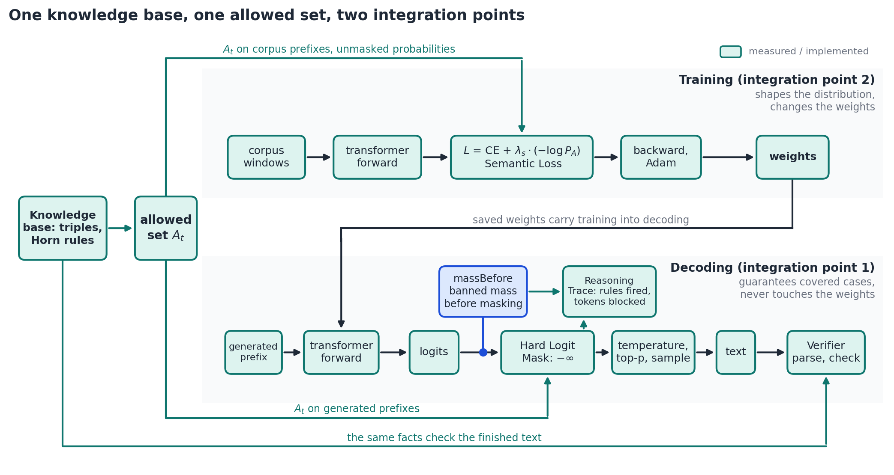

The two designs are not alternatives. KB of triples plus Horn rules gives one allowed set $A_t$ per position, and that set is used twice. Training shapes the distribution, so the model should learn to put little mass on banned tokens. Decoding guarantees the covered cases at test time. The published name for this pattern is constrained learning plus constrained inference (CL + CI, or CLCO; see [chapter 04 §3](docs/progress/04-neurosymbolic-design.md#3-architecture)).

The closest published precedent is Ahmed, Chang and Van den Broeck (2023), on GPT-2 (124M parameters) and RealToxicityPrompts. They train with a pseudo-semantic loss alongside SGEAT domain-adaptive training, then add Word Banning at decoding, which sets the probability of listed words to zero. The combination has the lowest toxicity: toxicity probability over all prompts is 9.20%, against 9.80% without banning and 14.05% for SGEAT alone. Two differences matter here: they score toxicity with the Perspective API rather than the constraint itself, and their loss works around a model sample, whereas the M5 semantic loss is a per-position term on corpus prefixes.

The KB covers definitions in the civil-law corpus. For example, `counterpart(claimant, defendant) ∧ defined_by(defendant, answers) ⇒ not_defined_by(claimant, answers)`. Forward chaining closes the KB once, and a trigger turns a derived fact into banned token IDs when the context ends in a frame such as `the claimant is the person who`. Every ban can be printed as a proof.

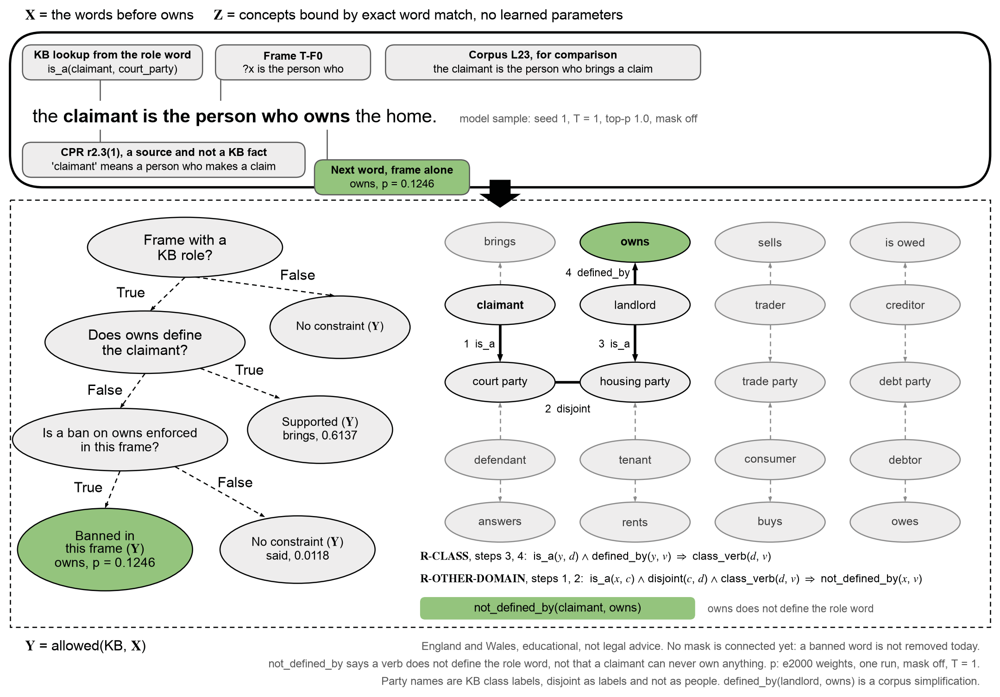

The figure traces one unmasked sample from the saved model (seed 1, T = 1, top-p 1.0), which began "the claimant is the person who owns the home", where corpus L23 says "brings a claim". The KB acts on the six tokens before `owns`: the frame `?x is the person who` binds `claimant`, and the closed KB holds `not_defined_by(claimant, owns)` by R-OTHER-DOMAIN, so `owns` is in the banned set. Green marks what the KB reached for this input, not what is correct. The facts are in [`symbolic.ts`](src/routes/neural-symbolic/symbolic.ts), and class labels such as `court_party` are the KB's own, pairwise disjoint as labels and not as people. `defined_by(landlord, owns)` is a corpus simplification.

These are read-only probes, not a measured effect. With the frame alone and the mask off, `owns` has p = 0.1246 (one trained run, T = 1), and 265 of 2,000 sampling seeds drew it at top-p 1.0. At top-p 0.6 all 2,000 drew `brings`, so the error depends on the sampling setting. [A test on the real corpus and tokenizer](tests/neural-symbolic-kb.test.ts) shows the triggers fire at 9 of 5,390 positions and never ban the next token in the corpus. The mask only runs on the neural-symbolic compare route, so the baseline's own output is never edited, and the KB covers only these definition frames. The layout follows Sheth, Roy and Gaur (2023, Fig. 4), and the drawing is original.

### Method 1 : the Knowledgebase enforced at decoding (Hard logit mask)

At each step, the logits of banned token IDs are set to −∞ before temperature and top-p. Optional companions are the M2 soft bias (towards supported tokens), the M3 reasoning trace (rules fired, tokens blocked and `massBefore`) and the M4 verifier (parses finished text into triples and checks them).

- **Guarantee.** Zero mass on covered banned tokens, but only relative to KB coverage, only for whole-word token IDs, and only when a trigger fires.
- **Limits.** It does not change the weights or choose among allowed tokens. A wrong rule is enforced absolutely. Errors concentrate in the translation from text to logic, so the M4 verifier reports only on what it could parse.
- **Taxonomy.** In Sheth, Roy and Gaur (2023) this is 1a-style lowering, by analogy, not strict 1a: the knowledge is neither compressed nor learned. The mapping is ours ([chapter 07 §5.4](docs/progress/07-neurosymbolic-code-2b.md#54-1a-style-lowering-by-analogy)).

### Method 2: Integrated Deterministic Loss to Transformer (Semantic Loss)

The objective is $L = \text{CE} + \lambda_s \cdot (-\log P_A)$, where $P_A$ is the probability mass on allowed tokens (Xu et al., 2018; the categorical form is Ahmed et al., 2023, Eq. 3). It is a deterministic function of the logits. The randomness in the system comes from seeded initialisation and top-p sampling, and this term leaves both in place. What it can do follows from these properties:

- **It cannot see the choice among allowed tokens.** $H(p) = H_b(P_A) + P_A H(q_A) + (1-P_A) H(q_B)$, where $q_A$ and $q_B$ are $p$ renormalised over allowed and banned tokens. The loss depends only on $P_A$, so $H(q_A)$ is outside its objective (our derivation). A constraint "only specifies what worlds are possible but does not specify which one is correct" (van Krieken et al., 2024).
- **It is a soft penalty.** Where data and rule conflict, the optimum at one context keeps banned mass $f_B/(1+\lambda_s)$, where $f_B$ is the banned tokens' frequency in the data (our derivation). There is no test-time guarantee (Ahmed et al., 2022).
- **It acts only where it is applied.** Where the target is allowed, $\text{CE} = \text{masked CE} + (-\log P_A)$, so the term changes the speed of learning there, not the optimum (our derivation). A probe of the chapter 07 KB (one seed, not an experiment) found it fires at 86 of 85,984 training-window positions (0.100%), with the target allowed at all of them. A null result is therefore plausible.
- **It may amplify seed differences.** Zombori et al. (2024, Theorem 4) prove for softmax regression that, with no other supervision, this form of loss concentrates mass on whichever allowed token starts largest. Whether that happens in a transformer has to be measured.
- **Taxonomy.** Towards 2b (intertwined), not end-to-end differentiable reasoning: the KB is discrete and only the loss term is differentiable. Sheth et al. do not use the term "semantic loss", so this placement is also our reading.

### Why Semantic Loss need Knowledgebase Hard Logit Mask

- **Violation rate cannot show what the Semantic Loss adds.** With the mask on, violations of token-expressible rules are 0 by construction. The evaluation therefore reads its contribution from `massBefore` (the banned-token mass before masking), violations with the mask off, violations the verifier finds that a token mask cannot express, and held-out cross-entropy on targets that do not conflict with the KB. `massBefore` is read at fixed contexts outside training, because on training contexts it is close to the training loss itself.
- **Prediction, not a result.** A model trained with the semantic loss puts less mass on banned tokens (P5), so the mask has to intervene less and renormalising distorts the distribution less. The distortion at one context is $KL(q_A \Vert p) = -\log P_A$, which is the value of the semantic loss there (our derivation). A covered context still samples from $q_A$, so no finite $\lambda_s$ makes the mask unnecessary for a correct rule.
- **Shared failure mode.** A wrong or missing rule enters both stages at once: it is trained into the weights and enforced at decoding. If lifting (reading candidate facts back from the model) is ever allowed to add bans, a wrong accepted triple reaches both stages, so that step stays off.
- **Perplexity cost.** A hard mask gives infinite perplexity on reference text containing a banned token. Ahmed et al. (2023) report this and score their banning variants on the 50% least toxic validation text only. Here, E2 computes perplexity from the weights alone, without the mask, and E4 reports held-out cross-entropy on targets that do not conflict with the KB.

The stated target stays **zero mass on rule-excluded tokens and a calibrated spread over the rest**, with each guarantee stated next to its coverage.

## Important: extracting transformer neural patterns into symbolic knowledge

This is the "neural patterns lifted into symbolic knowledge" half of the design. It probes the trained network with templates, reads its next-word distribution and turns confident verb predictions into **candidate** triples. Each candidate falls into one of three cases:

| Status      | Meaning                                      | Action                                                                                                             |
| ----------- | -------------------------------------------- | ------------------------------------------------------------------------------------------------------------------ |
| `confirmed` | KB already holds it                          | None. Evidence the network learned the fact, though on this model it may be memorisation                           |
| `conflict`  | KB derives the opposite (`not_defined_by`)   | Report with probability and proof. Direct evidence of the [reasoning gap](docs/progress/03-reasoning-gap.md)       |
| `novel`     | Neither                                      | Accept only if $p\ge\tau$ **and** adding it creates no new contradiction                                           |

**Reported only.** The neural-symbolic trainer runs [`lift.ts`](src/routes/neural-symbolic/lift.ts) at every epoch and shows each candidate's status, but a `novel` word that passes this gate is only flagged, never added to the KB. No full-length run has been recorded, so the table describes behaviour, not a result. An accepted triple is the network's belief, not ground truth, and it would stay out of the mask and the semantic loss, as the shared failure mode above requires. The design is in [chapter 07 §7](docs/progress/07-neurosymbolic-code-2b.md#7-lifting-liftts-network--symbols).

## Two separate trainers

The baseline and the neural-symbolic model are trained apart, so the difference between them can be inspected directly. They share the corpus, tokeniser, model code, Adam and hyperparameters. Only the loss differs.

|              | Baseline                                                       | Neural-symbolic                                                    |
| ------------ | -------------------------------------------------------------- | ------------------------------------------------------------------ |
| Code         | [`train-transformer/train.ts`](src/routes/train-transformer/train.ts) | [`neural-symbolic/train.ts`](src/routes/neural-symbolic/train.ts) |
| Page         | `/train-transformer`                                           | `/train-neural-symbolic`                                           |
| Loss         | CE                                                             | CE + $\lambda_s \cdot (-\log P_A)$                                 |
| Seed         | 42 only                                                        | Chosen per run                                                     |
| Weight files | `transformer-weights-*`                                        | `neural-symbolic-weights-*`, named with $\lambda_s$, seed and KB hash |

The compare view on the neural-symbolic page runs both models on one prompt and sampling seed, with the mask off and on. It shows their text, the mask trace, the verifier's claim counts and the banned mass at each definition frame. The same page draws the cross-entropy and semantic loss as training runs, with a dashboard of the latest epoch's numbers by trigger pattern. A saved λ = 0 run with the same settings appears as a dashed control on the semantic loss chart. It also gives every epoch one card: the trigger patterns, the rules violated (a blocked word's mean p at its pattern is at least 0.02), each lifted pattern's status, the semantic loss and the banned mass.

[A test](tests/neural-symbolic-train.test.ts) shows that at $\lambda_s = 0$ and seed 42 the new trainer saves the baseline's weights and losses, for a short run (3 epochs, 1 layer, weights compared at their saved 6 decimal places). This makes $\lambda_s = 0$ the CE-only control at seeds the baseline does not offer. Corpus positions are the only ones trained on, so the term still fires at 86 of 85,984 of them. **Implemented, but no full-length run has been compared**, so no effect is claimed.

## What is measured so far

Everything below ran with no KB, mask or semantic loss.

| Baseline                                                                | Measure                                                    | Value                           |
| ----------------------------------------------------------------------- | ---------------------------------------------------------- | ------------------------------- |
| Skip-gram, civil-law corpus, one seed                                   | Role analogies correct                                     | 0 of 5                          |
|                                                                         | landlord ↔ tenant cosine                                  | 0.59                            |
| Transformer, 2000 epochs, one seed, trained on all text                 | Final loss                                                 | 0.2489                          |
|                                                                         | Generated tokens copied from the corpus, epochs 1510–2000 | 100%                            |
| Transformer, 4-fold test on held-out stories, 16 runs per configuration | Test loss, learning rate 3e-4 / 1e-4 (nats per token)      | 5.389 ± 0.165 / 5.386 ± 0.174 |
|                                                                         | Bigram / unigram baseline on the same folds                | 5.290 / 6.012                   |
|                                                                         | Runs beating the bigram, per character                     | 0 of 16 / 1 of 16               |

**This is the motivation: low loss is not correctness.** The final loss of 0.2489 is memorisation, since the samples become copies of the training text. Fluent samples from earlier in that run state definitions the corpus does not contain, and contradict its definition of a claimant as "the person who brings a claim":

> the claimant is the person who owns the home. the tenant is the person who rents the home. the landlord gets *(epochs 1000 and 1370)*
>
> the claimant is the person who rents the home. the landlord gets the rent. the tenant pays the rent. the *(epoch 1380)*

These samples show that this happens, not how often. On held-out stories, a larger configuration (d = 64, 4 heads) does not beat a bigram model on any of the four folds. The Skip-gram result is the same gap in another form: moderate similarity, wrong relation.

## Falsifiable predictions and planned experiments

| #  | Prediction                                                                        | Test      | Refuted if                                                                       |
| -- | --------------------------------------------------------------------------------- | --------- | -------------------------------------------------------------------------------- |
| P1 | With the hard mask on, the violation rate is 0 for token-expressible constraints  | E2        | any such violation                                                               |
| P2 | With the processor off, output equals the unconstrained baseline at the same seed | unit test | any difference                                                                   |
| P3 | The unconstrained model violates the KB at a non-trivial rate                     | E2        | rate near 0                                                                      |
| P4 | Seeds give similar loss but different weights                                     | E1        | seeds agree closely in weights                                                   |
| P5 | Semantic loss lowers the network's own forbidden mass                             | E4        | not lower, with the mask off                                                     |
| P6 | Semantic loss reduces solution ambiguity across seeds but not weight ambiguity    | E4        | divergence of$(P_A, 1-P_A)$ does not shrink, or weight cosine rises close to 1 |
| P7 | The cost on unconstrained text is small                                           | E4        | a large rise in perplexity where no rule fires                                   |

P1 and P2 follow from the construction, so they test the implementation. P3–P7 are empirical and may fail.

**Experiments, none run.** E1: seed sensitivity. E2: violation rate with the mask off and on. E3: one full trace. E4: the ablation below, at $\lambda_s \in \{0, 2\}$ and seeds 42, 1, 2, 3. The CE-only arm at seeds 1, 2 and 3 comes from the neural-symbolic trainer at $\lambda_s = 0$.

| Arm                       | `massBefore` | Violations, mask off | Violations a token mask cannot express | Held-out CE, non-conflicting targets |
| ------------------------- | -------------- | -------------------- | -------------------------------------- | ------------------------------------ |
| CE only                   | pending        | pending              | pending                                | pending                              |
| CE + semantic loss        | pending        | pending              | pending                                | pending                              |
| CE + mask                 | pending        | pending              | pending                                | pending                              |
| CE + semantic loss + mask | pending        | pending              | pending                                | pending                              |

## Towards neurosymbolic world models

*A proposed direction for the PhD project "Neurosymbolic World Models for Robotic Manipulation" (University of Sheffield; Dr Marco Valentino, Dr Amir Ghalamzan). None of this has been done, and this repository contains no robotics.*

- **Objective 1 (foundations).** Move the same two-stage pipeline from token-level constraints on a toy language model to constraints on a pretrained LLM that writes action models (PDDL preconditions and effects). A planner or validator such as VAL (Howey et al., 2004), plus an entailment-based faithfulness check, would take the verifier's role, with localised repair.
- **Objective 2 (controller).** The advert's controller "will simulate actions and verify constraints to trigger automated error recovery". That is the same split: a world model trained to respect constraints corresponds to the semantic-loss stage, and a controller that verifies constraints before acting corresponds to the mask and verifier stage.

## Related work and positioning

- **Constraints in the loss or output layer.** Semantic loss (Xu et al., 2018) is the term our M5 semantic loss adapts. Semantic probabilistic layers (Ahmed et al., 2022) build consistency into the output layer and train through it; this design keeps loss and mask separate. Pseudo-semantic loss (Ahmed et al., 2023) extends the idea to autoregressive models and is the precedent above.
- **Constrained decoding.** NeuroLogic decoding (Lu et al., 2021) searches with lexical constraints, and grammar-constrained decoding (Geng et al., 2023) restricts output to a grammar. Both act only at decoding. The M1 hard logit mask is simpler than either: a per-token ban with no lookahead.
- **LLMs with theorem provers.** Explanation-Refiner (Quan et al., 2024) uses a theorem prover to verify natural-language explanations and feed corrections back to an LLM. The M4 verifier is a far weaker check: a pattern parser and forward chaining over a small hand-written KB.

## About the author

<!-- TODO: fill in all five lines -->

- **Name:** [name]
- **University:** [university]
- **Email:** [email]
- **CV:** [link]
- **AI assistance:** [one-line statement]

## References

- Ahmed, K., Chang, K.-W., Van den Broeck, G. (2023). A Pseudo-Semantic Loss for Autoregressive Models with Logical Constraints. *NeurIPS 36*. [arXiv:2312.03905](https://arxiv.org/abs/2312.03905).
- Ahmed, K., Teso, S., Chang, K.-W., Van den Broeck, G., Vergari, A. (2022). Semantic Probabilistic Layers for Neuro-Symbolic Learning. *NeurIPS 35*. [arXiv:2206.00426](https://arxiv.org/abs/2206.00426).
- Ba, J. L., Kiros, J. R., Hinton, G. E. (2016). Layer Normalization. [arXiv:1607.06450](https://arxiv.org/abs/1607.06450).
- Geng, S., Josifoski, M., Peyrard, M., West, R. (2023). Grammar-Constrained Decoding for Structured NLP Tasks without Finetuning. *EMNLP*. [arXiv:2305.13971](https://arxiv.org/abs/2305.13971).
- Holtzman, A., Buys, J., Du, L., Forbes, M., Choi, Y. (2020). The Curious Case of Neural Text Degeneration. *ICLR*. [arXiv:1904.09751](https://arxiv.org/abs/1904.09751).
- Howey, R., Long, D., Fox, M. (2004). VAL: Automatic Plan Validation, Continuous Effects and Mixed Initiative Planning Using PDDL. *ICTAI*, 294–301. [doi:10.1109/ICTAI.2004.120](https://doi.org/10.1109/ICTAI.2004.120).
- Kingma, D. P., Ba, J. (2015). Adam: A Method for Stochastic Optimization. *ICLR*. [arXiv:1412.6980](https://arxiv.org/abs/1412.6980).
- Lu, X., West, P., Zellers, R., Le Bras, R., Bhagavatula, C., Choi, Y. (2021). NeuroLogic Decoding: (Un)supervised Neural Text Generation with Predicate Logic Constraints. *NAACL*. [arXiv:2010.12884](https://arxiv.org/abs/2010.12884).
- Mikolov, T., Chen, K., Corrado, G., Dean, J. (2013a). Efficient Estimation of Word Representations in Vector Space. [arXiv:1301.3781](https://arxiv.org/abs/1301.3781).
- Mikolov, T., Sutskever, I., Chen, K., Corrado, G., Dean, J. (2013b). Distributed Representations of Words and Phrases and their Compositionality. *NeurIPS*. [arXiv:1310.4546](https://arxiv.org/abs/1310.4546).
- Piantadosi, S. T., Tily, H., Gibson, E. (2012). The communicative function of ambiguity in language. *Cognition* 122(3).
- Quan, X., Valentino, M., Dennis, L. A., Freitas, A. (2024). Verification and Refinement of Natural Language Explanations through LLM-Symbolic Theorem Proving. *EMNLP*, 2933–2958. [ACL Anthology](https://aclanthology.org/2024.emnlp-main.172/).
- Rumelhart, D. E., Hinton, G. E., Williams, R. J. (1986). Learning representations by back-propagating errors. *Nature* 323.
- Sennrich, R., Haddow, B., Birch, A. (2016). Neural Machine Translation of Rare Words with Subword Units. *ACL*. [arXiv:1508.07909](https://arxiv.org/abs/1508.07909).
- Sheth, A., Roy, K., Gaur, M. (2023). Neurosymbolic Artificial Intelligence (Why, What, and How). *IEEE Intelligent Systems* 38(3), 56–62.
- van Krieken, E., Minervini, P., Ponti, E., Vergari, A. (2024). On the Independence Assumption in Neurosymbolic Learning. *ICML*. [arXiv:2404.08458](https://arxiv.org/abs/2404.08458).
- Vaswani, A., et al. (2017). Attention Is All You Need. *NeurIPS*. [arXiv:1706.03762](https://arxiv.org/abs/1706.03762).
- Wang, K., He, H., Nguyen, T. D., Kumar, P., Roth, D. (2023). On Regularization and Inference with Label Constraints. *ICML*. [arXiv:2307.03886](https://arxiv.org/abs/2307.03886).
- Weizenbaum, J. (1966). ELIZA. *Communications of the ACM* 9(1).
- w3cj. how-llms-work (reference architecture). [GitHub](https://github.com/w3cj/how-llms-work).
- Xu, J., Zhang, Z., Friedman, T., Liang, Y., Van den Broeck, G. (2018). A Semantic Loss Function for Deep Learning with Symbolic Knowledge. *ICML*. [arXiv:1711.11157](https://arxiv.org/abs/1711.11157).
- Zombori, Z., Rissaki, A., Szabó, K., Gatterbauer, W., Benedikt, M. (2024). Towards Unbiased Exploration in Partial Label Learning. *JMLR* 25(412). [arXiv:2307.00465](https://arxiv.org/abs/2307.00465).

Figures cut from papers are credited in [`docs/progress/references.md`](docs/progress/references.md).
