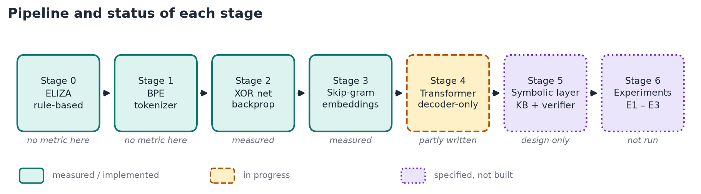
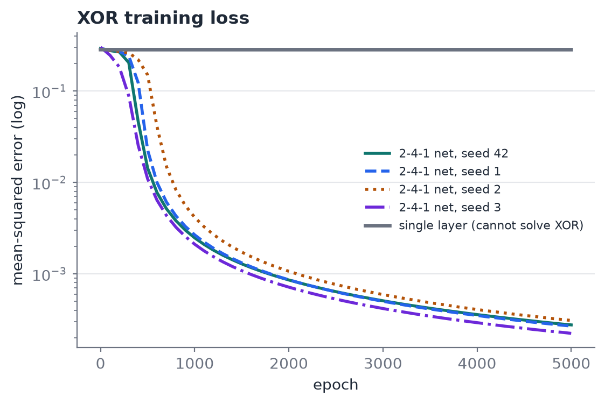
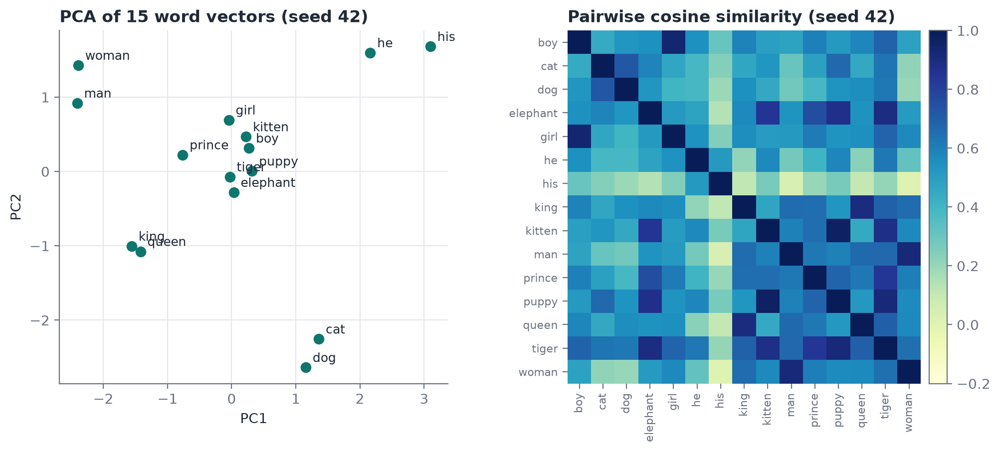
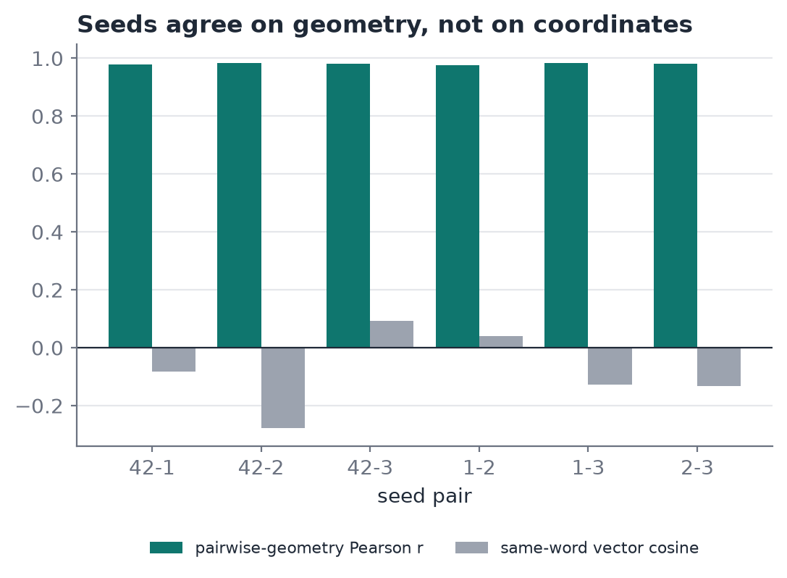
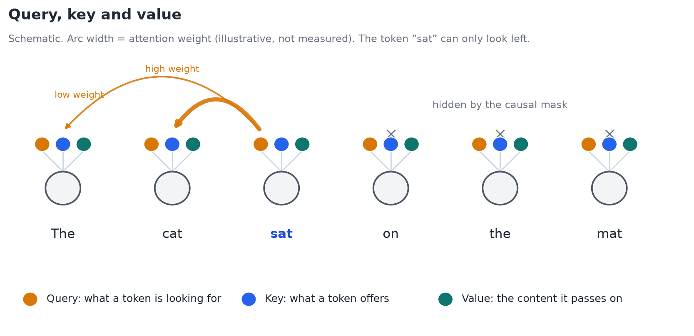
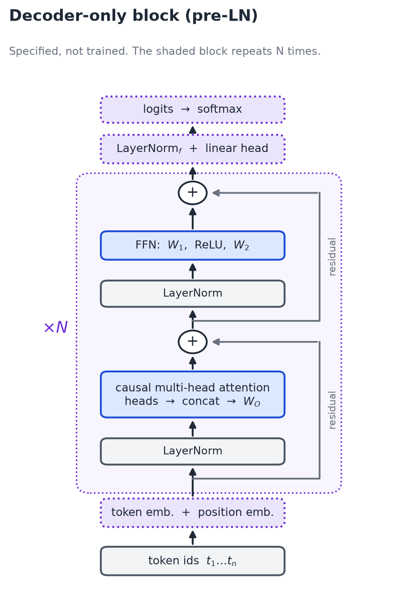
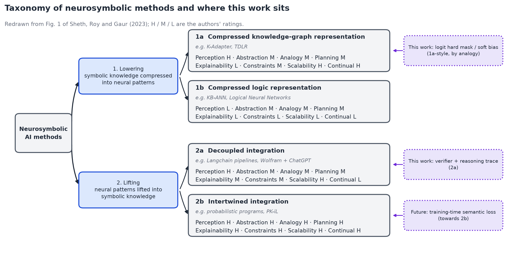
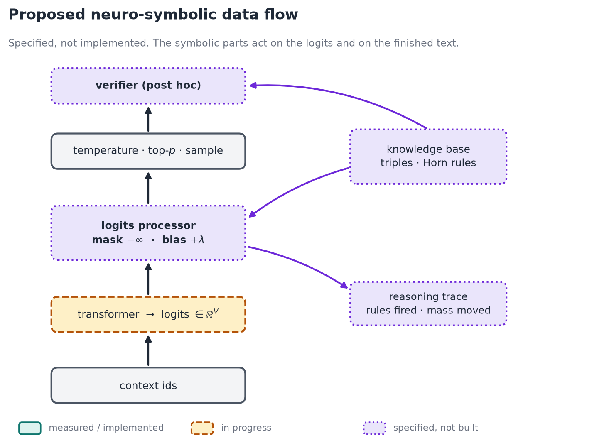

# Neural-Symbolic NLP: a small transformer from scratch, and what it cannot explain

A from-scratch TypeScript pipeline (no ML libraries) that climbs from a rule-based chatbot to a GPT-style transformer, plus a design for adding a symbolic layer on top.



*Teal = built and measured. Amber = in progress. Violet = designed, not built. Border style repeats the colour for greyscale.*

## The idea in three sentences

1. A transformer starts from random weights and is trained only to predict the next token. Nothing in that objective represents *why* a token is right.
2. So it can produce plausible text it cannot justify. The study note behind this project puts it as "the model guessing the best weight to achieved 'Target Error' But lack the Critical Reasoning to its own".
3. A feasible fix at this scale is not to make the network reason, but to put a **checkable symbolic layer** beside it: a logit mask from a small knowledge base, and a verifier that leaves a trace (Sheth, Roy and Gaur, 2023).

## Status

| Stage | What                                   | State                                                             |
| ----- | -------------------------------------- | ----------------------------------------------------------------- |
| 0     | ELIZA pattern-matching chat            | Works                                                             |
| 1     | BPE tokenizer                          | Works                                                             |
| 2     | XOR network, 2→4→1 with backprop     | Works, measured                                                   |
| 3     | Skip-gram word embeddings              | Fixed (was collapsed), measured                                   |
| 4     | Decoder-only transformer               | **In progress** (types and init only; does not compile yet) |
| 5     | Symbolic layer (mask, verifier, trace) | **Designed only**                                           |
| 6     | Experiments E1–E3 on the transformer  | **Not run, no results**                                     |

Only stages 2 and 3 have results. Every number below comes from code (`bun tests/ieee-data.ts`); nothing is typed in by hand.

## What was measured

### XOR: same function, unrelated weights

A single layer cannot learn XOR (loss 0.2845 → 0.2842). A 2→4→1 network can. Four seeds, same data and settings:

| Epochs           | Seed 42 | Seed 1  | Seed 2                           | Seed 3  |
| ---------------- | ------- | ------- | -------------------------------- | ------- |
| 500 (final MSE)  | 0.0144  | 0.0227  | **0.1506** (not converged) | 0.0110  |
| 5000 (final MSE) | 0.00028 | 0.00027 | 0.00031                          | 0.00022 |

At 5000 epochs all seeds compute the same function, but the first hidden unit's weights differ completely (for example `[5.84, −1.49, 6.18, −0.28]` for seed 42 against `[0, −6.50, −1.93, 5.29]` for seed 1).



### Skip-gram: the collapse, the fix, and a wrong answer

The first version gave every word pair cosine 1.0. Five independent bugs were the cause (an off-by-one in the sampling table, a missing positive update, the wrong row updated for negatives, a wrong analogy sign, and a corpus join that never lower-cased). After the fix (vocab 191, 107 sentences, dim 32, 300 epochs):

| Pair         | Cosine | Pair      | Cosine |
| ------------ | ------ | --------- | ------ |
| man / woman  | 0.92   | cat / dog | 0.72   |
| king / queen | 0.90   | man / cat | 0.30   |

`king − man + woman` returns *queen*. But `kitten − cat + dog` returns *lion* (expected *puppy*) on all four seeds. The model learned co-occurrence, not the relation "young animal of species X". Low loss, high similarity score, wrong relation.



### Four seeds: the geometry agrees, the coordinates do not

| Measure (6 seed pairs)                                | Range          |
| ----------------------------------------------------- | -------------- |
| Cosine of the *same word* across seeds              | −0.28 to 0.09 |
| Correlation of the *pairwise geometry* across seeds | 0.977 to 0.984 |
| Analogies correct (our answer key)                    | 5/7 to 6/7     |



This cuts against a strong reading of "random weights". The learned *function* is stable across seeds; the *weights* are not. So the internal solution is neither unique nor designed, and you cannot read a reason off it. Stability also does not mean correctness: the *lion* error appears on every seed.

## The transformer (target design)

Follows the study note: each token gets a query, key and value; attention weights are `softmax(QKᵀ/√d_k + M)V` with a causal mask `M`; several heads run in parallel; a feed-forward net refines each token; blocks stack.



Pre-LN block, as built in GPT-2:

```
x'  = x  + MHA(LN1(x))
x'' = x' + W2 · ReLU(W1 · LN2(x') + b1) + b2
```



Planned config: context 32, d = 32, 2 heads, feed-forward width 128, 2 layers, Adam lr 0.001. That is **12,704 parameters per block** (arithmetic, not a measurement), about 9×10⁴ in total at a 1000-token vocabulary. Training signal is next-token cross-entropy, nothing else.

## The reasoning gap

- **The objective has no notion of truth.** It rewards sounding like the corpus. Nothing in the loss forbids "the kitten barked".
- **Weights come from a random start.** XOR and Skip-gram above show equal behaviour from unrelated weights.
- **"Pure emergent, not designed" means opaque.** Attention maps show where the model looked, not a justification it could be held to.
- **More layers do not change the objective.** Whether reasoning emerges at scale is open. We claim only that nothing in *this* small model asks for it or exposes it.

## The neuro-symbolic design

Mapped onto the taxonomy of Sheth et al.: **lowering** compresses symbolic knowledge into the neural side, **lifting** lifts neural output into symbols.



| Mechanism                  | What it does                                                                          | Position                      |
| -------------------------- | ------------------------------------------------------------------------------------- | ----------------------------- |
| M1 Hard logit mask         | Sets logits of knowledge-base-violating tokens to −∞ before temperature and softmax | 1a-style lowering, by analogy |
| M2 Soft bias               | Adds +λ to tokens the knowledge base supports                                        | 1a-style lowering, by analogy |
| M3 Reasoning trace         | Per step: rules fired, tokens blocked, probability mass before and after              | Part of 2a                    |
| M4 Verifier                | Parses generated text into triples, checks them against the knowledge base            | 2a decoupled lifting          |
| M5 Semantic loss (stretch) | Training term rewarding mass on allowed tokens                                        | Toward 2b                     |



The knowledge base is a few hand-written relations (`is_a`, `lives_in`, `can`, `cannot`, …) and Horn rules such as `is_a(x, fish) ⇒ cannot(x, fly)`, applied by forward chaining. The useful number in the trace is `massBefore`: how much probability the network *wanted* to put on a token the knowledge base rejected.

**What this does not do.** A mask is not understanding. It blocks a class of outputs and leaves the weights unchanged. The trace explains the symbolic decision, not the network's internal computation. Constraints work cleanly only on whole-word tokens.

Four predictions the design must survive:

| #  | Prediction                                                                | Refuted if            |
| -- | ------------------------------------------------------------------------- | --------------------- |
| P1 | With the hard mask on, violations are 0 for token-expressible constraints | any such violation    |
| P2 | With the processor off, output equals the baseline at the same seed       | any difference        |
| P3 | The unconstrained model violates the knowledge base at a non-trivial rate | rate near 0           |
| P4 | Seeds give similar loss but different weights                             | weights agree closely |

## Not done yet

1. **Finish `src/routes/train-transformer/transformer.ts`** (written by hand by the owner). Known defects: `matmulTransAm` should be `matmulTransA`; `ln1Beta` should start at `zeros(D)`, not ones; `ff1B` should be `zeros(F)`, not `zeros(D)`; typos in `TransfomerConfig` and `numLayes`. Then LayerNorm, attention, block, forward, loss, backward, Adam, generation.
2. **Pass five gates** before trusting any run: finite-difference gradient check (error < 10⁻³), initial loss ≈ ln V, overfit a single sequence, causal-mask test, same seed gives same weights.
3. **Build the symbolic layer** (`symbolic.ts`, `constraints.ts`, verifier).
4. **Run E1–E3**: E1 seed sensitivity (weight and logit distance), E2 violation rate with the mask off and on, E3 one full trace. Until then, no claim is made about the transformer or the symbolic layer.
5. **Regenerate `.data/embedding-weights.json`**; the tracked file still holds the old collapsed model.

## Limits of the evidence

Toy corpus (107 sentences), four seeds, one configuration, no significance tests, an answer key we chose ourselves, no held-out set. The results show a mechanism, not behaviour at scale. The study note is the author's own, not peer reviewed.

## Run it

```bash
bun install
bun run dev                          # app at http://localhost:5173
bun test tests/train-embed.test.ts   # 4 Skip-gram sanity tests
bun tests/probe-xor.ts               # XOR across seeds 42/1/2/3
bun tests/probe-embed.ts 300         # Skip-gram, 300 epochs, about 6 s
bun tests/ieee-data.ts               # regenerate every number and table (about 25 s)
python3 docs/images/make_figures.py  # redraw figures (needs matplotlib, numpy)
```

`bunx tsc -b --noEmit` currently fails only inside the unfinished `transformer.ts`.

A 5-page IEEE-format paper of this report is in [`docs/progress/ieee/main.pdf`](docs/progress/ieee/main.pdf), built from the same data.

## References

- Sheth, A., Roy, K., Gaur, M. (2023). Neurosymbolic Artificial Intelligence (Why, What, and How). *IEEE Intelligent Systems* 38(3), 56–62.
- Weizenbaum (1966), ELIZA. Sennrich et al. (2016), BPE. Rumelhart et al. (1986), backpropagation. Mikolov et al. (2013a, b), Skip-gram. Vaswani et al. (2017), attention. Ba et al. (2016), LayerNorm. Kingma and Ba (2014), Adam.
- This research was based up on simple NLP model from  [w3cj/how-llms-work](https://github.com/w3cj/how-llms-work).
- Papers are in `docs/paper/`. Figures are in `docs/images/`: the `fig-*.png` files are drawn by `make_figures.py`; the rest are cut from the papers for study and credited in [`docs/progress/references.md`](docs/progress/references.md).
- Longer chapter-by-chapter write-up, if you want the detail: [`docs/progress/`](docs/progress/README.md).
