# Software architecture: how the pipeline and the transformer are built in code

*An object-oriented UML view of the from-scratch implementation, stage by stage*

This chapter describes the **code** rather than the maths. For each stage of the pipeline it gives the UML structure (class diagrams), the runtime behaviour (sequence and activity diagrams), and the files that implement it. The maths is in [chapter 02](progress/02-transformer-self-attention.md) and the symbolic design is in [chapter 04](progress/04-neurosymbolic-design.md).

**Snapshot.** The diagrams describe the working tree on 2026-10-29, which is newer than chapters 02 and 05. `transformer.ts`, `train.ts`, `weigth-layout.ts`, the worker and the SSE route now exist and type-check (`bunx tsc -b --noEmit` is clean), and checkpoints up to 2000 epochs for a 6-layer model sit in `.data/`. Section 9 lists three defects in the forward and backward passes found while drawing these diagrams. Until they are fixed and a gradient check passes, **those checkpoints are not evidence of anything**.

## 0. How to read the diagrams

The code is TypeScript written in a functional, data-oriented style. It has no `class` keyword: data lives in plain `type` records of `Float32Array`s, and behaviour lives in module-level functions. UML still fits once each language construct is mapped to a UML element:

| TypeScript construct | UML element | Stereotype used |
|---|---|---|
| ES module with exported functions (`transformer.ts`, `matrix.ts`, `bpe.ts`) | Class with static operations. Exported = `+` public, unexported = `-` private | `«module»` |
| `type X = { ... }` holding only data | Class with attributes only | `«struct»` |
| Nested record (`TransformerWeights.blocks: BlockWeights[]`) | Composition `*--` with multiplicity | |
| Function that reads or creates a type | Dependency `..>` | |
| `async function*` trainer | Class that implements an iterator and yields a union of events | `«generator»` |
| `new Hono().post(...)` sub-app | Boundary class | `«route»` |
| `node:worker_threads` entry file | Active class with its own thread | `«worker»` |
| Discriminated union (`SavedNetwork = SingleLayer \| MultiLayer`) | Generalisation `<\|--` from an abstract parent | `«union»` |
| Designed but not written (chapter 04) | Class drawn for the target design | `«designed»` |

Static methods are marked with `$` (Mermaid renders them underlined). Matrix shapes are written in brackets, for example `[V×D]` means a flat, row-major `Float32Array` of length `V·D`.

## 1. System overview

### 1.1 Layered package diagram

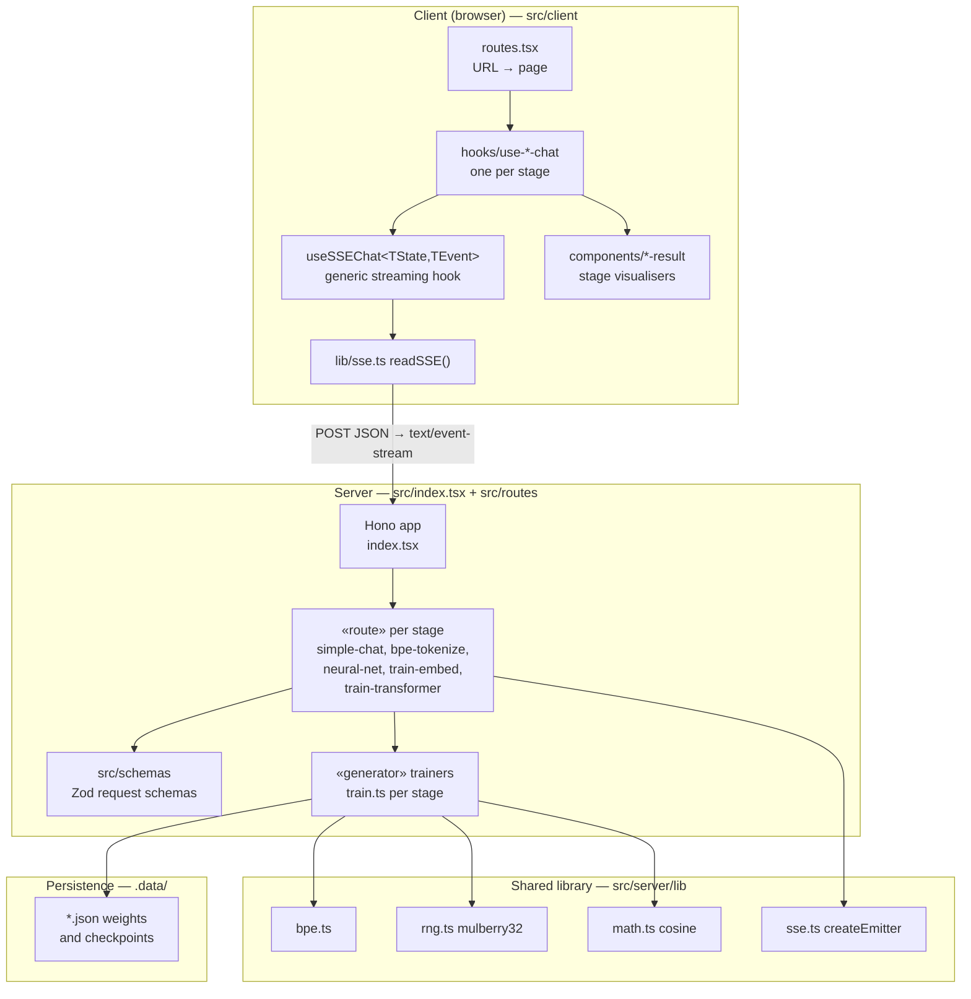

Dependencies point one way: client → HTTP → routes → trainers → shared library → disk. No trainer imports Hono and no shared-library module imports a route, so each trainer can run outside the server. The probe scripts in `tests/` rely on this.

### 1.2 The pattern every stage repeats

Each stage of the pipeline is built from the same five parts. Once this pattern is clear, each later stage only adds a new trainer and a new result component.

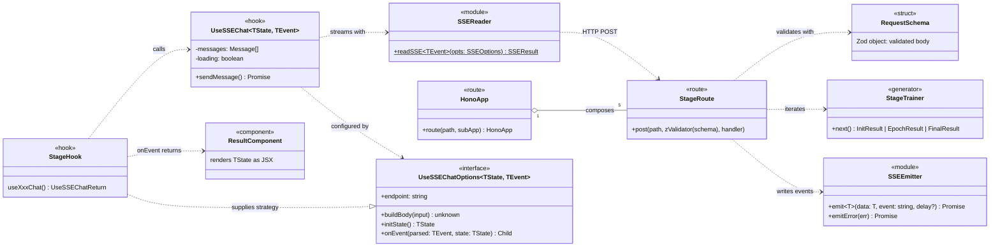

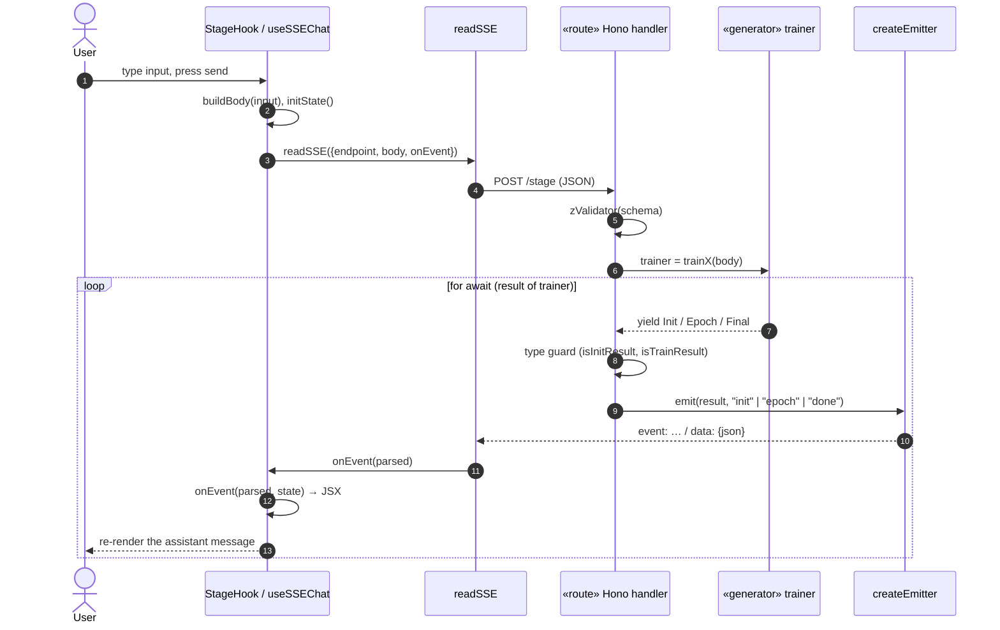

Design choices this pattern encodes:

- **Trainer as an async generator (Iterator).** The trainer does not know about HTTP. It only `yield`s plain objects. The route turns them into SSE events, and a test can consume the same generator with `for await`. `await tick()` after each yield returns control to the event loop so events are flushed during long loops.
- **Polymorphism through discriminated unions.** Each generator yields `InitResult | EpochResult | FinalResult`. The route tells them apart with type guards that test for a field (`"architecture" in value`). This replaces a class hierarchy with `instanceof`.
- **Strategy plus Template Method on the client.** `useSSEChat` fixes the lifecycle (append the user message, open the stream, update the assistant message, handle errors). Each stage supplies only `buildBody`, `initState` and `onEvent`.

## 2. Stage 0 — ELIZA pattern matching

*Progress: [ch. 01 §1](progress/01-background.md). File: `src/routes/simple-chat.ts`.*

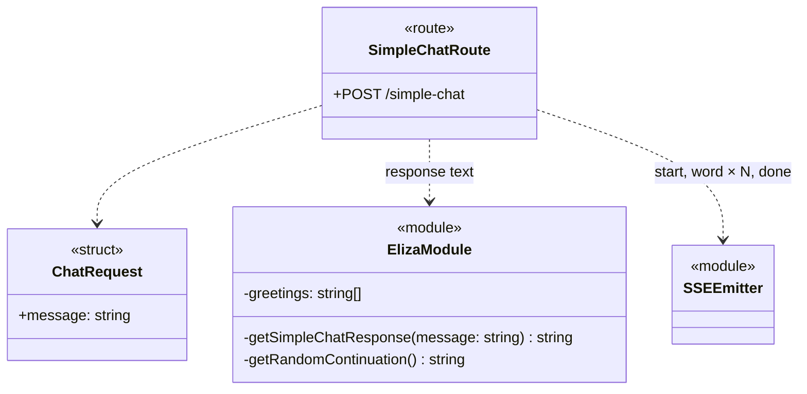

All of the "intelligence" is an ordered chain of rules inside `getSimpleChatResponse`: greeting → "i feel X" → "my X" → "worried" → a random fallback. Nothing is learned and nothing is stored. The stage sets up the streaming skeleton (route, schema, emitter, hook) that later stages reuse unchanged.

## 3. Stage 1 — BPE tokenizer

*Progress: [ch. 01 §2](progress/01-background.md). Files: `src/server/lib/bpe.ts` (shared library), `src/routes/bpe-tokenize.ts` (demo route).*

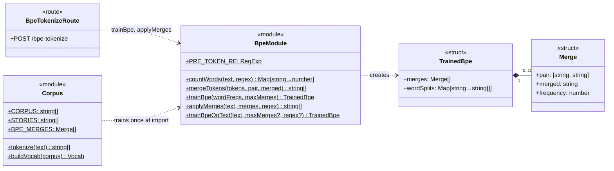

How it is built in code:

1. **Pre-tokenise** with a regex so merges never cross a word boundary. The transformer passes its own regex `/\s\w+|[^\w\s]/g`, so that a leading space belongs to the token (`" cat"`), and joining tokens restores the text.
2. **Count word types, not tokens** (`countWords`). Pair frequencies are weighted by word frequency, so `"the"` is split only once however often it appears.
3. **Merge greedily** (`trainBpe`): count all adjacent pairs, merge the most frequent, repeat up to `maxMerges`.
4. **Encode** (`applyMerges`) by replaying the merges in the order they were learned.

`bpe.ts` is the first **shared** module. The Skip-gram corpus (`Corpus.BPE_MERGES`) and the transformer (`trainBpeOnText(…, 1000, …)` in `train.ts`) both depend on it. The vocabulary of every later model is therefore defined by this stage.

## 4. Stage 2 — XOR network and backpropagation

*Progress: [ch. 01 §3](progress/01-background.md#3-stage-2-learning-by-backpropagation). Files: `src/routes/neural-net/{index,train,serialize}.ts`, `src/server/lib/rng.ts`.*

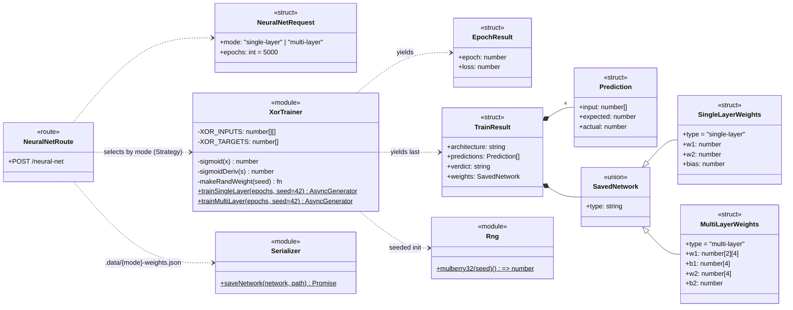

This stage adds three things that the transformer reuses:

- **A training loop as a generator**: forward → loss → backward → update, yielding about 50 `EpochResult`s.
- **A seeded RNG** (`mulberry32`). Every later stage takes its randomness from it, which is what made the four-seed comparison in chapter 01 possible.
- **Persisting weights to `.data/`** as JSON, with a `type` tag so the format can be told apart when it is read back.

The weights here are scalars and small nested arrays. The transformer replaces them with flat `Float32Array`s, because at 10⁴–10⁵ parameters nested JS arrays are slow and cannot be shared between threads.

## 5. Stage 3 — Skip-gram word embeddings

*Progress: [ch. 01 §4](progress/01-background.md#4-stage-3-word-embeddings-and-the-collapse-we-fixed). Files: `src/routes/train-embed/{index,train,corpus}.ts`, `src/server/lib/math.ts`.*

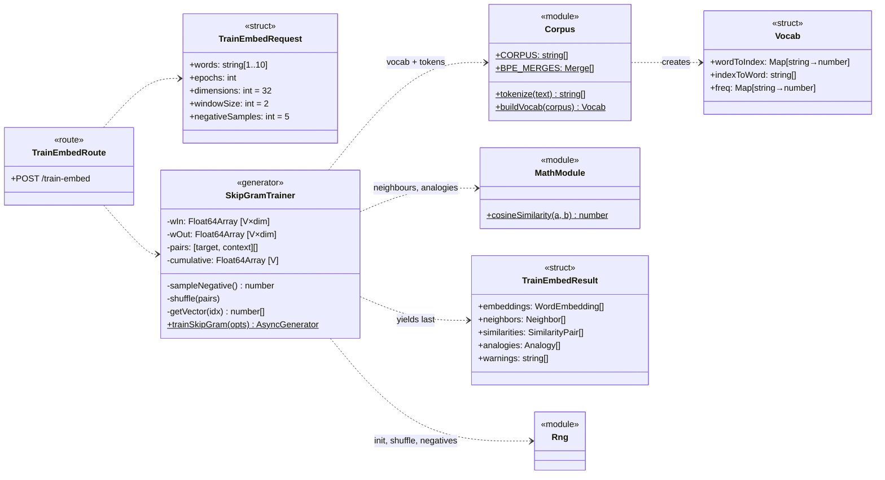

What this stage adds:

- **The weight matrix as a flat typed array** (`Float64Array`, row `i` starts at `i·dim`). The transformer uses the same layout.
- **Vocabulary from BPE** (`buildVocab`, sorted by frequency). The transformer builds its vocabulary the same way, but from `STORIES` and with its own merges.
- **An evaluation module** (`cosineSimilarity`, nearest neighbours, analogies) kept apart from training, so evaluation can change without touching the training loop.

The five bugs that caused the collapse (chapter 01 §4) were all inside `SkipGramTrainer`'s private operations (`cumulative`, the positive update, the negative row, the analogy sign) and in `Corpus`. Because the class boundary is narrow, the fix needed no change outside this module.

## 6. Stage 4 — the decoder-only transformer

*Progress: [ch. 02](progress/02-transformer-self-attention.md). Files: `src/routes/train-transformer/`*

| File | Responsibility |
|---|---|
| `matrix.ts` | Linear algebra on flat row-major `Float32Array`; seeded `rand` |
| `transformer.ts` | Model: types, init, forward, backward, loss, Adam, generation |
| `weigth-layout.ts` | Packs every parameter into one `SharedArrayBuffer`; zero-copy views |
| `train-worker.ts` | `«worker»`: forward + backward on a slice of sequences |
| `train.ts` | `«generator»` orchestrator: BPE, sequences, workers, Adam, checkpoints, samples |
| `index.ts` | `«route»` `POST /train-transformer` → SSE |
| `src/schemas/train-transformer-request.ts` | Zod: epochs, temperature, topP, numLayers, maxTokens |

### 6.1 Domain model (structure of the data)

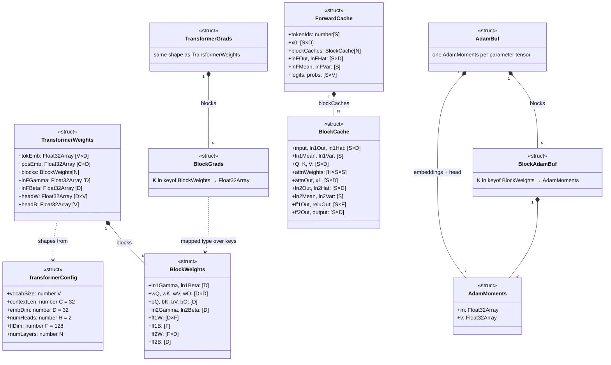

**One list of keys drives everything.** `BLOCK_KEYS` lists the 16 parameter names of a block in a fixed order. `BlockGrads` and `BlockAdamBuf` are TypeScript *mapped types* over `keyof BlockWeights`, so the compiler rejects a gradient or optimiser buffer that is missing a key. The same list drives `initAdam`, `adamUpdate`, `countParams`, `serializeModel`, and the shared-memory layout (`computeLayout`). Adding a parameter means adding it in three places: the type, `BLOCK_KEYS`, and `weightSize`.

**Parameter count** (from `countParams`, same formula as chapter 02 §6). One block is `4(D²+D) + 4D + 2DF + F + D = 12,704`. The trained vocabulary is `V = 392` (783 merges). With N = 2 the model has 51,976 parameters; with N = 6 (the checkpoints in `.data/`) it has 102,792.

### 6.2 Behaviour (the modules that operate on the data)

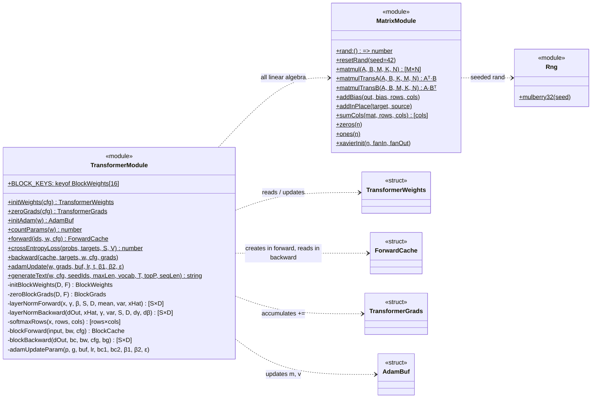

`transformer.ts` works as a **Facade**. It exports eight operations and keeps the layer internals (LayerNorm, softmax, block forward/backward) private. The orchestrator and the worker only call `forward`, `crossEntropyLoss`, `backward`, `adamUpdate` and `generateText`.

### 6.3 Logical layer view (the network as objects)

A framework such as PyTorch would make every layer an `nn.Module` object holding its weights and a `forward` method, with autograd producing `backward`. This code has neither objects nor autograd. Each layer is a **pair of hand-written functions** plus a **cache record** that carries activations from forward to backward. The diagram below is the *logical* object model. Each class is labelled with the code that actually implements it.

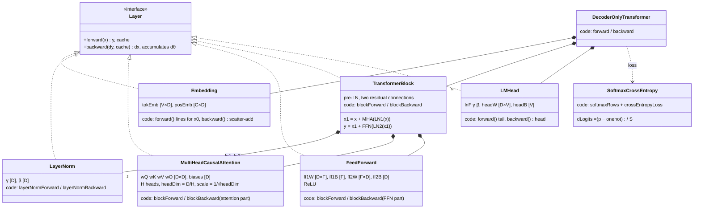

Writing the network as functions has a trade-off.

- **For:** every multiply is visible, the memory layout is explicit (needed for `SharedArrayBuffer`), and nothing is hidden by autograd. That fits the purpose of the project.
- **Against:** every forward operation needs a matching hand-derived backward. The compiler cannot check that the two agree, which is exactly how the defects in section 9 got in. The safeguard is a numerical one: the finite-difference gradient check in chapter 05.

### 6.4 Forward pass through one block

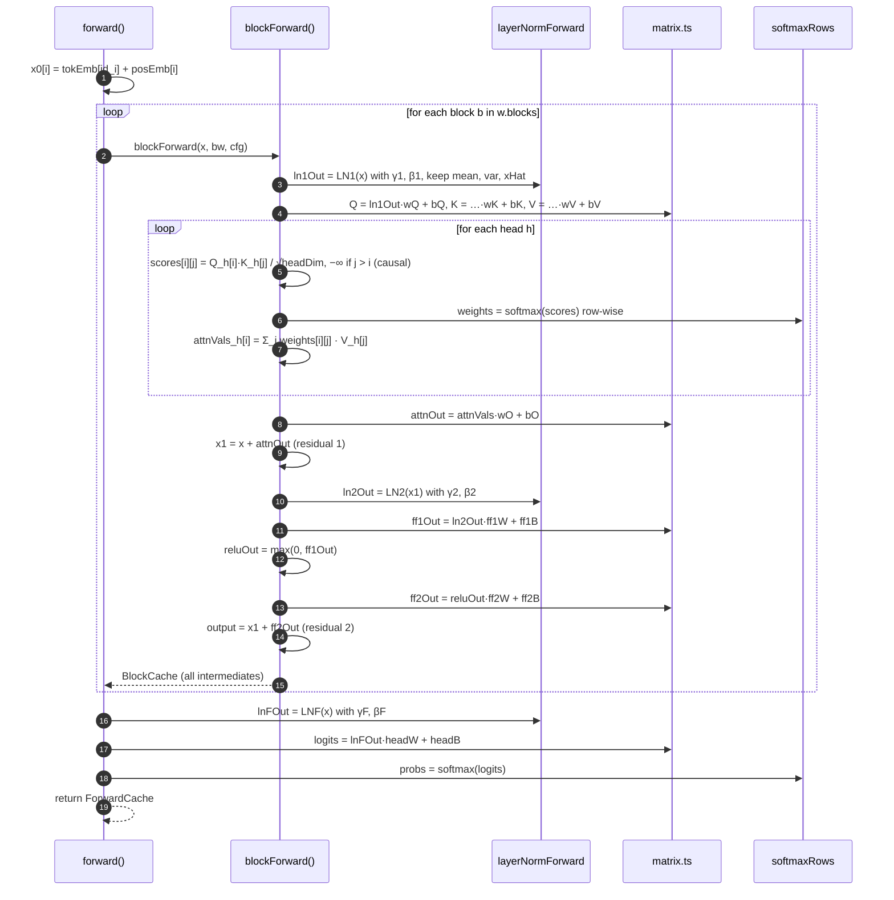

Heads are not separate objects. Head `h` is the column slice `[h·headDim, (h+1)·headDim)` of the shared `Q`, `K` and `V` matrices, so no reshape or copy is needed. `attnWeights` stores all heads in one `[H×S×S]` array so that the backward pass can reuse them.

### 6.5 Backward pass

`ForwardCache` acts as a **Memento**. The forward pass records every intermediate, and the backward pass reads them back in reverse order:

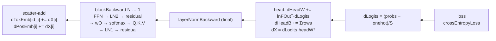

Gradients are **accumulated** (`+=`, through `addInPlace`) and never overwritten. Each worker can therefore run `backward` over many sequences into one buffer, and the main thread adds the buffers together. The `matmulTransA` and `matmulTransB` helpers compute `Aᵀ·B` and `A·Bᵀ` without building a transposed copy. These are the two shapes every linear-layer gradient needs: `dW = Xᵀ·dY` and `dX = dY·Wᵀ`.

### 6.6 Training orchestration: shared memory and worker threads

```mermaid
classDiagram
  direction LR
  class TrainTransformer {
    <<generator>>
    +trainTransformer(opts: TrainOpts) AsyncGenerator$
    -serializeModel(w, cfg, vocab, merges) JSON
    -tryLoadWeights(path) TransformerWeights | null
    -buildWorkerBundle() path
  }
  class TrainOpts {
    <<struct>>
    +epochs, temperature, topP
    +numLayers, maxTokens
  }
  class WeightLayoutModule {
    <<module>>
    -SHARED_KEYS = tokEmb, posEmb
    -HEAD_KEYS = lnFGamma, lnFBeta, headW, headB
    -weightSize(key, cfg) number
    +computeLayout(cfg) layout, totalFloats$
    +packWeightsToSab(w, layout, total) SharedArrayBuffer$
    +copyWeightsFromSab(sab, layout, w)$
    +createWeightViews(sab, layout, N) TransformerWeights$
    +createGradViews(sab, layout, N) TransformerGrads$
    +sumGradsFromWorkers(target, sabs, layout)$
  }
  class LayoutEntry {
    <<struct>>
    +key: string
    +blockIdx: number  (−1 = not in a block)
    +offset: number
    +length: number
  }
  class SharedArrayBuffer {
    <<platform>>
    weightSab: 1 shared by all
    gradSab: 1 per worker
  }
  class TrainWorker {
    <<worker>>
    -w: TransformerWeights (views on weightSab)
    -grads: TransformerGrads (views on gradSab)
    -sequences: input, target[]
    +on("compute") post("done", loss)
  }
  class Esbuild {
    <<platform>>
    buildSync → .train-worker.mjs
  }

  TrainTransformer ..> TrainOpts
  TrainTransformer ..> WeightLayoutModule
  WeightLayoutModule "1" *-- "many" LayoutEntry : WeightLayout
  WeightLayoutModule ..> SharedArrayBuffer : views into
  TrainTransformer "1" o-- "cpus − 2" TrainWorker : spawns
  TrainWorker ..> WeightLayoutModule : createWeightViews / createGradViews
  TrainWorker ..> TransformerModule : forward, loss, backward
  TrainTransformer ..> TransformerModule : adamUpdate, generateText
  TrainTransformer ..> Esbuild : bundles train-worker.ts
  TrainTransformer ..> BpeModule : trainBpeOnText(STORIES, 1000)
  class TransformerModule { <<module>> }
  class BpeModule { <<module>> }
```

The layout is `[tokEmb][posEmb][block 0: 16 keys]…[block N−1: 16 keys][lnFGamma][lnFBeta][headW][headB]`. `createWeightViews` returns a `TransformerWeights` whose fields are `Float32Array` *views* at given offsets into one buffer. Code that receives it (`forward`, `adamUpdate`) cannot tell it apart from a normally allocated model, so `transformer.ts` needs no change to support multiple threads. The main thread uses the same views (`wShared`), so when `adamUpdate` writes to the weights, every worker sees the new values without a copy.

One epoch, master–worker (data-parallel, synchronous):

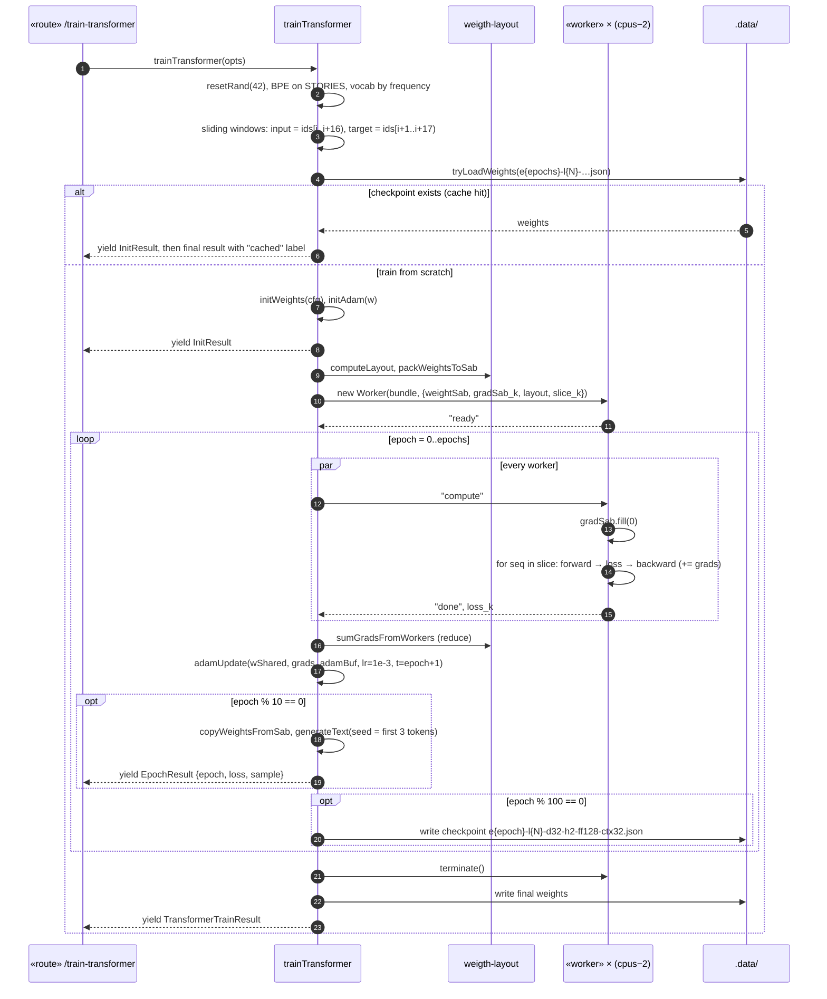

Training is **full-batch**: one Adam step per epoch on the summed gradient of every training window. Workers have no shared mutable state other than the weight buffer, and the main thread writes that buffer only after every worker has replied `"done"`. Because of this barrier the code needs no `Atomics`.

### 6.7 Persistence

| Artefact | Writer | Reader | Format |
|---|---|---|---|
| `.data/single-layer-weights.json`, `multi-layer-weights.json` | `saveNetwork` | — | `SavedNetwork` union |
| `.data/embedding-weights.json` | `trainSkipGram` (`save !== false`) | — | `{type:"word2vec-skipgram", vocab, merges, embeddings}` |
| `.data/transformer-weights-e{E}-l{N}-d{D}-h{H}-ff{F}-ctx{C}.json` | `serializeModel` (every 100 epochs and at the end) | `tryLoadWeights` | `{type:"decoder-transformer", config, vocab, merges, weights}`, values rounded to 6 d.p. |

The transformer filename encodes the configuration, so the file acts as a cache key: a request with the same `epochs` and `numLayers` loads the file and skips training. Two limits follow. The key does not include the seed or a hash of the code, so a checkpoint written before a bug fix is served again after it. After fixing the defects in section 9, delete the `transformer-weights-*` files.

### 6.8 Generation

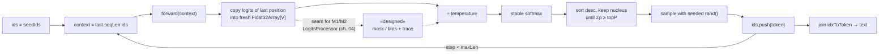

There is no KV cache: each step runs the full forward pass on the window again. The cost per token is O(S²·D·N), which is acceptable at S ≤ 16 and D = 32. Sampling draws from `matrix.rand`, so `resetRand(seed)` makes generation reproducible. Prediction P2 of chapter 04 depends on this.

## 7. Stage 5 — the symbolic layer («designed», not implemented)

*Progress: [ch. 04](progress/04-neurosymbolic-design.md). Planned files: `symbolic.ts`, `constraints.ts`, verifier.*

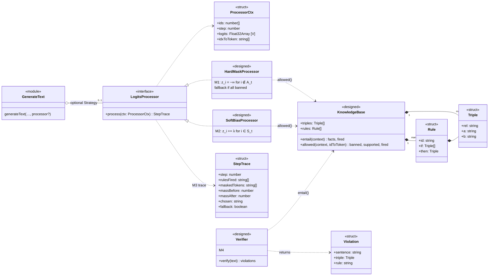

How this fits the code that exists:

- **One seam, optional dependency.** `generateText` gets an optional `LogitsProcessor` (Strategy), called right after the logits of the last position are copied and before `÷ temperature`. With no processor the code path is the current one, so the output is identical byte for byte at the same seed (P2). That is a unit test, not an experiment.
- **The weights are never touched.** The processor depends on `KnowledgeBase` and a `Float32Array`, never on `TransformerWeights`. This is what "decoupled" (2a) means in code terms.
- **The verifier is independent of generation.** It takes text, so it can check output produced with the processor on or off. That is how E2 compares the two.

## 8. Client architecture

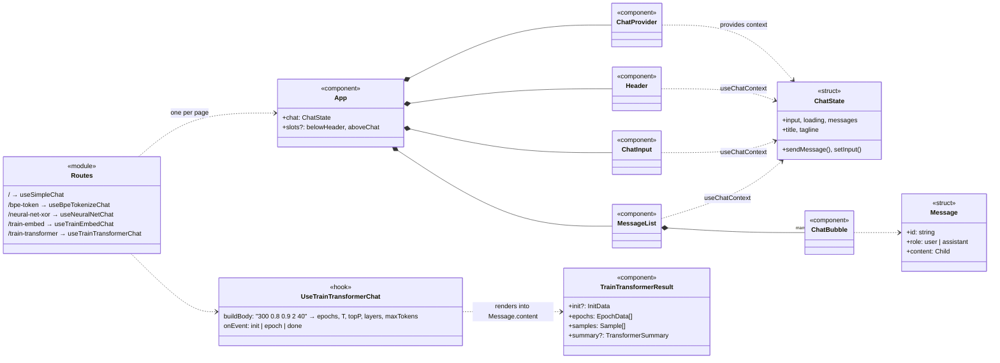

The same `App` shell serves every stage. A page differs only in the hook passed as `chat`, and that hook's `onEvent` returns the stage's result component as the assistant message's `content`. Each new stage added one hook, one result component and one route line. `App`, `useSSEChat` and `readSSE` were not changed.

## 9. Defects found while drawing the diagrams

Following each forward step to its backward counterpart (§6.3–6.5) shows three places where they do not match. They are listed for the owner and **not changed** in this chapter. Each one would make a finite-difference gradient check fail.

| # | Location | Code now | Should be | Effect |
|---|---|---|---|---|
| D1 | `transformer.ts:494` (`blockForward`, residual 1) | `x1[i] = input[i] * attnOut[i]` | `input[i] + attnOut[i]` | The residual becomes a product. `blockBackward` assumes a sum (`dInput = dX1 + …`), so the forward and backward passes no longer describe the same function. |
| D2 | `transformer.ts:482` (`blockForward`, weighted sum of V) | `for (let j = 0; j < i; j++)` | `j <= i` | Each token cannot attend to itself, and position 0 gets an all-zero attention output. The backward pass (`j <= i`) rebuilds `attnVals` differently from the forward pass. |
| D3 | `transformer.ts:668` (`blockBackward`, dK) | `dScores[i][j] * bc.K[i…]` | `dScores[i][j] * bc.Q[i…]` | `∂(Qᵢ·Kⱼ)/∂Kⱼ = Qᵢ`. Every dK is wrong, so `wK` and `bK` are trained on the wrong gradient. |

Housekeeping, lower priority:

- `train-worker.mjs` is tracked by git, but `train.ts` writes and loads `.train-worker.mjs` (the esbuild output). The tracked file is a stale bundle. Consider deleting it and adding `.train-worker.mjs` to `.gitignore`.
- The checkpoint cache key (§6.7) does not include a code version. Delete `.data/transformer-weights-*.json` after fixing D1–D3, or old weights will be served as "cached".
- Chapters 02 §7 and 05 §1.2–1.3 still say the transformer does not compile and that `train.ts` is not written. Both are out of date relative to this chapter.

## 10. Design patterns used

| Pattern | Where | Why it is there |
|---|---|---|
| Iterator (async generator) | Every `train*` function | Separates computing from transport. The same trainer feeds SSE, tests and probe scripts. |
| Observer over SSE | `createEmitter` → `readSSE` → `onEvent` | Pushes progress (loss, samples) to the browser while training runs |
| Template Method + Strategy | `useSSEChat` with `buildBody` / `initState` / `onEvent` | The lifecycle is written once and each stage supplies only what differs |
| Facade | `transformer.ts` exports 8 operations and hides layer internals | Callers (worker, orchestrator) do not depend on block internals |
| Memento | `ForwardCache` / `BlockCache` | Backward pass needs the exact forward activations |
| Master–worker, shared memory | `train.ts` + `train-worker.ts` + `weigth-layout.ts` | Data-parallel gradients on all cores, with no copying of weights or gradients |
| Zero-copy views | `createWeightViews` / `createGradViews` | The model code runs unchanged on shared memory |
| Cache-aside | `tryLoadWeights` before training | Repeat requests return at once |
| Discriminated union + type guard | `SavedNetwork`, yielded event unions, `isTrainResult` | Polymorphism with no class hierarchy, checked by the compiler |
| Single source of truth | `BLOCK_KEYS` + mapped types | Weights, grads, Adam state, layout and serialisation all follow one list of keys |
| Seeded dependency | `mulberry32(seed)`, `resetRand` | Reproducibility; seed variation is an experimental variable (E1) |
| Strategy («designed») | `LogitsProcessor` in `generateText` | Symbolic constraints plug in without touching the network |

## 11. Traceability: progress chapter → code

| Stage | Progress chapter | Main files | Key UML elements | State |
|---|---|---|---|---|
| 0 ELIZA | [01 §1](progress/01-background.md) | `routes/simple-chat.ts` | `ElizaModule`, `SimpleChatRoute` | Works |
| 1 BPE | [01 §2](progress/01-background.md) | `server/lib/bpe.ts`, `routes/bpe-tokenize.ts` | `BpeModule`, `Merge` | Works |
| 2 XOR | [01 §3](progress/01-background.md#3-stage-2-learning-by-backpropagation) | `routes/neural-net/*`, `server/lib/rng.ts` | `XorTrainer`, `SavedNetwork` | Works, measured |
| 3 Skip-gram | [01 §4](progress/01-background.md#4-stage-3-word-embeddings-and-the-collapse-we-fixed) | `routes/train-embed/*`, `server/lib/math.ts` | `SkipGramTrainer`, `Corpus`, `Vocab` | Fixed, measured |
| 4 Transformer | [02](progress/02-transformer-self-attention.md) | `routes/train-transformer/*` | `TransformerModule`, `TransformerWeights`, `ForwardCache`, `WeightLayoutModule`, `TrainWorker` | Implemented, type-checks; D1–D3 open; gates of ch. 05 not passed |
| 5 Symbolic | [04](progress/04-neurosymbolic-design.md) | — | `KnowledgeBase`, `LogitsProcessor`, `Verifier`, `StepTrace` | Designed only |
| 6 E1–E3 | [05](progress/05-implementation-and-evaluation.md) | — | — | Not run |
