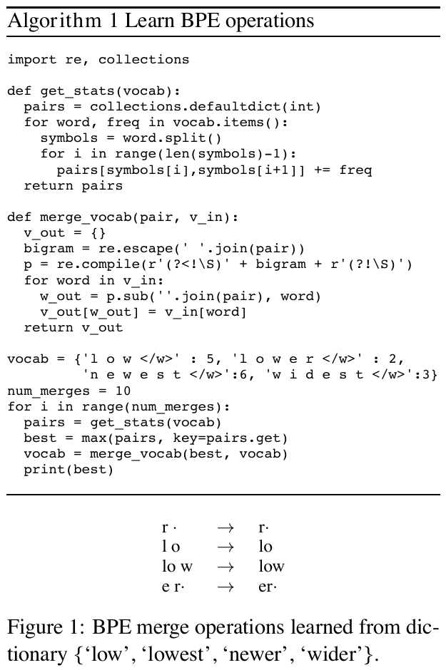
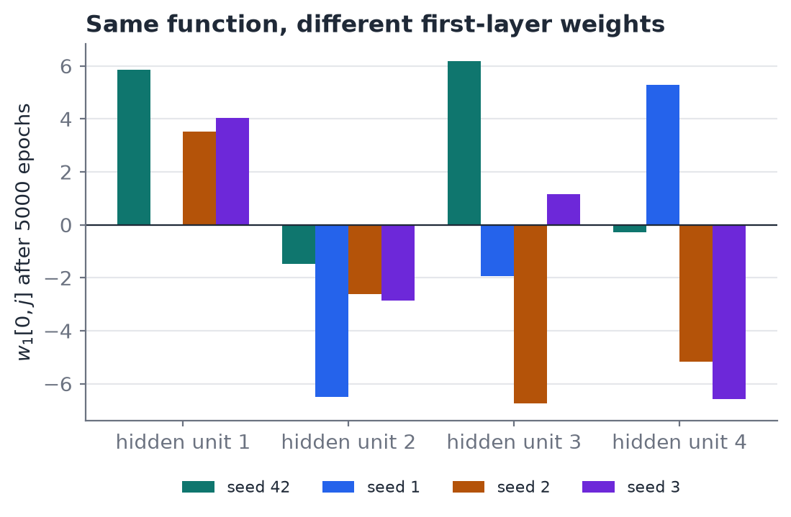
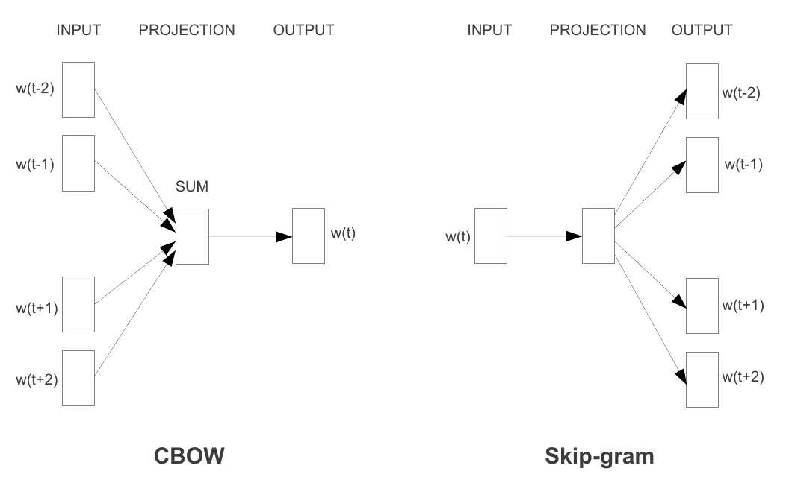
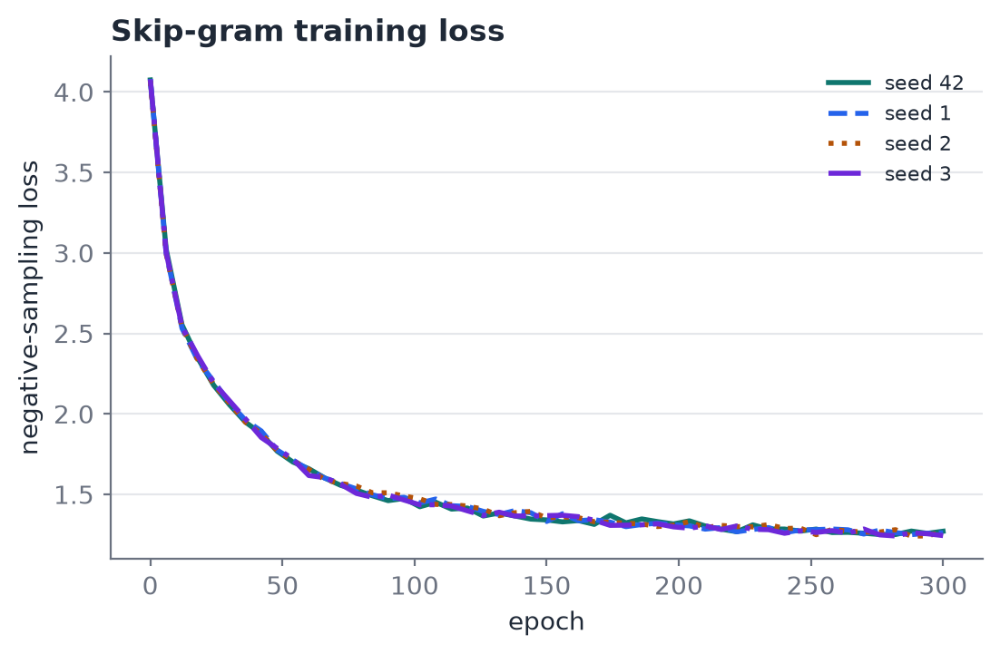
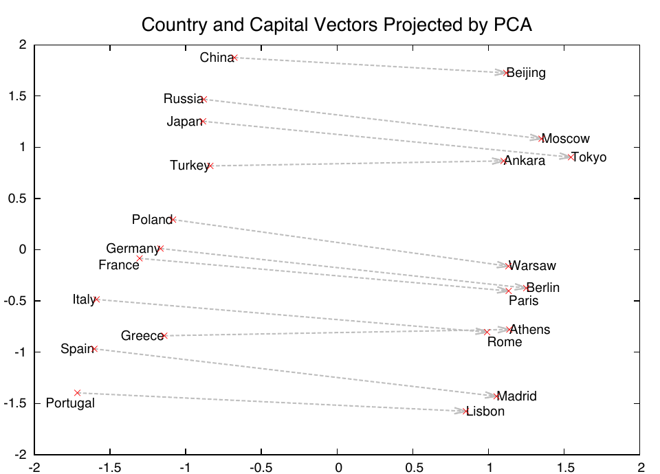

# 01. Background: from rules to embeddings

This chapter covers stages 0–3, the parts of the pipeline that exist and are measured. All numbers use seed 42 unless stated, and were produced by `tests/probe-xor.ts` and `tests/probe-embed.ts`.

*Figure 1.1. Pipeline and status (matplotlib, `docs/images/make_figures.py`). Solid border: implemented and measured. Dashed: in progress. Dotted: specified, not built. Stages 0–1 run in the application but contribute no metric to this report.*

## 1. Stage 0: ELIZA, the rule-based baseline

`src/routes/simple-chat.ts` matches keywords and fills templates ("I feel X" becomes "Why do you feel X?"), swapping pronouns. Weizenbaum (1966) showed that convincing conversation needs no understanding: the user supplies the meaning.

This is the contrast the report relies on. ELIZA's rules are **designed**, so every reply can be traced to the rule that produced it. It cannot learn, and it cannot generalise. Everything from stage 2 onward reverses that trade: the behaviour is **learned**, so it generalises, and the rule that produced a given output is no longer legible. Chapter 03 builds on this.

## 2. Stage 1: Byte Pair Encoding

BPE (Sennrich et al., 2016) starts from characters and repeatedly merges the most frequent adjacent pair into a new symbol, until a merge budget is spent. Frequent words become single tokens, and rare words split into subwords, so there is no unknown-word problem.

Implementation (`src/server/lib/bpe.ts`): pair counts are taken over *unique words weighted by frequency* rather than over raw text, which is what keeps training fast. The pre-tokenizer `PRE_TOKEN_RE = /[\w]+|[^\s\w]/g` drops whitespace. `countWords`, `applyMerges` and `trainBpeOnText` take an optional regex, so the transformer can use a GPT-style pre-tokenizer that keeps the leading space (`/\s\w+|[^\w\s]/g`) without changing stage 1.

*Figure 1.2. Algorithm 1 and the merge sequence for the toy dictionary {low, lowest, newer, wider}, cut from Sennrich et al. (2016), p. 4 (`docs/paper/sennrich-2016-bpe-rare-words.pdf`).*

The Skip-gram stage trains a 500-merge table on the lower-cased corpus. A word that is not a single token is split, and the Skip-gram route reports that as a warning. This matters later: the symbolic layer in chapter 04 can only constrain whole-word tokens cleanly.

## 3. Stage 2: learning by backpropagation

The XOR task is the smallest problem a single-layer network cannot solve, because the classes are not linearly separable (Minsky and Papert, 1969). Rumelhart, Hinton and Williams (1986) showed that backpropagating the error through a hidden layer lets the network learn an internal representation that does separate them.

We train two models in `src/routes/neural-net/train.ts`, both with sigmoid units, a squared-error loss, learning rate 1.0, and a seeded generator (`trainSingleLayer(epochs, seed)`, `trainMultiLayer(epochs, seed)`):

- a single-layer perceptron (2 inputs, 1 output);
- a multi-layer network, 2 → 4 → 1, with backpropagation.

**Result 1: the single layer fails, as theory predicts.** Loss goes from 0.2845 to 0.2842 and the outputs stay near 0.5 (0.53, 0.50, 0.47, 0.43 for the four inputs).

*Figure 1.3. XOR mean-squared error over 5000 epochs (log scale). Source data: `docs/progress/ieee/data/xor_multi_loss.csv`, `xor_single_loss.csv`.*

**Result 2: the multi-layer net succeeds, but not for every seed at every budget.**

| Epochs            | Seed 42 | Seed 1  | Seed 2           | Seed 3  |
| ----------------- | ------- | ------- | ---------------- | ------- |
| 500 (final loss)  | 0.0144  | 0.0227  | **0.1506** | 0.0110  |
| 5000 (final loss) | 0.00028 | 0.00027 | 0.00031          | 0.00022 |

At 500 epochs seed 2 has not converged: its outputs for the two XOR=1 cases are 0.78 and 0.54, and for one XOR=0 case 0.51. At 5000 epochs all four seeds reach the same function, with outputs near 0.01, 0.98, 0.98, 0.02. This is why the route's default is now 5000 epochs rather than 500.

**Result 3: the same function, different weights.** The first hidden unit's weights after 5000 epochs differ completely by seed:

| Seed | `w1[0]` (the 4 hidden units' weights from input 1) |
| ---- | ---------------------------------------------------- |
| 42   | [5.84, −1.49, 6.18, −0.28]                         |
| 1    | [0, −6.50, −1.93, 5.29]                            |
| 2    | [3.52, −2.62, −6.75, −5.17]                       |
| 3    | [4.02, −2.85, 1.15, −6.58]                         |

*Figure 1.4. The weights in the table above, plotted. Source data: `docs/progress/ieee/data/xor.json`.*

The data, architecture, loss and optimiser are identical; only the random initialisation differs. The solutions are functionally equal and parametrically unrelated. This is the smallest instance of the claim in chapter 03: **weights are a by-product of a random starting point, not a designed representation.** Seeded runs are deterministic (the same seed gives an identical final loss).

Scope of this evidence: a 4-sample problem, 4 seeds. It illustrates the mechanism and does not measure it at scale; experiment E1 repeats it on the transformer.

## 4. Stage 3: word embeddings, and the collapse we fixed

Skip-gram (Mikolov et al., 2013a, b) trains a shallow network to predict context words from a target word. With negative sampling, each (target, context) pair becomes a binary classification: push $\sigma(v_c^{out}\cdot v_t^{in})$ toward 1 for the true context, and toward 0 for $K$ words drawn from the unigram distribution raised to the power ¾.

$$
\mathcal{L} = -\log\sigma(v_c^{out}\!\cdot v_t^{in}) \;-\; \sum_{k=1}^{K}\log\sigma(-\,v_{n_k}^{out}\!\cdot v_t^{in})
$$

*Figure 1.5. CBOW (predict the word from its context) and Skip-gram (predict the context from the word), cut from Mikolov et al. (2013a), Fig. 1, p. 5. We implement the right-hand model.*

Configuration: vocabulary 191, dimension 32, window 2, 5 negatives, 107 corpus sentences giving 1878 training pairs.

### 4.1 The failure

Before the fix, every pair of words had cosine similarity 1.0 (king/queen, cat/dog, man/woman and cat/king alike), and the vocabulary had 206 entries. Geometry carried no information.

### 4.2 Diagnosis

Five independent defects, each of which would break the model on its own:

| # | Defect                                                                                    | Effect                                                                                     |
| - | ----------------------------------------------------------------------------------------- | ------------------------------------------------------------------------------------------ |
| 1 | The cumulative sampling table loop started at `i = 0` and read `cumulative[-1]` (NaN) | `sampleNegative()` always returned word 0                                                |
| 2 | No positive-pair update                                                                   | Nothing pulled true contexts together                                                      |
| 3 | The negative update used the context row, and its dot product started at the wrong offset | Negatives pushed the wrong vectors                                                         |
| 4 | Analogy vector computed as $a-b-c$                                                      | Analogy results meaningless                                                                |
| 5 | `CORPUS.join("".toLowerCase())`                                                         | Sentences glued together and not lower-cased, which is also why the old vocabulary was 206 |

Two further defects made the failure *silent in the UI*: the server emitted `similiarities` and `Anology` (typos) while the client read `similarities`, so the panel showed nothing, and `InitResult` lacked the `embeddingDim` field the client reads.

### 4.3 After the fix (300 epochs, about 6 s)

Loss falls from 4.074 to 1.271 (epoch 0 → 300: 4.074, 1.659, 1.415, 1.323, 1.284, 1.271).

| Pair             | Cosine |  | Pair        | Cosine |
| ---------------- | ------ | - | ----------- | ------ |
| man / woman      | 0.92   |  | woman / dog | 0.20   |
| king / queen     | 0.90   |  | woman / cat | 0.22   |
| tiger / elephant | 0.90   |  | man / dog   | 0.28   |
| cat / dog        | 0.72   |  | man / cat   | 0.30   |

Analogies ($a - b + c$, nearest word by cosine excluding the three inputs):

| Query                | Result   | Cosine | Correct?                      |
| -------------------- | -------- | ------ | ----------------------------- |
| king − man + woman  | queen    | 0.73   | yes                           |
| queen − woman + man | king     | 0.77   | yes                           |
| prince − boy + girl | princess | 0.95   | yes                           |
| he − man + woman    | she      | 0.71   | yes                           |
| his − man + woman   | her      | 0.82   | yes                           |
| kitten − cat + dog  | lion     | 0.85   | **no** (expected puppy) |
| puppy − dog + cat   | kitten   | 0.72   | yes                           |

*Figure 1.6. Negative-sampling loss, seeds 42, 1, 2, 3 (300 epochs). Source: `skipgram_loss.csv`.*

*Figure 1.7. Left: 2-D PCA of the 15 queried word vectors (axes carry no meaning). Right: pairwise cosine matrix. Source: `skipgram_pca_seed42.csv`, `skipgram_cos_seed42.csv`.*

For comparison, the original paper shows the same kind of projection for 1000-dimensional vectors trained on a very large corpus:

*Figure 1.8. Cut from Mikolov et al. (2013b), Fig. 2, p. 4. Capitals sit at a roughly constant offset from their countries. Our 15-word, 107-sentence model shows nothing at this scale and should not be read as reproducing it.*

Six of seven resolve correctly. The wrong answer is informative. `kitten − cat + dog` returns *lion*, a high-similarity animal, not *puppy*. The model has learned co-occurrence geometry, not the relation "young animal of species X". Nothing in the objective asks for that relation, and the corpus is 107 short sentences. The embedding is a statistical fit, which is the stage-3 version of the point chapter 03 makes about the transformer.

### 4.4 Verification

`tests/train-embed.test.ts` (4 tests, all passing) checks that cosines are no longer all equal, that loss decreases, and that analogies resolve. The test calls training with `save: false`, so it does not overwrite `.data/embedding-weights.json`.

**Caveat.** The tracked `.data/embedding-weights.json` still holds the *old, collapsed* model until training is re-run with saving on. Regenerate it before relying on that file.

### 4.5 Four seeds: the geometry agrees, the coordinates do not

`trainSkipGram` now takes an optional `seed` (default 42). The table is `docs/progress/ieee/data/table_sg.tex`, regenerated by `bun tests/ieee-data.ts`.

| Seed | Loss (epoch 0 → 300) | king/queen | man/woman | cat/dog | cat/king | Analogies correct |
| ---- | --------------------- | ---------- | --------- | ------- | -------- | ----------------- |
| 42   | 4.074 → 1.271        | 0.90       | 0.92      | 0.72    | 0.47     | 6/7               |
| 1    | 4.080 → 1.261        | 0.88       | 0.92      | 0.73    | 0.47     | 5/7               |
| 2    | 4.068 → 1.266        | 0.89       | 0.91      | 0.70    | 0.56     | 5/7               |
| 3    | 4.078 → 1.244        | 0.88       | 0.91      | 0.70    | 0.47     | 6/7               |

The analogy key is one acceptable answer per query, chosen by us and applied to every seed. `kitten − cat + dog` returns *lion* on all four seeds. Seed 1 returns *home* for `he − man + woman`, and seed 2 returns *father* for `his − man + woman`.

Two further measurements, over the six seed pairs:

- **Same word, different seed.** The mean cosine between a word's vectors from two seeds ranges from −0.28 to 0.09. The coordinates are unrelated.
- **Pairwise geometry.** The Pearson correlation between two seeds' pairwise-cosine matrices ranges from 0.977 to 0.984. The relations are shared.

*Figure 1.9. Pearson correlation of pairwise-cosine matrices (hatched) against mean same-word cosine (open), per seed pair. Source: `skipgram.json`.*

This refines the claim in chapter 03: at this scale the *function* the model learns is stable across seeds while the weights are not. The stability does not show the function is correct (`kitten − cat + dog` is wrong on every seed).

## 5. Limits of these results

- Four seeds for each stage, one configuration, 300 epochs for Skip-gram (not the 10000-epoch default). No confidence intervals or significance tests; ranges are reported as observed.
- A 107-sentence corpus gives a toy vocabulary; the numbers show the mechanism, not language-scale behaviour.
- Skip-gram is judged on its own training corpus; there is no held-out set.
- The analogy key is ours; other acceptable answers would change the accuracy column.
