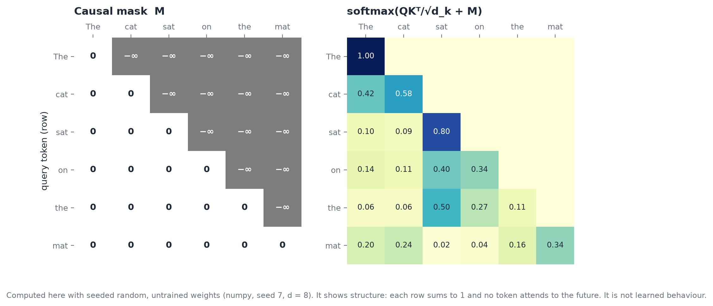
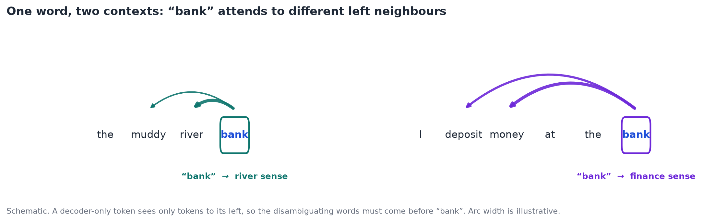
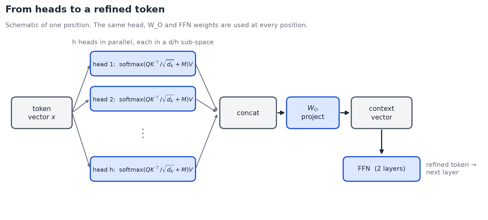
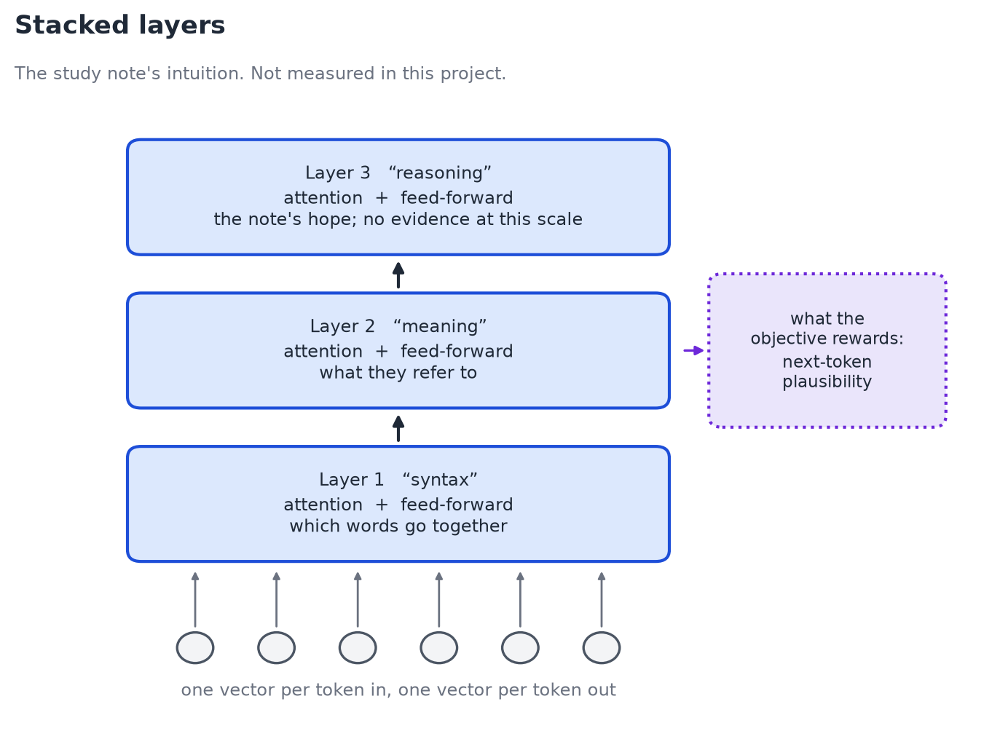

# 02. The transformer and self-attention

This chapter follows the order of the author's study note (`docs/paper/NLP Transformer Note.pdf`, 5 pages), then adds the mathematics the note does not contain.

**Provenance of the material.** The note is a set of annotated screenshots of an animated transformer visual. It has no equations and no worked numbers; its attention weights on page 1 (0.05, 0.45, 0.10, 0.08, 0.02, 0.30) are illustrative. Section headings below that cite the note are the note's order. Every equation is **added by the author of this report** (standard Vaswani et al., 2017 and GPT-style pre-LN), and is labelled as such. Quotations keep the note's wording, marked `[sic]` where the English is non-native.

**Implementation status.** `src/routes/train-transformer/transformer.ts` is written by hand by the project owner and is unfinished (see [chapter 05](05-implementation-and-evaluation.md#1-implementation-status-and-known-issues)). The mapping tables in this chapter name the functions that *will* hold each step; they are the target layout, not existing code, unless a row says otherwise.

## 1. Self-attention as Query, Key, Value (note p1)

The note's framing: each token has a **Query** ("looking for…"), a **Key** ("offers…") and a **Value** (the content it passes on). Its example sentence is "The cat sat on the mat". A token compares its query with every key; the better the match, the more of that token's value it takes in.

*Figure 2.1. Each token carries a query (what it is looking for), a key (what it offers) and a value (the content it passes on). The token "sat" scores its query against the keys to its left; arc width stands for attention weight and is illustrative. Original diagram (`docs/images/make_figures.py`) after the example in the study note, p. 1.*

*Equations (added).* For a sequence of $n$ token vectors stacked in $X \in \mathbb{R}^{n\times d}$:

$$
Q = XW_Q + b_Q,\qquad K = XW_K + b_K,\qquad V = XW_V + b_V \tag{1}
$$

$$
\operatorname{Attn}(X) = \operatorname{softmax}\!\left(\frac{QK^{\top}}{\sqrt{d_k}} + M\right)V \tag{2}
$$

The softmax runs over each row, so each token's attention weights sum to 1. The $1/\sqrt{d_k}$ factor keeps dot products from growing with the key dimension, which would push the softmax into regions with vanishing gradient. $M$ is the **causal mask**: $M_{ij}=0$ for $j\le i$ and $-\infty$ otherwise, so a token sees only itself and earlier tokens. This is what makes the model decoder-only and lets it train on next-token prediction without peeking at the answer.

*Figure 2.1b. Left: the mask $M$. Right: $\operatorname{softmax}(QK^{\top}/\sqrt{d_k}+M)$ for "The cat sat on the mat", computed by `docs/images/make_figures.py` with seeded **random, untrained** weights (numpy, seed 7, $d=8$). It shows the structure only: every row sums to 1 and no token attends to a later one. It is not learned behaviour.*

## 2. Polysemy: "bank" (note p2)

The note's example: the word **bank** is resolved differently in a river context and a finance context. A static embedding (stage 3) gives "bank" one vector regardless of neighbours. Attention gives it a context-dependent vector, because its output is a weighted mix of the values of the other tokens: near "river" the mix is pulled toward the water sense, near "money" toward the finance sense.

*Figure 2.2. The note's "bank" example, redrawn. The same word attends to different neighbours and so ends with a different vector. In a decoder-only model a token sees only tokens to its left, so the disambiguating words must come before "bank"; the note's sentences, where "bank" precedes "river", assume attention in both directions. Arc width is illustrative.*

This is the capability that separates stage 3 from stage 4. It is also a first illustration of the report's concern: the disambiguation emerges from fitted weights, and the model has no explicit representation of the two senses to point at.

## 3. Multiple heads (note p2–3)

The note calls these "Headers" `[sic]` (heads). Different heads can track different relations: adjacent words, long-range links, verb tense, broad context. Formally, split $d$ into $h$ sub-spaces of size $d_k=d/h$, run equation (2) in each, and concatenate:

$$
\operatorname{MHA}(X)=\big[\operatorname{head}_1;\dots;\operatorname{head}_h\big]W_O + b_O \tag{3}
$$

*Figure 2.3. Heads run in parallel in $d/h$-dimensional sub-spaces, are concatenated, and are mixed by $W_O$ into one context vector per token (note pp. 2–3). The feed-forward network of the next section then refines that vector. Original schematic.*

The output projection $W_O$ (note p3, "output projection") mixes the heads and produces the "context knowledge" per token.

**The note's callout (p3).** "Keys take away from pure NLP learning is 'pure emergent' not 'designed' => Nerual `[sic]` Symbolic to resolve 'black box'". That sentence is the seed of the whole report: nobody *assigned* a head to track tense. If one does, it is because training found it useful. We return to this in chapter 03.

## 4. Feed-forward refinement and the block (note p4)

The note describes a **two-layer feed-forward network** that refines each enriched token, and states that attention plus feed-forward make one transformer block, or "Layer".

*Equations (added).* This implementation uses pre-LN blocks (LayerNorm before each sub-layer, residual after), as in GPT-2 and the reference design:

$$
\begin{aligned}
x' &= x + \operatorname{MHA}\big(\operatorname{LN}_1(x)\big)\\
x'' &= x' + W_2\,\operatorname{ReLU}\!\big(W_1\operatorname{LN}_2(x')+b_1\big)+b_2
\end{aligned} \tag{4}
$$

with $\operatorname{LN}(x)=\gamma\odot\frac{x-\mu}{\sqrt{\sigma^2+\epsilon}}+\beta$ (Ba et al., 2016). The residual path lets gradients flow unchanged through depth; pre-LN keeps that path free of normalisation, which is the usual explanation for its stability (Xiong et al., 2020). The original paper placed the norm after each sub-layer (post-LN).

*Figure 2.4. The designed block of equation (4), after the note's steps 3–5. Dotted violet borders mean specified, not trained. The same feed-forward weights refine every token (note pp. 3–4).*

## 5. Stacking: syntax, meaning, reasoning (note p4–5)

The note stacks blocks: each takes one vector per token and returns one vector per token, so layers compose. It describes the layers as moving from **syntax**, to **meaning**, to "deep reasoning".

*Figure 2.5. The note's stack of layers, labelled syntax, meaning and reasoning (note p. 4). The labels are the note's intuition and are not measured here. The box on the right is the point of chapter 03: the training objective rewards next-token plausibility at every layer.*

*Caution on that last step.* That progression is the note's intuition and is a commonly stated heuristic. It is not something this project measures, and for a 2-layer model with a 107-sentence corpus there is no evidence that any layer does "reasoning". The note itself ends by denying it (chapter 03).

*Equations (added).* The full model:

$$
h_0 = E_{tok}[t] + E_{pos}[i],\qquad h_\ell = \operatorname{Block}_\ell(h_{\ell-1}),\qquad
\text{logits} = \operatorname{LN}_f(h_L)\,W_{head}+b_{head} \tag{5}
$$

$$
\mathcal{L}(\theta)= -\frac1n\sum_{i=1}^{n}\log p_\theta\big(t_{i+1}\mid t_{\le i}\big),\qquad p_\theta=\operatorname{softmax}(\text{logits}) \tag{6}
$$

Equation (6) is the whole training signal: **cross-entropy on the next token**. Positions are learned embeddings $E_{pos}$ (as GPT does), not sinusoids. Training uses Adam (Kingma and Ba, 2014).

## 6. Configuration and parameter count (computed, not measured)

Planned defaults: context length 32, $d=32$, 2 heads, feed-forward width $F=128$, 2 layers, training windows of 16 tokens, Adam with learning rate 0.001, about 1000 BPE merges.

Per block, with $D=32$, $F=128$ (arithmetic, not a measurement):

| Part | Parameters |
|---|---|
| Two LayerNorms ($\gamma,\beta$ each) | $4D = 128$ |
| $W_Q,W_K,W_V,W_O$ plus biases | $4(D^2+D)=4224$ |
| Feed-forward $W_1,b_1,W_2,b_2$ | $DF+F+FD+D=8352$ |
| **Per block** | **12 704** |

Two blocks: 25 408. Add positional embeddings ($32\times32=1024$), the final LayerNorm (64), and the vocabulary-dependent terms: token embedding $V\cdot D$ and head $V\cdot D+V$. At $V=1000$ the vocabulary terms are about 64 000, so the total is on the order of $9\times10^4$. A real GPT-1 has about $10^8$. Everything here is a model of the mechanism, not of scale.

## 7. Mapping to code (target layout)

| Step | Note | Function | Status |
|---|---|---|---|
| Types, config, block keys | p1–4 | `TransformerConfig`, `BlockWeights`, `BLOCK_KEYS` in `transformer.ts` | Written (with defects, see ch. 05) |
| Weight init (Xavier) | – | `initBlockWeights`, `initWeights` | Block init written; full init not |
| Matrix ops, seeded RNG | – | `matrix.ts`, `src/server/lib/rng.ts` | Done |
| LayerNorm forward/backward | p4 | `layerNormForward/Backward` | Not written |
| Causal multi-head attention | p1–3 | in `blockForward` | Not written |
| Block, stacking | p4–5 | `blockForward/Backward`, `forward` | Not written |
| Loss, backward, Adam | – | `crossEntropyLoss`, `backward`, `adamUpdate` | Not written |
| Generation | – | `generateText` | Not written |
| Training loop + SSE route | – | `train.ts`, `index.ts` | Not written |

The `ForwardCache` type already stores `logits` and `probs` for every position, which is the hook the symbolic layer needs in chapter 04.
