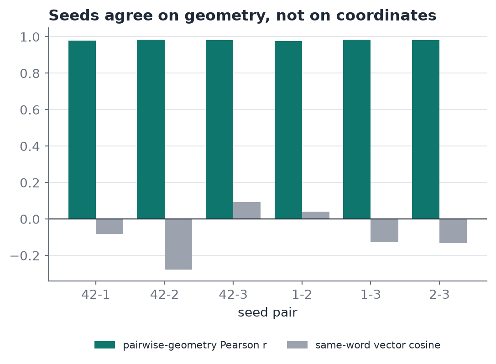

# 03. The reasoning gap

**Thesis.** A transformer is fitted, not designed. It is trained from random weights to minimise next-token loss, so what it ends up computing is a statistical compression of its data. It has no component that represents *why* an output is right, and so it cannot account for its own outputs. The study note says this in its closing callout (p5):

> the LLM abstracts relationships in the data but "lack the ability reasoning Why? its own output. Due to randomness of each Self Attention and Feed Forwarding. The model guessing the best weight to achieved 'Target Error' But lack the Critical Reasoning to its own."

This chapter separates that sentence into four claims, says how much support each has in this project, and states where the claim should *not* be pushed.

## 1. The objective contains no notion of truth

Equation (6) of chapter 02 rewards assigning high probability to the token that actually followed in the training text. It rewards plausibility with respect to the corpus. It does not reward:

- being consistent with a stated fact;
- being able to derive the answer;
- being able to say which earlier tokens or rules justified it.

A model can therefore reach low loss by producing text that *sounds* like the corpus while contradicting what the corpus implies. In our setting the corpus is England & Wales civil-dispute text, where a debtor owes money and a creditor is owed it. Nothing in the loss forbids "the creditor owes the debtor".

*Support in this project:* argument from the objective, plus the stage-3 analogue. On the earlier toy corpus, Skip-gram reaches a loss of 1.24 to 1.27 and still answers `kitten − cat + dog` with "lion" (cosine 0.81 to 0.86) on all four seeds (chapter 01 §4.3 and §4.5). On the civil-law corpus, on one seed, `claimant − defendant + debtor` returns *whether*, and 0 of 5 role analogies are correct ([root README](../../README.md#skip-gram-the-civil-law-vocabulary-and-a-wrong-answer)). Low loss, a high score and a wrong relation coexist.

## 2. Weights come from a random start, not from a design

Training begins at a random point (Xavier initialisation; chapter 02) and follows full-batch gradients to a nearby minimum. Different seeds give different minima.

*Support in this project (small scale, measured):* on XOR, four seeds with identical data, architecture, loss and optimiser all reach the same function (outputs 0.01 / 0.98 / 0.98 / 0.02, loss about $3\times10^{-4}$), yet their first hidden unit's weights are [5.84, −1.49, 6.18, −0.28], [0, −6.5, −1.93, 5.29], [3.52, −2.62, −6.75, −5.17] and [4.02, −2.85, 1.15, −6.58] (chapter 01 §3). At 500 epochs one seed had not converged at all (loss 0.1506 against 0.011 to 0.023).

*Support at stage 3 (measured, four seeds):* the same word has unrelated Skip-gram vectors across seeds (mean cosine −0.28 to 0.09), yet the pairwise geometry agrees (Pearson 0.977 to 0.984).

*Figure 3.1. Hatched: correlation of pairwise-cosine matrices between two seeds. Open: mean cosine between the same word's vectors from the two seeds. Chapter 01, Figure 1.9.*

*Not yet supported:* that the same holds for the transformer. Experiment E1 ([chapter 05](05-implementation-and-evaluation.md#2-experiments)) is designed to test it, and has not been run. We expect similar final loss and very different weights, but expectation is not a result.

*Care with the claim.* Randomness of weights does not by itself mean unreliable *outputs*. Four XOR seeds agree on the function, and four Skip-gram seeds agree on the relations between words. This is evidence *against* a strong reading of "random", and is reported as such. The point is narrower: the **internal solution is not unique and not designed**, so one cannot read the reason for an output off the weights, and two models with equal loss need not share a mechanism. Whether they agree on *held-out* behaviour is exactly what E1 and E2 would examine.

## 3. "Pure emergent, not designed" means opaque

The note's p3 callout links emergence to the black box. The neuro-symbolic literature draws the same line. Sheth, Roy and Gaur (2023, p57) note that the "black-box nature" of large models and their "inscrutability" hinder reliable evaluation of cognitive capability. Post-hoc explainers (attention maps, saliency) describe where the model looked, not a justification the model could be held to.

Contrast with stage 0. ELIZA's behaviour is fully explained by its rules, and fully unable to generalise. A transformer generalises and cannot explain itself. The two columns are the trade the neuro-symbolic programme tries to break (chapter 04).

## 4. Why more attention or depth does not close the gap

The note's own picture ends with layers that move from syntax to meaning to "deep reasoning". Adding heads or layers changes capacity, not the objective. If the objective rewards only next-token plausibility, capacity buys a better fit to plausible text. Whether *reasoning* emerges at scale is an open empirical question that this project cannot address; we claim only that **in this small model, nothing in the construction asks for it or exposes it**.

## 5. Scope and honest limits

- The model is tiny: 2 layers, $d=32$, 256 civil-law items (6,431 training windows). It demonstrates the mechanism, not the behaviour of large models, which are reported to do better on many reasoning tasks.
- The evidence so far is XOR (4 seeds), Skip-gram (4 seeds on the toy corpus, 1 on the civil-law corpus) and one single-seed transformer baseline that still contains known defects. It is illustrative, not statistical.
- "Lack of reasoning" is a design statement about *this* architecture and objective, not a proof about all neural models.
- The note is the author's study note, not a peer-reviewed source. The peer-reviewed support for the black-box concern is Sheth et al. (2023).

## 6. What would change the conclusion

If E1 shows that seeds converge to near-identical weights, the "random weights" claim weakens (the solution would be more unique than argued). If E2 shows that the baseline model already satisfies the knowledge-base constraints at a rate near 100%, the gap on this corpus is small and the symbolic layer has little to correct. Both outcomes are reportable.

## 7. Why a symbolic layer does not close it

*From the literature and our own derivations. Nothing in this section has been run on this transformer.*

The natural response to §1 is to change the objective: train on cross-entropy plus a semantic loss, $\text{CE} + \lambda_s(-\log P_A)$, where $P_A$ is the total probability on the tokens the knowledge base allows, and add the mask and verifier of chapter 04. This narrows the gap and does not close it.

**The loss is not the source of randomness.** It is a deterministic function of the probabilities, so the same logits always give the same value. "Probabilistic" describes what it measures, the probability that a rule holds. Only sampled approximations, such as pseudo-semantic loss (Ahmed et al., 2023), draw anything.

**The limits come from what the term can see and reach.**

- *It cannot choose among allowed tokens.* $H(p) = H_b(P_A) + P_A H(q_A) + (1-P_A) H(q_B)$, and the loss depends only on $P_A$, so $H(q_A)$ is outside its objective (our derivation). A constraint "only specifies what worlds are possible but does not specify which one is correct" (van Krieken et al., 2024).
- *It is soft.* At a conflict between data and rule, the optimum at one context keeps banned mass $f_B/(1+\lambda_s)$ (our derivation), and there is no test-time guarantee (Ahmed et al., 2022).
- *It acts only where applied.* Allowed sets come from corpus prefixes, and where the target is already allowed the term re-weights something cross-entropy already optimises (our derivation).
- *It inherits the knowledge.* A missing rule constrains nothing, and a wrong one is trained in. Wang et al. (2023) show a smaller generalisation gap at the cost of a bias toward a suboptimal model.

**Neither source of randomness goes away.**

| Source | What the approach does to it | What is left |
|---|---|---|
| Weight initialisation (§2) | The semantic loss constrains outputs, not coordinates. The mask, trace and verifier never touch the weights | Seeds still end at unrelated weights. Under this form of loss, which allowed token wins can depend on the initial weights (Zombori et al., 2024, Theorem 4, for softmax regression; not measured here) |
| Top-p sampling | The loss changes the probabilities drawn from. The mask removes banned tokens before temperature and top-p. The verifier checks after the draw | The next token is still drawn at random from what remains in the nucleus |

Both come from the one seeded `rand` in `matrix.ts`, so a run is repeatable at a fixed seed. Repeatable is not justified: seed 42 is no more correct than seed 1. Greedy decoding removes the draw, but its output is one fixed point of one seed's distribution, so the disagreement between seeds is hidden, not resolved. Removing both from an output's content means the network stops authoring it (a formal query, a reasoner and a template), which gives up generation and still repeats every knowledge-base error.

**Not all of this should be removed.** Language has many acceptable continuations, and ambiguity is a normal feature of it (Piantadosi et al., 2012). Maximisation is "an inappropriate decoding objective" for open-ended text (Holtzman et al., 2020). The realistic target is zero mass on rule-excluded tokens and a calibrated spread over the rest, with each guarantee stated next to its coverage. A wrong answer then has a rule and an author that can be checked, though that does not make it true.
