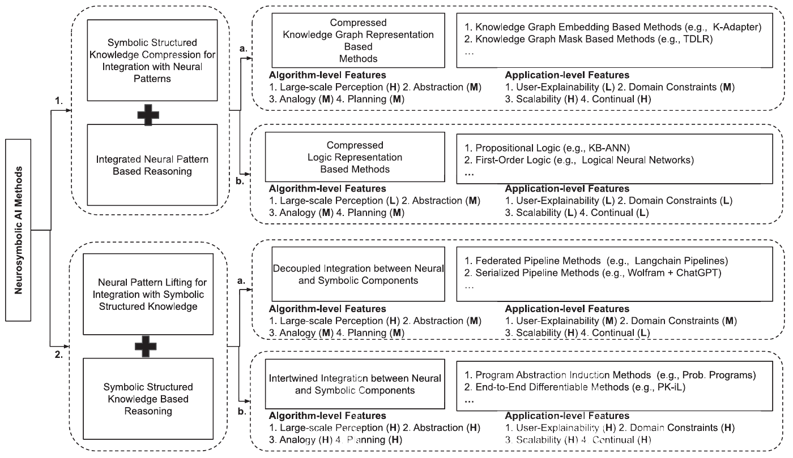
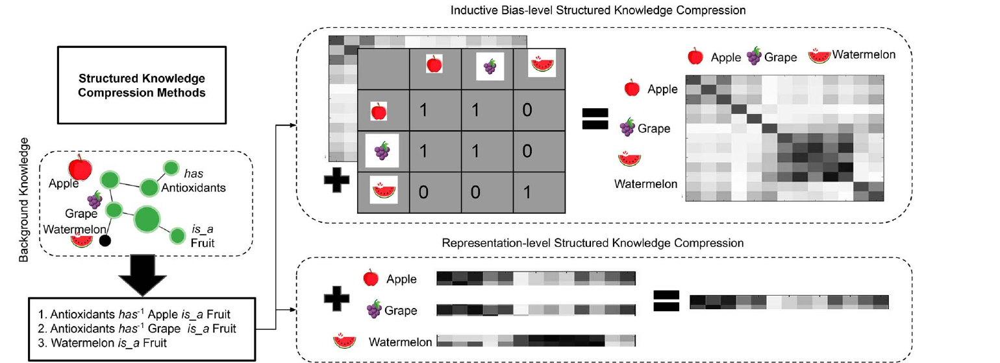
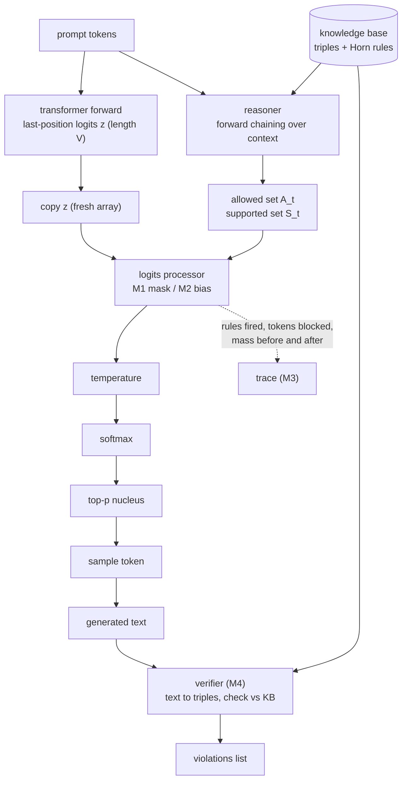

# 04. A feasible neuro-symbolic design for this model

**Status: design only. None of the code in this chapter exists yet.** It is the specification that the symbolic layer will be built against once the transformer's forward pass and generation function are finished. Where a claim depends on a measurement, it is listed as a hypothesis for [chapter 05](05-implementation-and-evaluation.md).

## 1. The source taxonomy

Sheth, Roy and Gaur (2023) organise neuro-symbolic systems by the direction in which knowledge crosses between the neural and symbolic sides (their Fig. 1, p58):

| Category | Direction | Subtypes |
|---|---|---|
| **1. Lowering** | Symbolic knowledge is compressed into the neural pathway | **1a** compressed knowledge-graph methods; **1b** compressed logic methods |
| **2. Lifting** | Neural patterns are lifted into symbolic structure and reasoned over | **2a** decoupled (federated or serialised pipelines); **2b** intertwined (program induction, end-to-end differentiable) |



*Figure 4.1. Cut from Sheth, Roy and Gaur (2023), Fig. 1, p. 58 (`docs/paper/Neurosymbolic_Artificial_Intelligence_Why_What_and_How.pdf`).*

The paper rates each subtype low (L), medium (M) or high (H) on four algorithm-level and four application-level features. Read from the figure above:

| Subtype | Perception | Abstraction | Analogy | Planning | Explainability | Constraints | Scalability | Continual |
|---|---|---|---|---|---|---|---|---|
| 1a compressed KG | H | M | M | M | L | M | H | H |
| 1b compressed logic | L | M | M | M | L | L | L | L |
| 2a decoupled | H | M | M | M | M | M | H | L |
| 2b intertwined | H | H | H | H | H | H | H | H |


*Figure 4.2. Figure 4.1 redrawn with matplotlib, with the position of each mechanism of section 2 added (dotted). The dotted boxes are our mapping, not the authors'.*

The paper's Fig. 2 shows the two ways to compress a knowledge graph for a neural network. The second, an inductive-bias mask on the self-attention matrix, is the closest published analogue to our logit mask, which is why we call the mask "1a-style by analogy" and not 1a:



*Figure 4.3. Cut from Sheth, Roy and Gaur (2023), Fig. 2, p. 59. Top: a knowledge-graph adjacency pattern added to the attention-matrix correlations. Bottom: representation-level compression into vectors.*

**Accuracy note.** The paper does *not* use Kautz's six types or the phrases "learning for reasoning" and "reasoning for learning". Those belong to other literature and are not used in this report.

## 2. Mapping to this project

| Mechanism | What it does | Taxonomy position | Honest qualification |
|---|---|---|---|
| **M1 Hard logit mask** | At generation time, sets the logits of tokens that violate the knowledge base to $-\infty$ | **1a-style lowering**, by analogy | Knowledge enters the neural pathway as an inference-time constraint. It is not a learned knowledge-graph embedding, which is what a strict 1a method would be |
| **M2 Soft logit bias** | Adds $+\lambda$ to tokens the knowledge base supports | 1a-style lowering, by analogy | Same qualification |
| **M3 Reasoning trace** | Records, per step, which rules fired and which tokens were blocked | Supports explainability; part of **2a** | The trace explains the *constraint*, not the network's internal computation |
| **M4 Post-hoc verifier** | Parses generated text into triples and checks them against the knowledge base | **2a decoupled lifting** | Parsing is by rule over whole words |
| **M5 Semantic loss** (stretch) | Adds a training term that rewards probability mass on allowed tokens | Edges toward **2b** | Needs a differentiable formulation; not required for the core claim |

We do **not** attempt a full 2b system (end-to-end differentiable reasoning). It is future work (chapter 06).

How this answers the reasoning gap of chapter 03: the gap is that the model cannot account for its output. M3 and M4 give an *account of the constraint behaviour* that is independent of the weights: a rule identifier and a blocked-token list for every step. They do not make the transformer itself reason, and the report should not claim that.

## 3. Architecture




*Figure 4.4. A simplified view of the diagram above (matplotlib). Dotted borders: nothing here is implemented.*

**The seam.** Constraints are applied at the single point where the last position's logits are copied into a fresh length-$V$ array, **before** temperature and softmax. Two properties follow:

- $-\infty$ divided by a temperature is still $-\infty$, and $\exp(-\infty)=0$, so masked tokens get exactly zero probability and are excluded from the renormalised top-p nucleus.
- The unconstrained path stays untouched: with the processor absent, generation must reproduce the unconstrained output byte for byte at the same seed. That is a required test.

**Guard.** If the mask would ban every token, softmax would produce NaN. The processor must fall back to the unmasked logits and record the fallback in the trace.

## 4. The knowledge base (`symbolic.ts`)

A small ontology written from the corpus, with 5 to 8 relations. Candidate relations and examples that the corpus actually supports (the final list is fixed after reading the corpus again, so treat these as illustrative):

| Relation | Example triple | Source sentence type |
|---|---|---|
| `is_a` | `is_a(kitten, animal)` | "the princess had a kitten and a puppy" |
| `lives_in` | `lives_in(bear, forest)` | "the bear lives in the forest" |
| `can` | `can(eagle, fly)`, `can(fish, swim)` | "the eagle flies", "the fish swims" |
| `cannot` | `cannot(fish, fly)` | authored; the corpus implies it |
| `opposite_of` | `opposite_of(king, queen)` | royal tales |
| `agrees_with` | `agrees_with(king, he)` | pronoun agreement (the Skip-gram analogies he−man+woman→she already probe this) |

A rule has the Horn form $\text{body}\Rightarrow\text{head}$. One example, chained forward:

$$
\mathrm{is\_a}(x,\text{fish}) \;\Rightarrow\; \mathrm{cannot}(x,\text{fly})
$$

Interface sketch:

```ts
type Triple = { rel: string; a: string; b: string };
type Rule = { id: string; if: Triple[]; then: Triple };

interface KnowledgeBase {
  triples: Triple[];
  rules: Rule[];
  entail(context: string[]): { facts: Triple[]; fired: string[] };
  allowed(context: string[], idToToken: string[]): { banned: number[]; supported: number[]; fired: string[] };
}
```

## 5. The logits processor (`constraints.ts`)

```ts
type ProcessorCtx = { ids: number[]; step: number; logits: Float32Array; idxToToken: string[] };
type LogitsProcessor = (ctx: ProcessorCtx) => StepTrace;
```

With allowed set $A_t$ and supported set $S_t$ at step $t$:

$$
\tilde z_i =
\begin{cases}
z_i + \lambda\,\mathbb{1}[i\in S_t] & i\in A_t\\
-\infty & i\notin A_t
\end{cases}
\tag{7}
$$

$\lambda=0$ gives a pure mask. The trace (M3) records, per step:

```ts
type StepTrace = {
  step: number;
  rulesFired: string[];
  maskedTokens: string[];
  massBefore: number;   // probability mass of the banned tokens before masking
  massAfter: number;    // should be 0 for banned tokens
  chosen: string;
  fallback: boolean;    // everything banned, mask skipped
};
```

`massBefore` is the useful number for the explanation: it says how much probability the network *wanted* to put on a token the knowledge base rejected. A large value is direct evidence of the gap; a value near zero means the network already agreed.

## 6. The verifier (M4)

`verify(text) => { violations: { sentence: string; triple: Triple; rule: string }[] }` parses the generated text into triples by pattern, then checks each against the knowledge base and its entailments. Optionally, rejection sampling retries up to $N$ times until `violations` is empty. The verifier is decoupled from the network, so it can also check text produced with the processor off: that is what lets E2 compare the two.

## 7. Semantic loss (M5, stretch)

A training-time term that rewards probability mass on allowed tokens:

$$
\mathcal{L}_{sem} = \mathcal{L}_{CE} \;-\; \lambda_s\,\log\!\!\sum_{i\in A_t} p_i \tag{8}
$$

This follows the idea of a *semantic loss* (Xu et al., 2018). The reference should be confirmed before it is cited in a final version, and the gradient added in `backward` before the head gradients. Only attempt it after M1–M4 are measured.

## 8. Limits to state in any result

1. **Whole-word tokens only.** With about 1000 merges, frequent words are single tokens, but a word split into several BPE tokens is constrained only on its first token. A banned word can leak through its continuation tokens.
2. **Small, hand-authored KB.** It covers a toy domain. It shows the mechanism and says nothing about open-domain knowledge, where the knowledge itself is the hard problem.
3. **A mask is not understanding.** It prevents a class of outputs. It does not give the network a concept of the constraint, and the weights are unchanged.
4. **Trace scope.** The trace explains the symbolic decision, not the network's logits.
5. **No KV cache.** Generation recomputes the full forward pass per token, which is fine at this size.

## 9. Falsifiable predictions

| # | Prediction | Test | Refuted if |
|---|---|---|---|
| P1 | With the hard mask on, the violation rate is 0 for token-expressible constraints | E2 | any violation of a token-expressible constraint |
| P2 | With the processor off, output equals the unconstrained baseline at the same seed | unit test | any difference |
| P3 | The unconstrained model violates the KB at a non-trivial rate | E2 | rate near 0 (then the symbolic layer has little to fix on this corpus) |
| P4 | Seeds give similar loss but different weights | E1 | seeds agree closely in weights |

P1 and P2 are properties of the construction and should hold; P3 and P4 are empirical and may fail.
