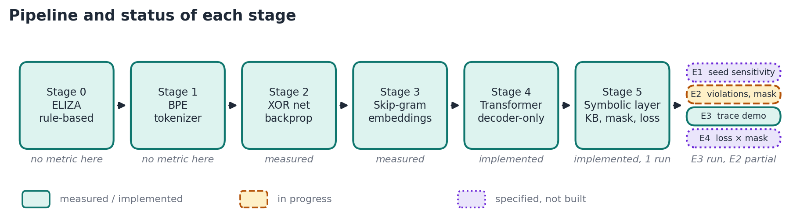

# 05. Implementation and evaluation

This chapter records the implementation state honestly, specifies the experiments, and states which results exist. **E1–E4 have not been run, and nothing on the symbolic layer has been run.** The transformer has one recorded single-seed baseline, which contains known defects (§4).

## 1. Implementation status and known issues

### 1.1 Done and verified

| Item | Evidence |
|---|---|
| Shared seeded RNG `src/server/lib/rng.ts` (`mulberry32`) | Used by `matrix.ts`, `train-embed/train.ts`, `neural-net/train.ts`; seeded runs are deterministic |
| Skip-gram collapse repaired | chapter 01 §4; `tests/train-embed.test.ts`: 5 tests |
| XOR seeded, default 5000 epochs | chapter 01 §3 |
| `cosineSimilarity` returns 0 for a zero vector | `src/server/lib/math.ts` |
| `zod` declared in `package.json` | was imported but only present transitively |
| `trainSkipGram` takes an optional `seed` (default 42) | lets the four-seed comparison run (chapter 01 §4.5) |
| `tests/ieee-data.ts` regenerates every number, table and plot input for the toy corpus | Two runs gave identical output. The paper's data is now in `docs/progress/report/data/`, but the script still writes to `docs/progress/ieee/data/` (§1.4) |
| `docs/images/make_figures.py` draws the diagrams and plots | no number is typed in; it also still reads `ieee/data/` (§1.4) |
| `transformer.ts`: forward, backward, Adam, top-p generation; `train.ts`, `train-worker.ts`, `index.ts` | Trains end to end; `bunx tsc -b --noEmit` passes. Not yet trusted (§1.2, §3) |

### 1.2 The transformer, as of this report

`src/routes/train-transformer/transformer.ts` is written by hand by the project owner. It trains end to end. Three places in it did not match between the forward and backward passes. They are listed in [architecture §9](../architecture.md#9-defects-found-while-drawing-the-diagrams) and were fixed on 2026-11-02, after which the five gates (§3) pass in `tests/train-transformer.test.ts`:

| # | Location | Defect | Fix |
|---|---|---|---|
| D1 | `blockForward`, line 494 | The first residual multiplies: `input[i] * attnOut[i]` | `input[i] + attnOut[i]` |
| D2 | `blockForward`, line 482 | Attention skips the token itself: `j < i` | `j <= i` |
| D3 | `blockBackward`, line 668 | The K gradient uses `K` | Use `Q`, since $\partial(Q_i \cdot K_j)/\partial K_j = Q_i$ |

Each failed the finite-difference gradient check. Older weights are no longer loaded, because filenames now carry `MODEL_VERSION`. The baseline has not yet been re-run on the fixed code.

The defects this chapter listed earlier have been fixed: the bad `matmulTransAm` import, `ln1Beta` and `ff1B` initialisation, and the misspelled type and field names. `weigth-layout.ts` is no longer empty, and its filename is still misspelled.

### 1.3 Not yet written

The whole symbolic layer: `symbolic.ts`, `constraints.ts`, `semantic-loss.ts`, `lift.ts` and the verifier. Chapter 07 specifies them, and they have not been run.

### 1.4 Other open items

- The ELIZA route emits its first event after a 10 000 ms delay (`src/routes/simple-chat.ts`, the `start` emit). That is probably a typo for 1000 but may be a deliberate "thinking" pause. Left unchanged; the owner should confirm.
- `bun run lint` fails with 17 errors. `src/client/routes.tsx:23` references a rule that does not exist (`ts/consistent-type-definitions`), which predates this work, and `tests/ieee-data.ts` and `tests/probe-xor.ts` use `any`.
- `package.json` contains a `test` dependency (a `node:test` polyfill) that was not added by this work. `bun test` does not need it.
- `.data/embedding-weights.json` now holds the civil-law model (the [root README](../../README.md#pre-training-the-baseline-before-the-symbolic-layer) records it).
- `tests/ieee-data.ts` still measures the toy-corpus words, and it and `make_figures.py` still use `docs/progress/ieee/data/`, while the paper is in `docs/progress/report/`. Running them now would create a second data folder, and the seed comparison cannot be regenerated for the civil-law corpus until the script is rewritten.
- `train-worker.mjs` is tracked by git but is a stale bundle (architecture §9).

## 2. Experiments

All experiments run locally and are seeded.

**Preconditions, none fully met yet.**

1. D1–D3 are fixed and the five gates (§3) pass (2026-11-02). Still to do: re-run the baseline.
2. Write a civil-law knowledge base. Stop if `constrainedPositions` is 0, because then the loss and the mask do nothing. In a read-only probe (2026-11-01, not a recorded experiment), the chapter 07 knowledge base fired on 0 of 6,447 positions.
3. Create a held-out split. None exists today.
4. Add the seed, knowledge-base hash and $\lambda_s$ to the training options and the weights filename. `train.ts:193` calls `resetRand()` with its default seed, and the cache key at `train.ts:250` has no seed, so seeds 1, 2 and 3 would reload seed 42's file.

### E1. Seed sensitivity (tests chapter 03 §2)

- **Question.** Does the same data, architecture and loss reach similar loss through very different weights?
- **Protocol.** Train the transformer with seeds 42, 1, 2, 3 under identical settings. For each seed record final loss. For each pair of seeds compute the L2 distance and the cosine between the flattened weight vectors, and the cosine between the *output logits* on a fixed held-out set of prompts.
- **Interpretation.** Similar loss with large weight distance supports the claim; large logit distance too would mean the models also *behave* differently. Weight distance can also be large only because of symmetries (permuting hidden units), so a logit-level comparison is required before concluding anything.
- **Status.** Not run. The XOR analogue is measured (chapter 01 §3).

### E2. Constraint violation rate (tests P1, P3)

- **Question.** How often does the unconstrained model generate text that contradicts the knowledge base, and what does the mask cost?
- **Protocol.** For each seed, generate $N$ samples with the processor off and with the hard mask on, at fixed temperature and top-p. Report violation rate (via the verifier) next to the number of claims it parsed, perplexity on held-out text, and distinct-token ratio. Zero violations in $n$ checked claims still allows a rate of about $3/n$ at 95%, so 0 of 100 allows about 3%.
- **Perplexity under the mask.** A held-out target in $B_t$ has probability 0 under the mask, so perplexity becomes infinite. Compute it from the weights only, without the mask.
- **Status.** Not run.

### E3. Trace demonstration

- **Protocol.** One generation with the full per-step trace table (`rulesFired`, `maskedTokens`, `massBefore`, `massAfter`, `chosen`).
- **Status.** Not run.

### E4. Semantic loss and mask factorial (tests P5, P6, P7)

- **Question.** What does the semantic loss add that the mask has not already done?
- **Protocol.** $\lambda_s \in \{0, 2\}$ × mask {off, on} × seeds {42, 1, 2, 3}. The mask needs no retraining, so this is 16 cells from 8 trainings, about 95 minutes extrapolated from the recorded 710 s per run. Run the mask-off arm as `bias` with $\lambda = 0$, because mode `off` leaves the trace empty.
- **Reading it.** Both mask-on cells sit at zero violations by construction, so an interaction on violation rate would be an arithmetic artefact. `massBefore` on training contexts is close to the training loss itself, because for one context $\mathcal{L}_{sem} = -\log(1 - \text{massBefore})$. Read M5's added value from four places instead: `massBefore` on fixed probe contexts outside training, against a random token set of similar frequency; violations of a held-out knowledge base never compiled into $A_t$; $H(q_A)$ and the split P6 measures; and weights-only perplexity on text where no rule fires.
- **Expected.** On labelled positions alone, a small effect, and a null on P5 would not be surprising (chapter 04 §7).
- **Statistics.** Four seeds cannot give a paired sign-flip $p$ below 0.125, so report per-seed values and ranges. Six seeds reach 0.031, at about 2.4 hours.
- **Status.** Proposed. Not run.

## 3. Verification gates for the transformer

Before any experiment is trusted:

1. A finite-difference gradient check for every parameter group (token and position embeddings, LayerNorm, Q/K/V/O, feed-forward, head), with relative error below $10^{-3}$.
2. Initial loss close to $\ln V$ (a uniform guess).
3. A single repeated sequence overfits to near-zero loss.
4. Causal mask: changing a future token leaves earlier logits unchanged.
5. The same seed gives the same weights.

## 4. Results

| Experiment | Result |
|---|---|
| E1 | none yet |
| E2 | none yet |
| E3 | none yet |
| E4 | none yet |

The measured results so far are those of stages 2 and 3, in [chapter 01](01-background.md), plus the PRE TRAINING baseline in the [root README](../../README.md#pre-training-the-baseline-before-the-symbolic-layer), recorded 2026-10-31:

| Stage | Metric | Seed | Value |
|---|---|---|---|
| 3 Skip-gram, civil law | analogies correct | 42 | 0 of 5 |
| 3 Skip-gram, civil law | landlord/tenant cosine | 42 | 0.59 |
| 4 Transformer, civil law, 2 layers, 300 epochs | final loss, **with D1–D3 present** | 42 | 5.678 (perplexity about 292) |

This table is the summary of the earlier toy-corpus runs, all from `bun tests/ieee-data.ts`:

| Stage | Metric | Seeds | Range observed |
|---|---|---|---|
| 2 XOR, 2→4→1 | MSE at 5000 epochs | 42, 1, 2, 3 | 2.2e-4 to 3.1e-4 |
| 2 XOR, 2→4→1 | MSE at 500 epochs | 42, 1, 2, 3 | 0.0110 to 0.1506 |
| 2 XOR, single layer | MSE, 500 epochs | 42 | 0.2845 → 0.2842 |
| 3 Skip-gram | loss, epoch 0 → 300 | 42, 1, 2, 3 | 4.07–4.08 → 1.244–1.271 |
| 3 Skip-gram | analogies correct (our key) | 42, 1, 2, 3 | 5/7 to 6/7 |
| 3 Skip-gram | same-word cosine across seeds | 6 seed pairs | −0.28 to 0.09 |
| 3 Skip-gram | pairwise-geometry Pearson r | 6 seed pairs | 0.977 to 0.984 |
| 4 Transformer | parameters per block, D=32, F=128 | analytic | 12 704 (not a measurement of a trained model) |

*Figure 5.1. Where the measured results sit in the pipeline (same as Figure 1.1).*

## 5. Threats to validity (anticipated)

- **Corpus size.** 256 civil-law items (6,431 training windows) is small, and the seed comparison used a 107-sentence toy corpus. Behaviour at scale will differ.
- **Knowledge-base coverage.** Rules reach few positions on this corpus, so report the denominator next to any effect.
- **Vacuous pass.** A verifier that parses little reports few violations (chapter 04 §6). Report claims parsed next to violations.
- **Few seeds.** Four seeds give a spread, not a distribution.
- **KB authored by us.** A knowledge base written by the same person who writes the test makes P1 easy to satisfy and P3 easy to inflate. The verifier and the processor should share the KB deliberately and the report should say so, and a few held-out constraints should be written without looking at model output.
- **Whole-word constraints.** Described in chapter 04 §8.
