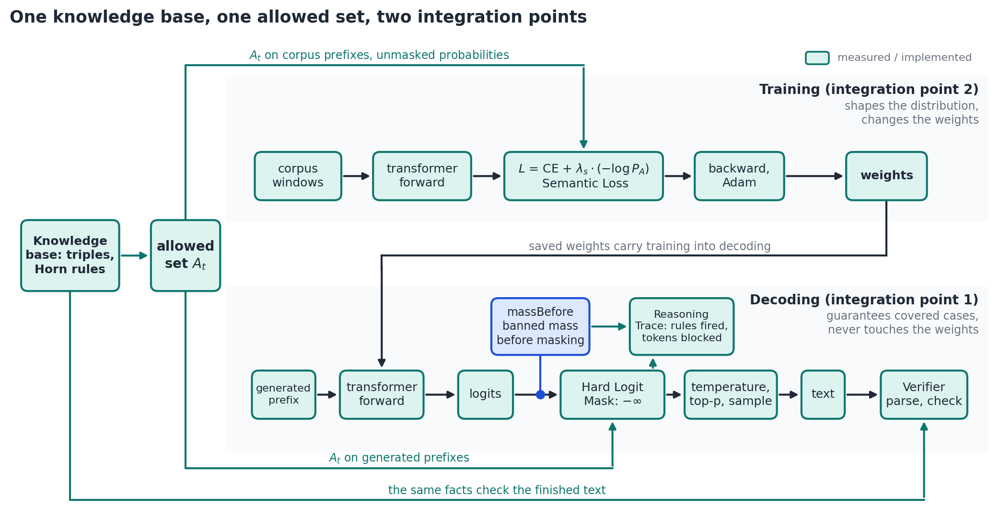

# 07. Code for the symbolic layer, towards 2b (intertwined integration)

This chapter gives the code for `src/routes/neuro-symbolic/` as snippets that you copy in by hand. **Nothing here has been run.** Each snippet names the file it goes in and, where it changes existing code, the exact place. The order matters: the knowledge base comes first, because M1–M5 all read the allowed set $A_t$ from it.

**Known mismatches with the current repo (2026-11-01; §2 updated 2026-11-03). Apart from §2, the snippets are unchanged and need these fixed before use.** Numbers marked "probe" come from a read-only script using the real tokenizer and these snippets. They are not recorded experiments.`

| # | Mismatch                                                                              | Effect                                                                                                                                                                  | What to do                                                                                                                                                                                  |
| - | ------------------------------------------------------------------------------------- | ----------------------------------------------------------------------------------------------------------------------------------------------------------------------- | ------------------------------------------------------------------------------------------------------------------------------------------------------------------------------------------- |
| 1 | Fixed: §2's old story KB fired 0 times on the civil-law text                         | §2 now holds the civil-law KB, also in `src/routes/neural-symbolic/symbolic.ts`. Probe: 9 of 5,390 positions, 0 conflicts                                            | Keep `tests/neural-symbolic-kb.test.ts` passing, since it runs on the real tokenizer. Stop if the firing count falls to 0                                                                 |
| 2 | §4 applies M5 only to labelled positions                                             | Where the target is allowed, it changes learning speed, not the optimum                                                                                                 | Decide whether to add unlabelled probe contexts with $\mathcal{L}_{sem}$ and no CE, and measure them for collapse                                                                         |
| 3 | §7's `liftCan` emits only `can` triples, and bans come only from `cannot`      | Lifting cannot change $A_t$. Probe: top-1 probability peaks at 0.0985 against $\tau = 0.3$, on the defective baseline                                               | Treat lifting as reporting only, or extend it with guards: freeze the original KB for the verifier, and hash the KB into the weights filename                                               |
| 4 | §2's `allowed()` closes the KB once and matches only the last words of the context | There is no forward chaining over the context                                                                                                                           | Describe it this way wherever it is reported                                                                                                                                                |
| 5 | §2's token index covers whole-word tokens                                            | Probe: all 8 roles and the KB's verbs are single tokens under the current tokenizer, and only 3 of 937 tokens lack a leading space. This can change with the vocabulary | Keep checking `unenforceable`, and repeat the check after any vocabulary change                                                                                                           |
| 6 | §6's verifier returns only violations                                                | Zero violations looks the same as zero claims checked                                                                                                                   | Report claims parsed, and supported, contradicted and unknown                                                                                                                               |
| 7 | §8's training options have no seed or KB hash                                        | Seeds 1, 2 and 3 would reload seed 42's file                                                                                                                            | Add them to the options and the filename (chapter 05 §2)                                                                                                                                   |
| 8 | §6, §7 and §9 still use the old KB: `cannot`, `can`, `girl` and `fly`      | With the new §2, `verify` always returns no violations and `liftCan` finds no conflicts, so both look clean while checking nothing. §9's KB and hook tests fail   | Rewrite them for `defined_by` and `not_defined_by` before use. These sections also say `neuro-symbolic` and `verifier.ts`, while the repo has `neural-symbolic` and `verify.ts` |

## 0. What "2b" means here, honestly

Sheth et al. split *lifting* (category 2, "neural patterns lifted into symbolic knowledge") into **2a decoupled** and **2b intertwined**. In 2b, the symbolic and neural parts shape each other during learning, rather than one checking the other afterwards. This project gets there in two pieces:

| Direction                      | Mechanism               | File                 | What crosses the boundary                                                                                         |
| ------------------------------ | ----------------------- | -------------------- | ----------------------------------------------------------------------------------------------------------------- |
| symbols → network (training)  | **Semantic Loss** | `semantic-loss.ts` | gradient $\partial\mathcal{L}_{sem}/\partial z$ pushes probability mass off KB-banned tokens                    |
| network → symbols (lifting)   | **lift step**     | `lift.ts`          | high-probability next tokens become candidate triples, which are checked against the KB and, if consistent, added |
| symbols → network (inference) | Hard Logit Mask         | `constraints.ts`   | the logits are edited and the edit is recorded                                                                    |
| network output → symbols      | Verifier                | `verifier.ts`      | generated text is turned into triples and checked                                                                 |

The loop **train with $\mathcal{L}_{sem}$ (KB$_r$) → lift → accept → KB$_{r+1}$ → retrain** is the intertwined part. It is still **not** end-to-end differentiable reasoning:

- The KB is discrete.
- The acceptance gate is a threshold, not a learned function.
- The reasoner (forward chaining) has no parameters.

State it as "towards 2b", as chapter 04 §2 already does.



## 1. File layout

```text
src/routes/neuro-symbolic/
  symbolic.ts        KB, forward chaining, triggers, allowed()      (§2)
  semantic-loss.ts   M5 loss + gradient                             (§3)
  constraints.ts     M1/M2 logits processor, M3 StepTrace           (§5)
  verifier.ts        M4 text → triples → violations                 (§6)
  lift.ts            network → candidate triples → KB               (§7)
  model.ts           load weights + vocab + merges from .data/      (§8)
  index.ts           POST /neuro-symbolic                           (§8)
src/schemas/neuro-symbolic-request.ts                               (§8)
tests/neuro-symbolic.test.ts                                        (§9)
```

Changes to existing files, all opt-in so that today's behaviour is unchanged (prediction P2):

- `transformer.ts`: an optional `sem` argument to `backward` (§4), and an optional `hooks` argument to `generateText` (§5).
- `train.ts` and `train-worker.ts`: precompute the masks and pass `lambdaS` (§4).
- `train-transformer-request.ts`: `lambdaS`, default `0`.
- `src/index.tsx`: one `.route(...)`.

## 2. `symbolic.ts`: knowledge base, reasoner, allowed set

This KB is written for the civil-law text the transformer trains on: the eight role definitions at `corpus.ts` L23-38. It has 26 base facts and 5 rules, closing to 100 facts with 56 `not_defined_by` bans. It is enforced only inside three definition frames such as `?x is the person who`, because wider triggers ban legitimate text. Probe, from `tests/neural-symbolic-kb.test.ts` and a read-only script on the real tokenizer: it fires at 9 of 5,390 positions (97 of 85,984 window positions) with 0 conflicts and nothing `unenforceable`. These are text and tokenizer checks. They do not show that the mask removes any probability mass at those positions, and the frames cover very little of the corpus. `not_defined_by(landlord,rents)` stays in the KB but is not enforced until it has had legal review. This is educational text, not legal advice.

```ts
// src/routes/neural-symbolic/symbolic.ts
/**
 * Knowledge base: triples + Horn rules, closed by naive forward chaining.
 * Every fact keeps its provenance, so any ban can be explained as a rule chain.
 */
export type Triple = { rel: string; a: string; b: string };
/** Terms starting with "?" are variables, e.g. { rel: "is_a", a: "?x", b: "?y" }. */
export type Rule = { id: string; if: Triple[]; then: Triple };
export type Provenance =
  | { source: "kb" }
  | { source: "lifted"; p: number }
  | { source: "rule"; rule: string; from: string[] };

export const key = (t: Triple) => `${t.rel}(${t.a},${t.b})`;
const isVar = (s: string) => s.startsWith("?");

/**
 * Civil-law facts for the role words in corpus.ts (L23-38). Educational, England and Wales,
 * not legal advice. `not_defined_by(x, v)` says v is not what defines the role word x. It does
 * not say a person in that role can never do v: a creditor can bring a claim.
 */
export const TRIPLES: Triple[] = [
  { rel: "defined_by", a: "claimant", b: "brings" },
  { rel: "defined_by", a: "defendant", b: "answers" },
  { rel: "defined_by", a: "landlord", b: "owns" },
  { rel: "defined_by", a: "tenant", b: "rents" },
  { rel: "defined_by", a: "trader", b: "sells" },
  { rel: "defined_by", a: "consumer", b: "buys" },
  { rel: "defined_by", a: "creditor", b: "is_owed" },
  { rel: "defined_by", a: "debtor", b: "owes" },
  { rel: "is_a", a: "claimant", b: "court_party" },
  { rel: "is_a", a: "defendant", b: "court_party" },
  { rel: "is_a", a: "landlord", b: "housing_party" },
  { rel: "is_a", a: "tenant", b: "housing_party" },
  { rel: "is_a", a: "trader", b: "trade_party" },
  { rel: "is_a", a: "consumer", b: "trade_party" },
  { rel: "is_a", a: "creditor", b: "debt_party" },
  { rel: "is_a", a: "debtor", b: "debt_party" },
  { rel: "counterpart", a: "claimant", b: "defendant" },
  { rel: "counterpart", a: "landlord", b: "tenant" },
  { rel: "counterpart", a: "trader", b: "consumer" },
  { rel: "counterpart", a: "creditor", b: "debtor" },
  { rel: "disjoint", a: "court_party", b: "housing_party" },
  { rel: "disjoint", a: "court_party", b: "trade_party" },
  { rel: "disjoint", a: "court_party", b: "debt_party" },
  { rel: "disjoint", a: "housing_party", b: "trade_party" },
  { rel: "disjoint", a: "housing_party", b: "debt_party" },
  { rel: "disjoint", a: "trade_party", b: "debt_party" },
];

export const RULES: Rule[] = [
  {
    id: "R-SYM-COUNTERPART",
    if: [{ rel: "counterpart", a: "?x", b: "?y" }],
    then: { rel: "counterpart", a: "?y", b: "?x" },
  },
  {
    id: "R-SYM-DISJOINT",
    if: [{ rel: "disjoint", a: "?c", b: "?d" }],
    then: { rel: "disjoint", a: "?d", b: "?c" },
  },
  {
    id: "R-CLASS",
    if: [{ rel: "is_a", a: "?y", b: "?d" }, { rel: "defined_by", a: "?y", b: "?v" }],
    then: { rel: "class_verb", a: "?d", b: "?v" },
  },
  {
    id: "R-COUNTER",
    if: [{ rel: "counterpart", a: "?x", b: "?y" }, { rel: "defined_by", a: "?y", b: "?v" }],
    then: { rel: "not_defined_by", a: "?x", b: "?v" },
  },
  {
    id: "R-OTHER-DOMAIN",
    if: [
      { rel: "is_a", a: "?x", b: "?c" },
      { rel: "disjoint", a: "?c", b: "?d" },
      { rel: "class_verb", a: "?d", b: "?v" },
    ],
    then: { rel: "not_defined_by", a: "?x", b: "?v" },
  },
];

type Binding = Record<string, string>;

function unify(pat: Triple, fact: Triple, b: Binding): Binding | null {
  if (pat.rel !== fact.rel) return null;
  const out: Binding = { ...b };
  const pairs: [string, string][] = [[pat.a, fact.a], [pat.b, fact.b]];
  for (const [p, f] of pairs) {
    if (isVar(p)) {
      if (out[p] === undefined) out[p] = f;
      else if (out[p] !== f) return null;
    }
    else if (p !== f) return null;
  }
  return out;
}

function subst(t: Triple, b: Binding): Triple {
  return {
    rel: t.rel,
    a: isVar(t.a) ? b[t.a] : t.a,
    b: isVar(t.b) ? b[t.b] : t.b,
  };
}

export class KnowledgeBase {
  readonly facts = new Map<string, { t: Triple; prov: Provenance }>();
  private readonly base: { t: Triple; prov: Provenance }[] = [];

  readonly rules: Rule[];

  constructor(triples: Triple[], rules: Rule[]) {
    this.rules = rules;
    for (const t of triples) this.assert(t, { source: "kb" });
    this.close();
  }

  /** Add a base fact (from the KB file or from lifting). Call close() afterwards. */
  assert(t: Triple, prov: Provenance): boolean {
    if (this.facts.has(key(t))) return false;
    this.base.push({ t, prov });
    this.facts.set(key(t), { t, prov });
    return true;
  }

  has(rel: string, a: string, b: string): boolean {
    return this.facts.has(key({ rel, a, b }));
  }

  objects(rel: string, a: string): string[] {
    const out: string[] = [];
    for (const { t } of this.facts.values()) if (t.rel === rel && t.a === a) out.push(t.b);
    return out;
  }

  entities(): Set<string> {
    const s = new Set<string>();
    for (const { t } of this.facts.values()) s.add(t.a);
    return s;
  }

  /** Naive forward chaining to a fixpoint. Fine for tens of facts. */
  close(): void {
    let changed = true;
    while (changed) {
      changed = false;
      const all = [...this.facts.values()].map((f) => f.t);
      for (const rule of this.rules) {
        let binds: { b: Binding; from: string[] }[] = [{ b: {}, from: [] }];
        for (const pat of rule.if) {
          const next: { b: Binding; from: string[] }[] = [];
          for (const { b, from } of binds) {
            for (const f of all) {
              const u = unify(pat, f, b);
              if (u) next.push({ b: u, from: [...from, key(f)] });
            }
          }
          binds = next;
        }
        for (const { b, from } of binds) {
          const t = subst(rule.then, b);
          if (!this.facts.has(key(t))) {
            this.facts.set(key(t), { t, prov: { source: "rule", rule: rule.id, from } });
            changed = true;
          }
        }
      }
    }
  }

  /** defined_by(x,v) and not_defined_by(x,v) both hold. Reported, never silently resolved. */
  contradictions(): { a: string; b: string }[] {
    const out: { a: string; b: string }[] = [];
    for (const { t } of this.facts.values()) {
      if (t.rel === "defined_by" && this.has("not_defined_by", t.a, t.b)) {
        out.push({ a: t.a, b: t.b });
      }
    }
    return out;
  }

  /** The proof of a fact as readable lines, leaves first. */
  explain(t: Triple, depth = 0): string[] {
    const f = this.facts.get(key(t));
    if (!f) return [`${"  ".repeat(depth)}${key(t)}  [not in KB]`];
    const pad = "  ".repeat(depth);
    if (f.prov.source === "kb") return [`${pad}${key(t)}  [kb]`];
    if (f.prov.source === "lifted") return [`${pad}${key(t)}  [lifted, p=${f.prov.p.toFixed(3)}]`];
    const lines = [`${pad}${key(t)}  [${f.prov.rule}]`];
    for (const k of f.prov.from) {
      const child = this.facts.get(k);
      if (child) lines.push(...this.explain(child.t, depth + 1));
    }
    return lines;
  }

  clone(): KnowledgeBase {
    const kb = new KnowledgeBase([], this.rules);
    for (const { t, prov } of this.base) kb.assert(t, prov);
    kb.close();
    return kb;
  }
}

// ─── From facts to token ids ────────────────────────────────────────────────

/**
 * Token text of each KB verb. `is_owed` maps to "owed", not "is": banning " is" would also block
 * "the debtor is the person who is liable". Its triggers below read one word further instead.
 */
export const SURFACE: Record<string, string[]> = {
  brings: ["brings"],
  answers: ["answers"],
  owns: ["owns"],
  rents: ["rents"],
  sells: ["sells"],
  buys: ["buys"],
  is_owed: ["owed"],
  owes: ["owes"],
};

export const baseForm = (word: string): string | undefined =>
  Object.keys(SURFACE).find((k) => SURFACE[k].includes(word));

/**
 * A trigger says: when the last context words match `pattern` (?x binds to a KB entity), the next
 * word is banned or supported. `only` and `except` limit which KB verbs the trigger may enforce.
 */
export type Trigger = {
  id: string;
  pattern: string[];
  rel: string;
  mode: "ban" | "support";
  only?: string[];
  except?: string[];
};

/** Definition frames only. One-word triggers such as "the landlord" would be legally unsound. */
const FRAMES = [
  ["?x", "is", "the", "person", "who"],
  ["?x", "is", "a", "person", "who"],
  ["?x", "is", "a", "business", "that"],
];

export const TRIGGERS: Trigger[] = FRAMES.flatMap((frame, i) => [
  { id: `T-F${i}-BAN`, pattern: frame, rel: "not_defined_by", mode: "ban" as const, except: ["is_owed"] },
  { id: `T-F${i}-SUP`, pattern: frame, rel: "defined_by", mode: "support" as const, except: ["is_owed"] },
  { id: `T-F${i}-IS-BAN`, pattern: [...frame, "is"], rel: "not_defined_by", mode: "ban" as const, only: ["is_owed"] },
  { id: `T-F${i}-IS-SUP`, pattern: [...frame, "is"], rel: "defined_by", mode: "support" as const, only: ["is_owed"] },
]);

/**
 * Derived but not enforced until legally reviewed: a subtenant's landlord also rents, and bare
 * "rents" runs both ways in English. The fact and its proof stay in the KB.
 */
export const NOT_ENFORCED = new Set(["not_defined_by(landlord,rents)"]);

/**
 * word → ids of tokens that are exactly " word" (a whole word starting with a space).
 * A word that BPE splits has no entry and cannot be enforced (chapter 04 §8). It is
 * reported as `unenforceable` rather than over-banning its first piece.
 */
export function buildTokenIndex(idxToToken: string[]): Map<string, number[]> {
  const idx = new Map<string, number[]>();
  idxToToken.forEach((tok, id) => {
    if (!tok.startsWith(" ")) return;
    const w = tok.trim();
    if (!/^[a-z]+$/.test(w)) return;
    idx.set(w, [...(idx.get(w) ?? []), id]);
  });
  return idx;
}

export type Allowed = {
  banned: number[];
  supported: number[];
  fired: string[];
  unenforceable: string[];
};

export function contextWords(ids: number[], idxToToken: string[]): string[] {
  return ids.map((i) => idxToToken[i]).join("").trim().split(/\s+/);
}

/** A_t is everything except `banned`; S_t is `supported`. */
export function allowed(
  kb: KnowledgeBase,
  contextIds: number[],
  idxToToken: string[],
  tokenIndex: Map<string, number[]>,
  triggers: Trigger[] = TRIGGERS,
): Allowed {
  const words = contextWords(contextIds, idxToToken);
  const entities = kb.entities();
  const banned = new Set<number>();
  const supported = new Set<number>();
  const fired: string[] = [];
  const unenforceable: string[] = [];

  for (const trig of triggers) {
    const n = trig.pattern.length;
    if (words.length < n) continue;
    const tail = words.slice(-n);
    let x: string | undefined;
    const ok = trig.pattern.every((p, k) => {
      if (p === "?x") {
        x = tail[k];
        return entities.has(tail[k]);
      }
      return p === tail[k];
    });
    if (!ok || !x) continue;

    for (const obj of kb.objects(trig.rel, x)) {
      if (trig.only && !trig.only.includes(obj)) continue;
      if (trig.except?.includes(obj)) continue;
      if (trig.mode === "ban" && NOT_ENFORCED.has(key({ rel: trig.rel, a: x, b: obj }))) continue;
      const forms = SURFACE[obj] ?? [obj];
      const target = trig.mode === "ban" ? banned : supported;
      let hit = false;
      for (const form of forms) {
        const ids = tokenIndex.get(form);
        if (!ids) {
          unenforceable.push(form);
          continue;
        }
        ids.forEach((id) => target.add(id));
        hit = true;
      }
      if (hit) {
        const prov = kb.facts.get(key({ rel: trig.rel, a: x, b: obj }))!.prov;
        const why = prov.source === "rule" ? prov.rule : prov.source;
        fired.push(`${trig.id}: ${trig.rel}(${x},${obj}) ← ${why}`);
      }
    }
  }
  for (const b of banned) supported.delete(b); // a ban always wins over support
  return { banned: [...banned], supported: [...supported], fired, unenforceable };
}
```

## 3. `semantic-loss.ts`: M5

Equation (8) of chapter 04 is $\mathcal{L}_{sem} = -\tfrac{\lambda_s}{S}\sum_t \log P_A(t)$, with $P_A(t)=\sum_{i\in A_t}p_{t,i}$. Store the **banned** set $B_t$ (the complement of $A_t$), because it is small and sparse. With $c=\lambda_s/S$:

$$
\frac{\partial \mathcal{L}_{sem}}{\partial z_{t,j}} =
\begin{cases}
c\,p_{t,j}\left(1-\dfrac{1}{P_A(t)}\right) & j\in A_t\\[2mm]
c\,p_{t,j} & j\in B_t
\end{cases}
$$

This is the cross-entropy shape "p minus target", where the target is $p$ renormalised over $A_t$. The model therefore has no reason to prefer one allowed token over another. Each row sums to $c(P_B + P_A - 1) = 0$, like the cross-entropy gradient. If $B_t$ is empty, the loss and gradient are $0$. If $B_t$ covers the whole vocabulary, skip the position, because there is nothing allowed to move mass to.

```ts
// src/routes/neuro-symbolic/semantic-loss.ts
/**
 * Semantic loss (Xu et al., 2018, in the "exactly one of A" form):
 *   L_sem = -(1/S) Σ_t log Σ_{i∈A_t} p_{t,i}
 * banned[t] = token ids outside A_t, or null when position t has no constraint.
 */
export type SemMask = (number[] | null)[];

function allowedMass(probs: Float32Array, row: number, V: number, isBanned: Uint8Array): number {
  let pA = 0;
  for (let j = 0; j < V; j++) if (!isBanned[j]) pA += probs[row + j];
  return Math.max(pA, 1e-10);
}

function bannedFlags(B: number[], V: number): Uint8Array {
  const f = new Uint8Array(V);
  for (const j of B) f[j] = 1;
  return f;
}

export function semanticLoss(probs: Float32Array, banned: SemMask, S: number, V: number): number {
  let loss = 0;
  for (let t = 0; t < S; t++) {
    const B = banned[t];
    if (!B || B.length === 0 || B.length >= V) continue;
    loss -= Math.log(allowedMass(probs, t * V, V, bannedFlags(B, V)));
  }
  return loss / S;
}

/** Adds λ_s · ∂L_sem/∂z into dLogits (which already holds the CE gradient, scaled by 1/S). */
export function addSemanticGrad(
  dLogits: Float32Array,
  probs: Float32Array,
  banned: SemMask,
  S: number,
  V: number,
  lambdaS: number,
): void {
  const c = lambdaS / S;
  for (let t = 0; t < S; t++) {
    const B = banned[t];
    if (!B || B.length === 0 || B.length >= V) continue;
    const row = t * V;
    const isBanned = bannedFlags(B, V);
    const pA = allowedMass(probs, row, V, isBanned);
    for (let j = 0; j < V; j++) {
      const p = probs[row + j];
      dLogits[row + j] += isBanned[j] ? c * p : c * p * (1 - 1 / pA);
    }
  }
}
```

## 4. Wiring M5 into training

> **Changed from the snippets below.** The repo does not add `lambdaS` to `train-transformer`, so the baseline stays CE only. M5 has its own trainer and worker in `src/routes/neural-symbolic/` (`train.ts`, `train-worker.ts`), with weight files named by $\lambda_s$, seed and KB hash, which also resolves mismatch #7. `backward` takes a generic optional `editDLogits` callback rather than importing the semantic loss. The verifier in §6 has also been rewritten for `defined_by` and `not_defined_by`. §7's `lift.ts` has too: it now classifies `defined_by` claims at definition frames, and the trainer reports them every epoch without adding any to the KB. Workers also total semantic loss by trigger pattern, and the trainer reports every epoch rather than every tenth.

**`transformer.ts`, `backward`.** Add one optional argument, and one call right after the cross-entropy `dLogits` loop and before `addInPlace(grads.headB, ...)`:

```ts
// transformer.ts — imports
import type { SemMask } from "../neuro-symbolic/semantic-loss.js";
import { addSemanticGrad } from "../neuro-symbolic/semantic-loss.js";

export function backward(
  cache: ForwardCache,
  targets: number[],
  w: TransformerWeights,
  cfg: TransformerConfig,
  grads: TransformerGrads,
  sem?: { banned: SemMask; lambda: number },   // NEW, optional
) {
  // … existing dLogits loop (p - onehot) / S …

  if (sem && sem.lambda > 0) {                 // NEW
    addSemanticGrad(dLogits, cache.probs, sem.banned, S, V, sem.lambda);
  }

  addInPlace(grads.headB, sumCols(dLogits, S, V));
  // … unchanged …
}
```

**`train.ts`.** Precompute one mask per sequence position, once, after `sequences` is built. Count the conflicts, i.e. positions where the corpus target is itself a banned token:

```ts
// tstrain.ts — after the `sequences` loop
import type { SemMask } from "../neuro-symbolic/semantic-loss.js";
import { allowed, buildTokenIndex, KnowledgeBase, RULES, TRIPLES } from "../neuro-symbolic/symbolic.js";

const kb = new KnowledgeBase(TRIPLES, RULES);
const tokenIndex = buildTokenIndex(indexToWord);
let constrainedPositions = 0;
const corpusConflicts: string[] = [];

const semMasks: SemMask[] = sequences.map((seq) =>
  seq.input.map((_, t) => {
    const ctx = seq.input.slice(0, t + 1);
    const { banned } = allowed(kb, ctx, indexToWord, tokenIndex);
    if (banned.length === 0) return null;
    constrainedPositions++;
    if (banned.includes(seq.target[t])) {
      corpusConflicts.push(
        ctx.slice(-4).map((i) => indexToWord[i]).join("") + " →" + indexToWord[seq.target[t]],
      );
    }
    return banned;
  }),
);
// On the old story corpus, expect corpusConflicts to contain "… the girl → flew" (several times, because windows overlap).
```

In the worker loop, slice `semMasks` exactly as you slice `sequences`, and pass it with `lambdaS`:

```ts
// train.ts — inside the `for (let i = 0; i < numWorkers; i++)` loop
const from = i * seqsPerWorker;
const to = (i + 1) * seqsPerWorker;
const workerSeqs = sequences.slice(from, to);
const workerMasks = semMasks.slice(from, to);
// workerData: { …existing…, semMasks: workerMasks, lambdaS }
```

```ts
// train-worker.ts
import { semanticLoss } from "../neuro-symbolic/semantic-loss.js";
const { /* …existing… */ semMasks, lambdaS } = workerData as { /* … */ semMasks: SemMask[]; lambdaS: number };

let totalLoss = 0;
let totalSem = 0;
sequences.forEach((seq, k) => {
  const cache = forward(seq.input, w, cfg);
  totalLoss += crossEntropyLoss(cache.probs, seq.target, seqLen, cfg.vocabSize);
  if (lambdaS > 0) totalSem += semanticLoss(cache.probs, semMasks[k], seqLen, cfg.vocabSize);
  backward(cache, seq.target, w, cfg, grads, lambdaS > 0 ? { banned: semMasks[k], lambda: lambdaS } : undefined);
});
parentPort!.postMessage({ type: "done", loss: totalLoss, semLoss: totalSem });
```

Two further edits:

- **Schema:** add `lambdaS: z.number().min(0).max(5).default(0)` to `train-transformer-request.ts`.
- **Weights filename:** add the suffix `-sem${lambdaS}` when `lambdaS > 0`. Otherwise a cached unconstrained model is loaded for a constrained run, and the comparison is void.

Report `semLoss`, `constrainedPositions` and `corpusConflicts.length` in the `init` and `epoch` events. A corpus conflict means CE and $\mathcal{L}_{sem}$ pull in opposite directions at that position, so with $\lambda_s>0$, the CE term at that position cannot reach zero.

## 5. M1/M2 processor and M3 trace: `constraints.ts`

```ts
// src/routes/neuro-symbolic/constraints.ts
import type { KnowledgeBase } from "./symbolic.js";
import { allowed } from "./symbolic.js";

export type StepTrace = {
  step: number;
  rulesFired: string[];
  maskedTokens: string[];
  supportedTokens: string[];
  unenforceable: string[];
  massBefore: number; // p(banned) at temperature 1, before editing: how much the network wanted it
  massAfter: number;  // p(banned) after editing: 0 under the mask
  chosen: string;
  fallback: boolean;  // everything banned → logits left untouched
};

export type ProcessorCtx = { ids: number[]; step: number; logits: Float32Array; idxToToken: string[] };
export type LogitsProcessor = (ctx: ProcessorCtx) => StepTrace;

function massOf(logits: Float32Array, ids: number[]): number {
  let max = -Infinity;
  for (const z of logits) if (z > max) max = z;
  let sum = 0;
  for (const z of logits) sum += Math.exp(z - max);
  let m = 0;
  for (const i of ids) m += Math.exp(logits[i] - max) / sum;
  return m;
}

export function makeProcessor(
  kb: KnowledgeBase,
  tokenIndex: Map<string, number[]>,
  opts: { mode: "mask" | "bias" | "both"; lambda: number },
): LogitsProcessor {
  return ({ ids, step, logits, idxToToken }) => {
    const a = allowed(kb, ids, idxToToken, tokenIndex);
    const trace: StepTrace = {
      step,
      rulesFired: a.fired,
      maskedTokens: a.banned.map((i) => idxToToken[i]),
      supportedTokens: a.supported.map((i) => idxToToken[i]),
      unenforceable: a.unenforceable,
      massBefore: massOf(logits, a.banned),
      massAfter: 0,
      chosen: "",
      fallback: false,
    };
    if (a.banned.length >= logits.length) {
      trace.fallback = true;
      trace.massAfter = trace.massBefore;
      return trace;
    }
    if (opts.mode !== "bias") for (const b of a.banned) logits[b] = -Infinity;          // M1, eq. (7)
    if (opts.mode !== "mask") for (const s of a.supported) logits[s] += opts.lambda;  // M2
    trace.massAfter = opts.mode === "bias" ? massOf(logits, a.banned) : 0;
    return trace;
  };
}
```

**`transformer.ts`, `generateText`.** Add an optional last argument. Call the processor on the fresh `logits` copy, **before** the temperature loop (the seam in chapter 04 §3), and record the sampled token:

```ts
export function generateText(
  w: TransformerWeights, cfg: TransformerConfig, seedIds: number[], maxLen: number,
  idxToToken: string[], temparture = 0.8, topP = 0.9, seqLen?: number,
  hooks?: { processor: LogitsProcessor; traces: StepTrace[] },   // NEW
): string {
  // … for (let step …) { … copy last-position logits into `logits` …

    const trace = hooks?.processor({ ids: contextIds, step, logits, idxToToken });   // NEW

    // … temperature, softmax, top-p, sample `sampled` (unchanged) …

    if (trace) { trace.chosen = idxToToken[sampled]; hooks!.traces.push(trace); }    // NEW
    ids.push(sampled);
  // }
}
```

The sampling code already handles a masked token: `-Infinity / T` is `-Infinity`, and `Math.exp(-Infinity - max)` is `0`. A masked token therefore never enters the nucleus.

## 6. M4 verifier: `verifier.ts`

```ts
// src/routes/neuro-symbolic/verifier.ts
import type { KnowledgeBase, Triple } from "./symbolic.js";
import { baseForm } from "./symbolic.js";

export type Violation = { sentence: string; claim: Triple; proof: string[] };

/** Parse "<entity> <verb-form>" and "<entity> can|could <verb>" claims; check against cannot(). */
export function verify(kb: KnowledgeBase, text: string): Violation[] {
  const entities = kb.entities();
  const out: Violation[] = [];
  for (const sentence of text.toLowerCase().split(/[.!?]+/)) {
    const w = sentence.trim().split(/\s+/);
    for (let i = 0; i < w.length - 1; i++) {
      if (!entities.has(w[i])) continue;
      const verbWord = w[i + 1] === "can" || w[i + 1] === "could" ? w[i + 2] : w[i + 1];
      const verb = verbWord ? baseForm(verbWord) : undefined;
      if (verb && kb.has("cannot", w[i], verb)) {
        const claim = { rel: "can", a: w[i], b: verb };
        out.push({ sentence: sentence.trim(), claim, proof: kb.explain({ rel: "cannot", a: w[i], b: verb }) });
      }
    }
  }
  return out;
}
```

For example, `verify(kb, "the girl flew over the forest")` returns one violation, with this proof:

```text
cannot(girl,fly)  [R-INHERIT-CANNOT]
  is_a(girl,human)  [kb]
  cannot(human,fly)  [kb]
```

That proof is the explanation the symbolic layer gives for the result.

## 7. Lifting: `lift.ts` (network → symbols)

This is the "neural patterns lifted into symbolic knowledge" half. Probe the trained network with templates. Read its next-word distribution and turn confident verb predictions into **candidate** triples. Each candidate falls into one of three cases:

| Status        | Meaning                              | Action                                                                               |
| ------------- | ------------------------------------ | ------------------------------------------------------------------------------------ |
| `confirmed` | KB already holds it                  | none; evidence the network learned the fact                                          |
| `conflict`  | KB derives the opposite (`cannot`) | report with probability and proof; direct evidence of the reasoning gap (chapter 03) |
| `novel`     | neither                              | accept only if $p\ge\tau$ **and** adding it creates no new contradiction     |

```ts
// src/routes/neuro-symbolic/lift.ts
import type { TransformerConfig, TransformerWeights } from "../train-transformer/transformer.js";
import type { KnowledgeBase, Triple } from "./symbolic.js";
import { forward } from "../train-transformer/transformer.js";
import { baseForm } from "./symbolic.js";

export type Candidate = {
  triple: Triple;
  p: number;
  status: "confirmed" | "conflict" | "novel";
  proof: string[];
};

export function liftCan(
  kb: KnowledgeBase,
  w: TransformerWeights,
  cfg: TransformerConfig,
  idxToToken: string[],
  encode: (text: string) => number[],
  opts = { templates: ["the {x}", "the {x} can"], topK: 8, minP: 0.02 },
): Candidate[] {
  const V = cfg.vocabSize;
  const best = new Map<string, Candidate>();
  for (const x of kb.entities()) {
    for (const tpl of opts.templates) {
      const ids = encode(tpl.replace("{x}", x));
      if (ids.length === 0) continue;
      const ctx = ids.slice(-cfg.contextLen);
      const { probs } = forward(ctx, w, cfg);
      const row = probs.subarray((ctx.length - 1) * V, ctx.length * V);
      const top = Array.from(row, (p, id) => ({ p, id })).sort((a, b) => b.p - a.p).slice(0, opts.topK);
      for (const { p, id } of top) {
        const tok = idxToToken[id];
        const verb = tok.startsWith(" ") ? baseForm(tok.trim()) : undefined;
        if (!verb || p < opts.minP) continue;
        const triple = { rel: "can", a: x, b: verb };
        const status = kb.has("can", x, verb) ? "confirmed" : kb.has("cannot", x, verb) ? "conflict" : "novel";
        const proof = status === "conflict" ? kb.explain({ rel: "cannot", a: x, b: verb }) : kb.explain(triple);
        const k = `${x}|${verb}`;
        if (!best.has(k) || best.get(k)!.p < p) best.set(k, { triple, p, status, proof });
      }
    }
  }
  return [...best.values()].sort((a, b) => b.p - a.p);
}

/** Accept novel candidates that keep the KB consistent. Returns the next KB and an audit log. */
export function acceptLifted(kb: KnowledgeBase, cands: Candidate[], tau = 0.3) {
  const next = kb.clone();
  const log: { triple: Triple; p: number; accepted: boolean; reason: string }[] = [];
  for (const c of cands) {
    if (c.status !== "novel") continue;
    if (c.p < tau) {
      log.push({ triple: c.triple, p: c.p, accepted: false, reason: `p < τ=${tau}` });
      continue;
    }
    const trial = next.clone();
    const before = trial.contradictions().length;
    trial.assert(c.triple, { source: "lifted", p: c.p });
    trial.close();
    if (trial.contradictions().length > before) {
      log.push({ triple: c.triple, p: c.p, accepted: false, reason: "would contradict KB" });
      continue;
    }
    next.assert(c.triple, { source: "lifted", p: c.p });
    next.close();
    log.push({ triple: c.triple, p: c.p, accepted: true, reason: "consistent" });
  }
  return { kb: next, log };
}
```

**The intertwined loop:**

| Round | Step                                                       | Result        |
| ----- | ---------------------------------------------------------- | ------------- |
| 0     | Train with $\lambda_s>0$ against KB$_0$                | weights$_0$ |
| 0     | `liftCan` → `acceptLifted`                            | KB$_1$      |
| 1     | Retrain (or fine-tune) with $\lambda_s$ against KB$_1$ | weights$_1$ |
| …    | Stop when a round accepts nothing                          |               |

Every lifted fact carries `[lifted, p=…]` in its proof, so an explanation always shows which knowledge came from the network and which came from the author. Keep $\tau$ high, and log every rejection. Lifted facts are the network's beliefs, not ground truth; the corpus has talking animals.

## 8. Route: `model.ts`, schema, `index.ts`, mount

`train.ts` already writes `config`, `vocab`, `merges` and `weights` into the `.data/*.json` file (see `serializeModel`). The loader only needs to read them back. Rather than copy `tryLoadWeights`, export it from `train.ts` and widen its return type to `{ weights, history, config, vocab, merges }`. Then:

```ts
// src/routes/neuro-symbolic/model.ts
import { applyMerges } from "../../server/lib/bpe.js";
import { tryLoadWeights } from "../train-transformer/train.js"; // export it, return config/vocab/merges too

const PRE_TOKEN_RE = /\s\w+|[^\w\s]/g; // same as train.ts

export async function loadModel(path: string) {
  const m = await tryLoadWeights(path);
  if (!m) return null;
  const wordToIndex = new Map(m.vocab.map((t, i) => [t, i] as const));
  const encode = (text: string) =>
    applyMerges(` ${text}`.toLowerCase(), m.merges, PRE_TOKEN_RE)
      .map((t) => wordToIndex.get(t))
      .filter((i): i is number => i !== undefined);
  return { ...m, encode };
}
```

```ts
// src/schemas/neuro-symbolic-request.ts
/** Request schema for constrained generation + verification + optional lifting. */
import { z } from "zod";

export default z.object({
  prompt: z.string().min(1).max(200).default("the girl"),
  weightsFile: z.string().regex(/^transformer-weights-[\w.-]+\.json$/), // no path traversal
  mode: z.enum(["off", "mask", "bias", "both"]).default("mask"),
  lambda: z.number().min(0).max(10).default(2),
  maxTokens: z.number().int().min(1).max(100).default(20),
  temperature: z.number().min(0.1).max(2).default(0.8),
  topP: z.number().min(0.1).max(1).default(0.9),
  seed: z.number().int().default(42),
  lift: z.boolean().default(false),
});
```

```ts
// src/routes/neuro-symbolic/index.ts
/**
 * Neuro-symbolic route: runs the same prompt unconstrained and constrained (same seed),
 * returns both texts, the per-step trace (M3), verifier violations (M4) and,
 * optionally, lifted candidate triples.
 */
import type { LogitsProcessor, StepTrace } from "./constraints.js";
import { join } from "node:path";
import { zValidator } from "@hono/zod-validator";
import { Hono } from "hono";
import NeuroSymbolicRequest from "../../schemas/neuro-symbolic-request.js";
import { resetRand } from "../train-transformer/matrix.js";
import { generateText } from "../train-transformer/transformer.js";
import { makeProcessor } from "./constraints.js";
import { liftCan } from "./lift.js";
import { loadModel } from "./model.js";
import { buildTokenIndex, KnowledgeBase, RULES, TRIPLES } from "./symbolic.js";
import { verify } from "./verifier.js";

export default new Hono().post(
  "/neuro-symbolic",
  zValidator("json", NeuroSymbolicRequest),
  async (c) => {
    const body = c.req.valid("json");
    const model = await loadModel(join(process.cwd(), ".data", body.weightsFile));
    if (!model) return c.json({ error: "weights not found: train the transformer first" }, 404);

    const kb = new KnowledgeBase(TRIPLES, RULES);
    const tokenIndex = buildTokenIndex(model.vocab);
    const seedIds = model.encode(body.prompt);
    const windowSize = Math.min(model.config.contextLen, 16); // same cap as train.ts:234

    const run = (processor?: LogitsProcessor) => {
      resetRand(body.seed);
      const traces: StepTrace[] = [];
      const text = generateText(
        model.weights, model.config, seedIds, body.maxTokens, model.vocab,
        body.temperature, body.topP, windowSize,
        processor ? { processor, traces } : undefined,
      );
      return { text, traces, violations: verify(kb, text) };
    };

    const baseline = run();
    const constrained = body.mode === "off"
      ? null
      : run(makeProcessor(kb, tokenIndex, { mode: body.mode, lambda: body.lambda }));
    const lifted = body.lift
      ? liftCan(kb, model.weights, model.config, model.vocab, model.encode)
      : undefined;

    return c.json({ baseline, constrained, lifted, contradictions: kb.contradictions() });
  },
);
```

```ts
// src/index.tsx
import neuroSymbolic from "./routes/neuro-symbolic";
export const _routes = app.route("/", simpleChat) /* … */ .route("/", trainTransformer).route("/", neuroSymbolic);
```

To try it:

```bash
curl -s -X POST localhost:5173/neuro-symbolic -H 'content-type: application/json' \
  -d '{"prompt":"the girl","weightsFile":"transformer-weights-e300-l2-d32-h2-ff128-ctx32.json","lift":true}' | jq
```

## 9. Tests: `tests/neuro-symbolic.test.ts`

These are gate 1 of chapter 05 §3 for the new term, plus P1 and P2 of chapter 04 §9. The numbers in the table were checked by hand: $z=[0,0,0]$, $A=\{0,1\}$ gives $\mathcal{L}=-\ln\tfrac23=0.4055$ and gradient $[\tfrac13-\tfrac12,\ \tfrac13-\tfrac12,\ \tfrac13]$.

| logits z  | A (banned B)   | L_sem  | dL/dz                        |
| --------- | -------------- | ------ | ---------------------------- |
| [0, 0, 0] | {0, 1} (B={2}) | 0.4055 | [−0.1667, −0.1667, 0.3333] |
| [2, 0, 0] | {1, 2} (B={0}) | 1.546  | [0.787, −0.3935, −0.3935]  |
| any       | all (B=∅)     | 0      | [0, 0, 0]                    |

```ts
// tests/neuro-symbolic.test.ts
import { describe, expect, test } from "bun:test";
import { makeProcessor } from "../src/routes/neuro-symbolic/constraints";
import { addSemanticGrad, semanticLoss } from "../src/routes/neuro-symbolic/semantic-loss";
import { allowed, buildTokenIndex, KnowledgeBase, RULES, TRIPLES } from "../src/routes/neuro-symbolic/symbolic";
import { verify } from "../src/routes/neuro-symbolic/verifier";
import { resetRand } from "../src/routes/train-transformer/matrix";
import { generateText, initWeights } from "../src/routes/train-transformer/transformer";

const softmax = (z: number[]) => {
  const m = Math.max(...z);
  const e = z.map((v) => Math.exp(v - m));
  const s = e.reduce((a, b) => a + b, 0);
  return Float32Array.from(e.map((v) => v / s));
};

describe("M5 semantic loss", () => {
  test.each([
    [[0, 0, 0], [2], 0.4055, [-0.1667, -0.1667, 0.3333]],
    [[2, 0, 0], [0], 1.546, [0.787, -0.3935, -0.3935]],
  ])("z=%p B=%p", (z, B, L, g) => {
    const p = softmax(z);
    expect(semanticLoss(p, [B], 1, 3)).toBeCloseTo(L, 3);
    const d = new Float32Array(3);
    addSemanticGrad(d, p, [B], 1, 3, 1);
    d.forEach((v, j) => expect(v).toBeCloseTo(g[j], 3));
    expect(d.reduce((a, b) => a + b, 0)).toBeCloseTo(0, 5);
  });

  test("finite difference matches analytic gradient", () => {
    const z = [0.3, -1.2, 0.8, 0.1];
    const B = [2, 3];
    const L = (zz: number[]) => semanticLoss(softmax(zz), [B], 1, 4);
    const d = new Float32Array(4);
    addSemanticGrad(d, softmax(z), [B], 1, 4, 1);
    const h = 1e-3;
    z.forEach((_, j) => {
      const up = [...z]; up[j] += h;
      const dn = [...z]; dn[j] -= h;
      expect(d[j]).toBeCloseTo((L(up) - L(dn)) / (2 * h), 3);
    });
  });
});

describe("knowledge base", () => {
  const kb = new KnowledgeBase(TRIPLES, RULES);
  test("inheritance derives cannot(girl, fly) with a proof", () => {
    expect(kb.has("cannot", "girl", "fly")).toBe(true);
    expect(kb.explain({ rel: "cannot", a: "girl", b: "fly" })[0]).toContain("R-INHERIT-CANNOT");
  });
  test("can(eagle, fly) via transitive is_a", () => expect(kb.has("can", "eagle", "fly")).toBe(true));
  test("the base KB is consistent", () => expect(kb.contradictions()).toEqual([]));
  test("verifier flags the corpus sentence", () => {
    expect(verify(kb, "the girl flew over the forest")).toHaveLength(1);
    expect(verify(kb, "the eagle flew over the forest")).toHaveLength(0);
  });
  test("allowed() bans every surface form after the subject", () => {
    const vocab = [" the", " girl", " flew", " flies", " fly", " ran"];
    const a = allowed(kb, [0, 1], vocab, buildTokenIndex(vocab));
    expect(a.banned.sort()).toEqual([2, 3, 4]);
  });
});

describe("generation hooks", () => {
  const cfg = { vocabSize: 6, contextLen: 8, embDim: 8, numHeads: 2, ffDim: 16, numLayers: 1 };
  const vocab = [" the", " girl", " flew", " flies", " fly", " ran"];
  resetRand(7);
  const w = initWeights(cfg);
  const kb = new KnowledgeBase(TRIPLES, RULES);

  test("P2: no hooks → identical output at the same seed", () => {
    resetRand(42); const a = generateText(w, cfg, [0, 1], 10, vocab);
    resetRand(42); const b = generateText(w, cfg, [0, 1], 10, vocab);
    expect(a).toBe(b);
  });
  test("P1: the hard mask never emits a banned token after 'girl'", () => {
    const traces: any[] = [];
    resetRand(42);
    generateText(w, cfg, [0, 1], 30, vocab, 0.8, 0.9, 8,
      { processor: makeProcessor(kb, buildTokenIndex(vocab), { mode: "mask", lambda: 0 }), traces });
    for (const t of traces) if (t.maskedTokens.length) expect(t.maskedTokens).not.toContain(t.chosen);
  });
});
```

The P2 test as written only checks determinism. The full P2 check compares output with `hooks` undefined against output from **before** the edit to `generateText`. Save one baseline string at seed 42 before changing the file, then assert equality with it.

## 10. What to report

| Measure                                                                     | Where it comes from | What it says                                                                                                          |
| --------------------------------------------------------------------------- | ------------------- | --------------------------------------------------------------------------------------------------------------------- |
| `corpusConflicts`                                                         | §4                 | how often the training text itself breaks the KB                                                                      |
| `semLoss` over epochs, for $\lambda_s\in\{0, 0.5, 2\}$                  | §4                 | whether the network learns to put mass on $A_t$ without the mask                                                    |
| `massBefore` at triggered steps, with the mask **off** at inference | §5                 | **the key number for 2b**: if training with $\lambda_s>0$ lowers it, the knowledge has moved into the weights |
| verifier violation rate, mask off vs on                                     | §6                 | P1 and P3                                                                                                             |
| lifted candidates by status                                                 | §7                 | what the network believes, and where it disagrees with the KB                                                         |
| held-out CE                                                                 | E2                  | the cost of the constraint                                                                                            |

Limits, in addition to chapter 04 §8:

- **Whole-word tokens only.** A word that BPE splits is reported as `unenforceable` and never partly banned.
- **Lifting reads probabilities, not mechanisms.** A lifted triple says what the network predicts, not why.
- **Lexical subject matching.** The KB binds `?x` to the last word, so "the eagle saw the girl flew" would wrongly bind "girl". With a 16-token window this is rare, but it can happen.

// src/schemas/neuro-symbolic-request.ts
/** Request schema for constrained generation + verification + optional lifting. */
import { z } from "zod";

export default z.object({
  prompt: z.string().min(1).max(200).default("the girl"),
  weightsFile: z.string().regex(/^transformer-weights-[\w.-]+\.json$/), // no path traversal
  mode: z.enum(["off", "mask", "bias", "both"]).default("mask"),
  lambda: z.number().min(0).max(10).default(2),
  maxTokens: z.number().int().min(1).max(100).default(20),
  temperature: z.number().min(0.1).max(2).default(0.8),
  topP: z.number().min(0.1).max(1).default(0.9),
  seed: z.number().int().default(42),
  lift: z.boolean().default(false),
});
