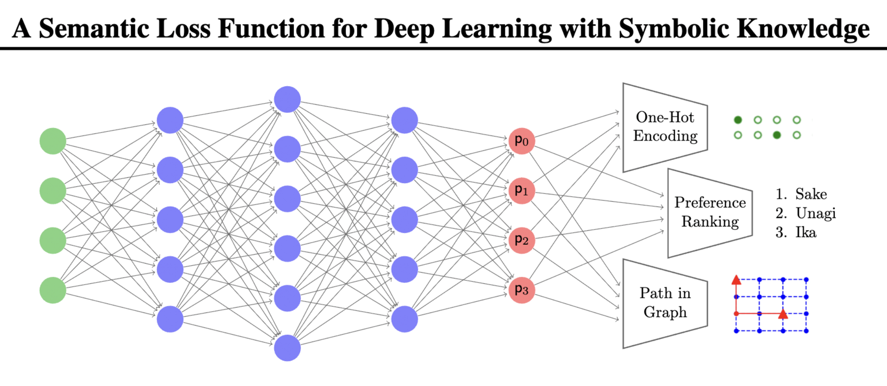
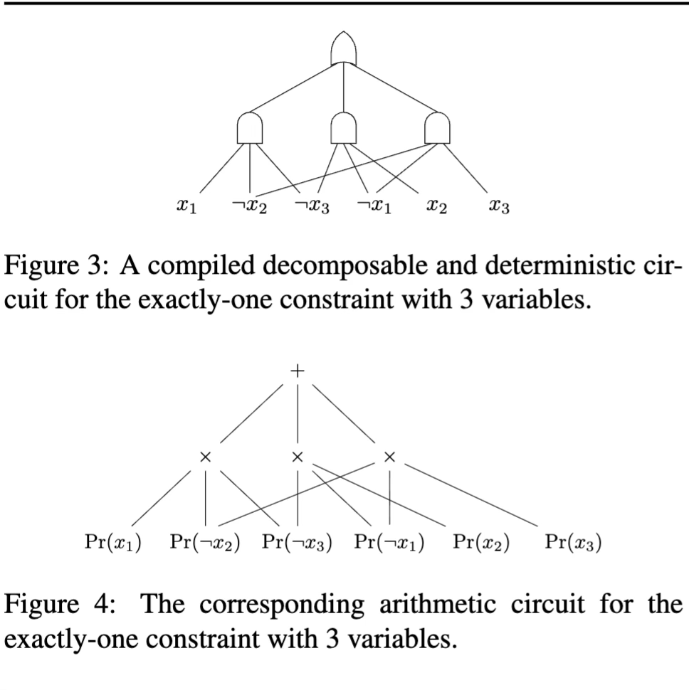
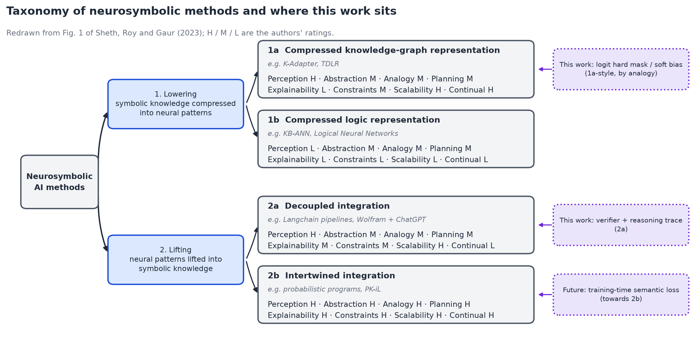
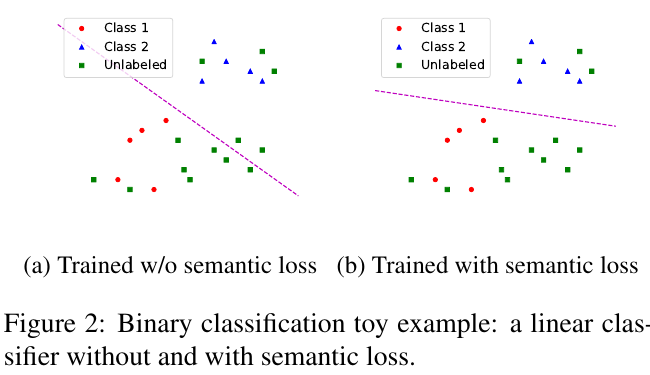

# Rebuilding a Small Transformer from Scratch, and the Reasoning It Does Not Have

*A progress report on a from-scratch NLP pipeline in TypeScript, with a proposed neuro-symbolic layer*

## Abstract

This project rebuilds, with no ML libraries, the pipeline that leads to a GPT-style language model: a rule-based chatbot (ELIZA), a subword tokenizer (BPE), a network trained by backpropagation (XOR), word embeddings (Skip-gram), and a decoder-only transformer with multi-head causal self-attention.

Building it exposes a structural limit. A transformer is trained to minimise next-token cross-entropy, starting from random weights. Nothing in that objective represents *why* a token is right. The model ends with weights that predict natural-looking text, but it cannot justify its own output. The author's study note puts it this way: the model "guess[es] the best weight to achieve 'Target Error' But lack[s] the Critical Reasoning to its own" (note p5). The same note says the behaviour is "pure emergent" and "not designed", and names neuro-symbolic AI as the way to resolve the black box (p3).

We take that note as the thesis and ask what a *feasible* neuro-symbolic extension of this small model looks like. Following the taxonomy of Sheth, Roy and Gaur (2023), we propose two mechanisms: symbolic knowledge injected into the logits (a "lowering" of knowledge into the neural pathway, Category 1a), and a decoupled verifier with a reasoning trace (a "lifting" of neural output to symbols, Category 2a). The integration target is now Category **2b, intertwined**: a training-time *semantic loss* (Xu et al., 2018) that puts the knowledge base into the gradient, with the 1a-style mask and the 2a verifier kept as parts of it. Why 2b, and how it is built, is in [the section below](#intertwined-integration-2b-for-nlp-why-this-method-and-how-it-is-built).

**What is measured and what is not.** Stages 0–3 are fixed, tested and measured; their numbers are in [chapter 01](01-background.md). The transformer trains end to end and has one recorded single-seed baseline, but that baseline contains three defects, since fixed (2026-11-02). The transformer now passes its five verification gates, but no baseline has been recorded on the fixed code. The symbolic layer is designed but **not implemented**. The experiments that would test it (E1–E4) are specified in [chapter 05](05-implementation-and-evaluation.md) with **no results yet**. This report does not claim any reasoning result for the transformer, or any result for the symbolic layer.

**What the design would not do.** Even when built, it would not resolve the transformer's ambiguity completely, and it would remove neither weight-initialisation nor top-p randomness ([chapter 03 §7](03-reasoning-gap.md#7-why-a-symbolic-layer-does-not-close-it)).

## Status

| Stage | Component                                                       | State                               | Evidence                                                                                                                                                             |
| ----- | --------------------------------------------------------------- | ----------------------------------- | -------------------------------------------------------------------------------------------------------------------------------------------------------------------- |
| 0     | ELIZA pattern-matching chat (`src/routes/simple-chat.ts`)     | Works                               | Rule-based, no learning                                                                                                                                              |
| 1     | BPE tokenizer (`src/server/lib/bpe.ts`)                       | Works                               | 5000 merges for Skip-gram, 1000 for the transformer                                                                                                                                   |
| 2     | XOR network, perceptron vs 2→4→1 (`src/routes/neural-net/`) | Works, now seeded                   | All 4 seeds solve XOR at 5000 epochs; see [ch. 01 §3](01-background.md#3-stage-2-learning-by-backpropagation)                                                        |
| 3     | Word2Vec Skip-gram (`src/routes/train-embed/`)                | **Repaired**                  | Was collapsed (every cosine 1.0). Toy corpus: king/queen 0.90, see [ch. 01 §4](01-background.md#4-stage-3-word-embeddings-and-the-collapse-we-fixed). Civil-law corpus: landlord/tenant 0.59, 0 of 5 role analogies |
| 4     | Transformer (`src/routes/train-transformer/`)                 | **Gates pass, no new baseline yet**, user-written | One baseline, one seed: final loss 5.678, with defects D1–D3 present. D1–D3 fixed and gates passed since; see [ch. 05 §1.2](05-implementation-and-evaluation.md#12-the-transformer-as-of-this-report)                                                      |
| 5     | Symbolic layer                                                  | **Designed only**             | [ch. 04](04-neurosymbolic-design.md)                                                                                                                                  |
| 6     | Experiments E1–E4                                              | **Not run**                   | [ch. 05](05-implementation-and-evaluation.md)                                                                                                                         |

## Contributions

1. A working, tested from-scratch pipeline for stages 0–3, with a diagnosed and fixed Word2Vec collapse (negative-sampling table off-by-one, missing positive update, wrong negative row, wrong analogy sign).
2. Reproducible experiments through a shared seeded generator (`src/server/lib/rng.ts`), and a first piece of evidence on seed sensitivity: four seeds reach the same XOR function through very different weights.
3. A transformer chapter that follows the study note's order and adds the equations the note omits.
4. A reasoning-gap argument tied to the note and to the neuro-symbolic literature.
5. A concrete, scoped neuro-symbolic design for this model, with the limits stated.

## Reading guide

| Chapter                                                                | Content                                                                         |
| ---------------------------------------------------------------------- | ------------------------------------------------------------------------------- |
| [01 Background](01-background.md)                                       | Stages 0–3 with measured results, including the Word2Vec failure and fix       |
| [02 Transformer and self-attention](02-transformer-self-attention.md)   | Q/K/V, polysemy, heads, block, stacking; equations; mapping to code             |
| [03 The reasoning gap](03-reasoning-gap.md)                             | Why fitting random weights to a loss is not reasoning, and what a symbolic layer leaves open                           |
| [04 Neuro-symbolic design](04-neurosymbolic-design.md)                  | Taxonomy mapping, mechanisms, interfaces, limits                                |
| [05 Implementation and evaluation](05-implementation-and-evaluation.md) | Known issues, experiment protocol, results status                               |
| [06 Conclusion and future work](06-conclusion-and-future-work.md)       | Summary and next steps                                                          |
| [07 Code towards 2b](07-neurosymbolic-code-2b.md)                       | Copy-in code for the symbolic layer: KB, M1–M5, lift loop, tests (not yet run) |
| [References](references.md)                                             | Papers, the study note, the reference repository                                |

## Intertwined integration (2b) for NLP: why this method, and how it is built

**Status: designed and specified ([chapter 07](07-neurosymbolic-code-2b.md)); not implemented, no results.** This section explains the choice. It does not report a measurement.



*Figure R.1. Xu et al. (2018), Fig. 1, p. 2: "Outputs of a neural network feed into semantic loss functions for constraints representing a one-hot encoding, a total ranking of preferences, and paths in a grid graph." In this project the outputs $p_0, p_1, \dots$ are the transformer's next-token probabilities, and the constraint is "the next token is one the knowledge base allows".*

### The four options, and what each would mean for this transformer

Sheth, Roy and Gaur (2023) sort neuro-symbolic methods into four subcategories by the direction knowledge crosses ([chapter 04 §1](04-neurosymbolic-design.md#1-the-source-taxonomy)). Their own ratings (Fig. 1, read from the figure; L = low, M = medium, H = high):

| Subcategory                                        | What it would mean here                                                                  | Explainability | Constraints | Continual   | Rated H on |
| -------------------------------------------------- | ---------------------------------------------------------------------------------------- | -------------- | ----------- | ----------- | ---------- |
| **1a** compressed knowledge graph (lowering) | Learn embeddings of a knowledge graph and add them to the network's inputs or attention  | L              | M           | H           | 3 of 8     |
| **1b** compressed logic (lowering)           | Turn the rules into network structure or into fixed constraints on the weights           | L              | L           | L           | 0 of 8     |
| **2a** decoupled (lifting)                   | Let the network generate, then check the text with a separate reasoner (our M4 verifier) | M              | M           | L           | 2 of 8     |
| **2b** intertwined (lifting)                 | Let the knowledge base and the network shape each other *during training*              | **H**    | **H** | **H** | 8 of 8     |

These ratings are the authors' assessment of each category, not something this project has measured.

### Why 2b was chosen

**1. The gap is in the training objective, and only 2b changes the objective.** The transformer is trained on next-token cross-entropy, which rewards sounding like the corpus and has no notion of truth ([chapter 03](03-reasoning-gap.md)). The other three options leave that objective as it is:

- the 1a-style mask (M1/M2) edits the logits after training and leaves the weights unchanged ("a mask is not understanding", [chapter 04 §8](04-neurosymbolic-design.md#8-limits-to-state-in-any-result));
- the 2a verifier (M4) judges text the network has already produced, and the network never learns from the verdict;
- 1a proper and 1b would have to be rebuilt into the architecture (below).

A semantic loss adds a second term to the training loss, so the knowledge base reaches the weights through the same gradient as the data.

**2. The measured baseline shows a relation the corpus does not teach.** On the civil-law corpus, the Skip-gram model gets **0 of 5** role analogies (for example, `claimant − defendant + debtor` returns *whether*, not *creditor*). The transformer's loss stops at **5.68** and its samples are domain words in no order (root [README, PRE TRAINING](../../README.md#pre-training-the-baseline-before-the-symbolic-layer)). "The creditor is owed money; the debtor owes it" is one line in a knowledge base, but co-occurrence alone did not recover it from 401 sentences. 2b is the option that turns that line into a training signal.

**3. It helped most when labels were scarce, and whether that transfers here is open.** In Xu et al., semantic loss gave its largest gains with few labels: MNIST with 100 labels rose from 78.46% to 98.38%. With full supervision it "is almost always zero" (Xu et al., 2018, §4, Table 1, Prop. 3). Our text is small (the transformer trains on 256 items and 6,431 windows), but scarce text is not scarce labels: every training position has a target, and Xu's gain comes from applying the loss to unlabelled data. As specified, M5 runs only on labelled positions. Where the target is already allowed, CE = masked CE + $L_\text{sem}$, so the term changes the speed of learning and not the optimum (our derivation). The regime matches only if unlabelled probe contexts are added, which is a design change. The loss adds no parameters and needs no extra labelled text.

**4. It is cheap for our kind of constraint.** In general, the loss is a weighted model count. The constraint is compiled into a Boolean circuit (Fig. R.2, top), AND gates become × and OR gates become +, and evaluating the arithmetic circuit (Fig. R.2, bottom) gives the probability that the constraint holds, in time linear in the circuit (Xu et al., 2018, §5.1).



*Figure R.2. Xu et al. (2018), Figs. 3 and 4, p. 7: the exactly-one constraint over three variables, compiled into a decomposable, deterministic Boolean circuit (top) and the matching arithmetic circuit (bottom).*

A language model's output layer is a softmax, which "enforces the same mutual exclusion constraint" by construction (Xu et al., 2018, §4). So the exactly-one part of the circuit is already paid for. What remains of "exactly one token, and it is in $A_t$" is a single **+** node over the allowed leaves:

$$
P_A(t) = \sum_{i\in A_t} p_{t,i}
$$

That is one pass over the vocabulary (807 tokens) per position, with no circuit compiler and no library. That matters in a codebase with no ML libraries.

**5. It keeps the other three as parts, not rivals.** Choosing 2b does not discard M1–M4:

- the 1a-style mask still gives the hard guarantee at generation time (prediction P1);
- the trace (M3) still records what was blocked;
- the 2a verifier (M4) is the measuring instrument, used to compare outputs with and without the loss.

2b is the only one of the four that changes **what the network learns**. That is why it is the integration target.

**Why not the other three as the target:**

- **1a.** A knowledge-graph embedding needs a graph large enough to embed. Ours is a few dozen hand-written triples. The knowledge would also be compressed into vectors, so it could no longer be traced; Sheth et al. rate 1a's explainability L.
- **1b.** Compiling the rules into the network's structure would mean redesigning the hand-written transformer. It is rated L on five of the eight features.
- **2a.** It explains a verdict but leaves the network untouched, and it is rated L on continual learning. It answers "was this output wrong?", never "why does the model keep producing it?"

### How it is built for NLP

The loop, in the order [chapter 07](07-neurosymbolic-code-2b.md) implements it:

```text
  KB_r (triples + Horn rules)
     │ KB closed once; triggers match the end of the context
     ▼
  allowed set A_t per position ──► L = L_CE + λ_s · L_sem ──► backward ──► weights_r
                                                                            │
  KB_{r+1} ◄── accept if p ≥ τ and no contradiction ◄── lift: probe "the x …" ◄┘
```

**Step 1: Knowledge base and allowed sets** (`symbolic.ts`). Facts are triples and rules are Horn clauses. The knowledge base is closed once by forward chaining. For each training position $t$, triggers match the last few words of the context, and a match gives a banned set $B_t$; the allowed set is $A_t = V \setminus B_t$. If no rule fires, $B_t = \varnothing$ and the position adds no loss.

**Step 2: The loss** (`semantic-loss.ts`). For a window of $S$ positions:

$$
\mathcal{L} = \mathcal{L}_{CE} + \lambda_s\,\mathcal{L}_{sem},\qquad
\mathcal{L}_{sem} = -\frac{1}{S}\sum_{t} \log \sum_{i\in A_t} p_{t,i}
$$

This is the semantic loss of Xu et al. (2018, Definition 1) adapted to a categorical (softmax) output. Their definition assumes independent yes/no outputs, so it is not that formula applied literally. It is exactly the categorical form written down by Ahmed, Chang and Van den Broeck (2023, Eq. 3), applied per position under teacher forcing.

**Step 3: The gradient** (added inside `backward`). With $c = \lambda_s/S$ and $P_A = \sum_{i\in A_t} p_{t,i}$:

$$
\frac{\partial(\lambda_s\mathcal{L}_{sem})}{\partial z_{t,j}} =
\begin{cases}
c\,p_{t,j}\,\bigl(1 - 1/P_A\bigr) & j\in A_t \quad(\text{negative: pushes the logit up})\\
c\,p_{t,j} & j\in B_t \quad(\text{positive: pushes the logit down})
\end{cases}
$$

It is added to `dLogits` right after the cross-entropy term and before the head gradients, so every layer below receives it through the existing backward pass. No other part of the transformer changes.

**Worked example (illustrative).** The corpus has "the tenant pays the rent", "the buyer pays the price" and "the customer pays the invoice". Take a rule that the object of "pays" must be something that payer owes. After "the tenant pays the", that bans *invoice*. Suppose three candidate tokens [*rent*, *deposit*, *invoice*] have equal logits $z = [0, 0, 0]$ and $\lambda_s/S = 1$:

|          | rent  | deposit | invoice (banned) |
| -------- | ----- | ------- | ---------------- |
| $p$    | 1/3   | 1/3     | 1/3              |
| gradient | −1/6 | −1/6   | +1/3             |

$P_A = 2/3$, so $\mathcal{L}_{sem} = -\ln(2/3) = 0.4055$. A gradient-descent step lowers the logit of *invoice* and raises the other two. These are the same numbers as the first M5 unit test in chapter 07 §9, which was recomputed independently.

**Step 4: Lifting** (`lift.ts`). After a training round, probe the model with role prompts and read off its high-probability continuations as candidate triples. A candidate is accepted into the knowledge base only if its probability reaches a threshold $\tau$ and adding it creates no contradiction. This is the "intertwined" part: knowledge shapes the weights (Step 3), and the weights propose knowledge (Step 4). As specified, though, lifting emits only `can` triples and bans come only from `cannot`, so it cannot yet change the allowed sets. Closing that loop would mean extending it to bans, which adds a feedback risk: a wrong accepted triple would then reach the mask and the loss together.

**Step 5: Generation and checking.** At inference, M1/M2 mask or bias the logits and M3 records the trace. M4 checks the finished text. Every result is compared with the PRE TRAINING baseline in the root README, using the same corpus, settings and seed.

### What this is not

- **Towards 2b, not full 2b.** The knowledge base is discrete, the acceptance gate is a fixed threshold, and forward chaining has no parameters. Only the loss term is differentiable.
- **The mapping is ours.** Sheth et al. never cite Xu et al. or use the words "semantic loss". Their only cited 2(b) example is PK-iL (Roy et al., 2022), which as printed is not end-to-end differentiable either. Filing semantic loss under 2b is this project's reading of their phrase "end-to-end differential compositions of functions" (p. 60).
- **The effect will be local.** The loss is non-zero only where the network puts probability on a banned token. Any result must report how many positions were actually constrained.
- **Whole-word tokens.** A banned word that BPE splits is reported as `unenforceable` and never partly banned. A banned word can also leak if it is spelled from other tokens.

### What blocks a run today

The two layers do not conflict mathematically, but as specified the combination would do nothing yet:

- **Coverage.** The chapter 07 knowledge base fires on 0 of 6,447 positions in the civil-law text, and a role-word knowledge base reaches about 2% (read-only probe, 2026-11-01, not a recorded experiment). A civil-law knowledge base has to be written first.
- **Labelled positions only.** Reason 3 above: M5 needs contexts the data does not settle.
- **Lifting.** It cannot reach the allowed sets (Step 4).

The full list is at the top of [chapter 07](07-neurosymbolic-code-2b.md).

### Design-doc checks for this step

| Section                        | Content                                                                                                                                                                                                                                                                                                                                                           |
| ------------------------------ | ----------------------------------------------------------------------------------------------------------------------------------------------------------------------------------------------------------------------------------------------------------------------------------------------------------------------------------------------------------------- |
| **What**                 | Add `semantic-loss.ts` and one optional `addSemanticGrad` call in `backward`; build $A_t$ from `symbolic.ts`; add the lift loop                                                                                                                                                                                                                         |
| **What not**             | No change to attention, LayerNorm or Adam; no change to generation when the processor is off; no claim of end-to-end differentiable reasoning                                                                                                                                                                                                                     |
| **Risks and guardrails** | A wrong gradient: finite-difference test, tolerance 5e-4 (07 §9). A position where everything is banned: skip it ($A_t = \varnothing$ guard). A comparison polluted by fixing the transformer's known defects: re-run the PRE TRAINING baseline first. $\lambda_s$ too large, overriding the data: report CE and $\mathcal{L}_{sem}$ separately each epoch |
| **Verification**         | `bun test tests/neuro-symbolic.test.ts` (M5 cases: loss 0.4055 and 1.5464, gradient rows sum to 0); with $\lambda_s = 0$, weights identical to the baseline at the same seed; E2 violation rate and `massBefore` with the mask off, against the baseline                                                                                                    |

**Sources.**

- Xu, Zhang, Friedman, Liang and Van den Broeck (2018), *A Semantic Loss Function for Deep Learning with Symbolic Knowledge*, ICML, PMLR 80:5502–5511, arXiv:1711.11157.
- Ahmed, Chang and Van den Broeck (2023), *A Pseudo-Semantic Loss for Autoregressive Models with Logical Constraints*, NeurIPS, arXiv:2312.03905.
- Sheth, Roy and Gaur (2023).
- Roy et al. (2022), arXiv:2204.12560.

Full entries are in [references](references.md). The local PDFs of Xu et al. and Ahmed et al. are under arXiv's default licence: keep them local and do not commit them.

## Semantic loss and the ambiguity of a neural network

**Status: argument and predictions only. Nothing here is measured yet.** This section answers one question: how does a semantic loss help with the ambiguity of a neural network, compared with the other approaches in the taxonomy?



*Figure R.3. Sheth et al. (2023), Fig. 1, redrawn with this work's mechanisms added (dotted boxes, our mapping). The H/M/L ratings are the authors'.*

### Three kinds of ambiguity, and which ones this project has already measured

"The model is ambiguous" covers three different things. They need different remedies.

| Kind | What it means | Evidence in this project |
|---|---|---|
| **A. Weight ambiguity** | Many different weight settings give the same loss and the same behaviour | XOR: all four seeds compute XOR, but the first hidden unit is `[5.84, −1.49, 6.18, −0.28]` for seed 42 and `[0, −6.50, −1.93, 5.29]` for seed 1. Skip-gram: the same word's vector across seeds has cosine −0.28 to 0.09, yet the pairwise geometry correlates at 0.977–0.984 ([ch. 01](01-background.md), toy corpus) |
| **B. Solution ambiguity** | Many *functions* fit the training data equally well but disagree on what the data never pinned down, such as a relation | Toy corpus: `kitten − cat + dog` returned *lion* on all four seeds. Civil-law corpus: `claimant − defendant + debtor` returns *whether*, not *creditor*, and all five role analogies fail (root README, PRE TRAINING) |
| **C. Output ambiguity** | At one context, the next-token distribution spreads probability over tokens that a rule excludes | Not yet measured. It is `massBefore` in the M3 trace (E2, E3) |

Kind A is the study note's "pure emergent, not designed": you cannot read a reason off the weights. Kinds B and C are what make the output untrustworthy. They are related but not the same: A can be total while behaviour is identical, as the XOR seeds show.

### What semantic loss does to each kind

**B: it selects among the solutions that fit the data equally well.** Cross-entropy sees only the training targets. Every function that predicts them equally well gets the same loss, whatever it does elsewhere. The semantic loss adds a term that is zero only for functions that put their probability inside the allowed set $A_t$. Among the solutions cross-entropy cannot tell apart, it prefers the ones consistent with the knowledge base. Xu et al. show exactly this in a toy case:



*Figure R.4. Xu et al. (2018), Fig. 2, p. 4. (a) With labels alone, many lines separate the labelled points; training picks one that cuts through the unlabelled points. (b) With semantic loss, the model "must confidently assign a consistent class even to unlabeled data", which gives "a more accurate decision boundary" (§4).*

This supports M5 by analogy only. Xu's pressure comes from exactly-one over independent Bernoulli outputs, where zero loss requires a confident answer. A softmax already satisfies exactly-one, so that pressure is absent from M5's objective (our reading).

**C: it removes probability from forbidden tokens inside the network, not after it.** Cross-entropy has only one kind of "wrong": every token that is not the target. After "the tenant pays the", the corpus target is *rent*. Cross-entropy pushes *deposit* (a plausible alternative) and *invoice* (something the rules exclude) down for the same reason and in proportion to their probability. The semantic loss adds a second kind of wrong, "forbidden". Its gradient is $+c\,p_j$ on banned tokens only and negative on all allowed ones (worked example above). Its *objective* does not choose between *rent* and *deposit*: the value depends only on $P_A$. Its *gradient steps* can. On free logits, a step gives $\Delta(z_i - z_j) = \eta(q_i - q_j)(1 - P_A)$, where $q$ is $p$ renormalised over $A_t$, so the larger allowed token gains log-odds (our derivation). Zombori et al. (2024, Theorem 4) prove that, with no other supervision, softmax regression under this form of loss concentrates all mass on one acceptable label, set by the initial weights. The worked example above has tied logits, the one case where this vanishes. Cross-entropy should anchor the ratios wherever it has targets, but this has not been measured on the transformer. So the term aims at the part the rules can decide, and whether it stays within that part has to be tested (P6).

**A: it does not help, and it should not be claimed to.** The constraint is on the outputs. It does not care which hidden unit carries which feature, so permuted or rotated weights that give the same outputs get the same semantic loss. Seeds will still disagree on coordinates. The claim is narrower: the weights stay emergent, but part of the behaviour is now *specified* by the knowledge base instead of being left to the data. This is also why it fits the study note's complaint. The problem was never that the weights are unreadable. It was that nothing in training asked for the reasoning.

### Compared with the other approaches

| Approach (taxonomy) | Where it acts | A. weights | B. solution | C. output | Does the effect stay without the component? |
|---|---|---|---|---|---|
| **1a** compressed knowledge graph (K-Adapter, TDLR) | Inputs or attention, as learned vectors | Worse: more learned parameters, and the knowledge itself becomes coordinates | Can help, through more informative features | Indirect only | Yes, but the knowledge can no longer be traced (explainability L) |
| **1b** compressed logic (KB-ANN, Logical Neural Networks) | The architecture: neurons or weights correspond to rules | **Best in principle**: rule-mapped units have a meaning by construction | Yes, where rules exist | Yes | Yes, but it means rebuilding this transformer; rated L on five of eight features |
| **M1/M2 mask or bias** (this work, 1a-style) | Logits at generation | No | No | **Removed where a trigger fires, for single-token forms the KB bans**: their probability becomes 0. A banned word spelled in pieces is not covered | **No.** Take the mask away and the ambiguity is back; `massBefore` measures how much it was hiding |
| **M4 verifier** (this work, 2a) | Finished text | No | No | Detected, not reduced; rejection sampling only filters | No. The network never learns from the verdict |
| **M5 semantic loss** (this work, towards 2b) | The training gradient | No | Predicted: reduced where the KB speaks (P6) | Predicted: reduced in the network's own distribution (P5) | Predicted yes: any change lives in the weights, so it should persist with the mask off (P5) |

The honest summary:
- **1b** is the only approach that attacks weight ambiguity itself, at the price of the architecture.
- **The mask** is the only one that *guarantees* a forbidden token never appears, but only while it is switched on, and only for the token IDs the KB bans under a fired trigger.
- **The semantic loss** is the only one designed to make the network *itself* less ambiguous about rule-decidable choices, with a reduction that would survive when no symbolic component is running. Both parts are predictions until P5 and P6 are measured.

That is why the design uses the semantic loss to train and keeps the mask for the guarantee and the verifier for measurement.

### What it cannot do

- **Only where the knowledge base speaks.** At positions where no rule fires, $A_t = V$ and the term is zero. A small KB reduces a small part of the ambiguity, and any result must report how many positions were constrained.
- **It cannot fix a wrong rule.** A wrong rule creates a confident wrong behaviour. Whatever the KB states becomes part of what the network learns, which is why lifted facts pass a threshold and a contradiction check (chapter 07 §7).
- **It conflicts with the data where they disagree.** If the corpus contains a sentence a rule bans, cross-entropy and the semantic loss pull in opposite directions, and $\lambda_s$ decides. Report the two losses separately.
- **It does not explain a single prediction.** It makes behaviour consistent with the rules. The per-step account of *why* still comes from the M3 trace.
- **It cannot settle the choice among allowed tokens.** $H(p) = H_b(P_A) + P_A H(q_A) + (1-P_A) H(q_B)$, and the loss depends only on $P_A$, so $H(q_A)$ is outside its objective (our derivation). A constraint "only specifies what worlds are possible but does not specify which one is correct" (van Krieken et al., 2024).
- **It gives no test-time guarantee.** It is a soft penalty, and it reaches only the contexts it is applied to (Ahmed et al., 2022). Xu et al. (2018) report test constraint satisfaction of 69.89% on grid paths and 55.28% on preference rankings.
- **It removes neither source of randomness.** The loss is deterministic, but training still starts from seeded Xavier weights and generation still draws from the nucleus. M1–M4 leave both in place too: the mask removes banned tokens before temperature and top-p, and the next token is still drawn from what remains. A fixed seed makes a run repeatable, not justified, and greedy decoding removes the draw but not the disagreement between seeds. See the [root README](../../README.md#the-reasoning-gap) and [chapter 03 §7](03-reasoning-gap.md#7-why-a-symbolic-layer-does-not-close-it).

### Predictions that would show it working (also listed in chapter 04 §9)

| # | Prediction | Measurement | Refuted if |
|---|---|---|---|
| P5 | Semantic loss lowers the network's own forbidden mass | Mean `massBefore` on constrained positions, mask **off**, λ_s > 0 against λ_s = 0, same seed | not lower |
| P6 | Semantic loss reduces solution ambiguity across seeds but not weight ambiguity | Seeds 42, 1, 2, 3, on constrained positions: mean pairwise Jensen–Shannon divergence of $(P_A, 1-P_A)$; the same divergence of $q_A$, where no reduction is expected; mean $H(q_A)$ with and without M5, which detects collapse onto one allowed token; and mean same-parameter cosine of the weights | the divergence of $(P_A, 1-P_A)$ does not shrink, or the weight cosine rises close to 1 (then the gain is not what this section claims). A large fall in $H(q_A)$ is reported as collapse, not as success |
| P7 | The cost on unconstrained text is small | Perplexity on held-out sentences where no rule fires, λ_s > 0 against λ_s = 0 | a large rise, which would mean λ_s is overriding the data |

All three are compared with the PRE TRAINING baseline in the root README, with the same corpus, settings and seeds. Experiment E4 in [chapter 05](05-implementation-and-evaluation.md#e4-semantic-loss-and-mask-factorial-tests-p5-p6-p7) tests them.

## IEEE conference version

A 5-page IEEE-format paper of this report is in [`report/main.pdf`](report/main.pdf) (source: `report/main.tex`). It reports the earlier toy-corpus numbers. Its figures, tables and every number are regenerated by one command and read from `ieee/data/`; nothing is typed in by hand. It includes the pipeline diagram, a redrawn taxonomy of Sheth et al. (Fig. 1 of the paper), the designed transformer block, XOR and Skip-gram metrics over four seeds, an embedding PCA and cosine heat-map, and the neuro-symbolic data flow. The transformer and symbolic layer have no results, and the paper says so.

```bash
cd docs/progress/report && latexmk -pdf main.tex
```

`tests/ieee-data.ts` still writes to `docs/progress/ieee/data/`, not `report/data/`, so it does not refresh the paper until it is updated ([chapter 05 §1.4](05-implementation-and-evaluation.md#14-other-open-items)).

## Figures in the chapters

Chapters 01–06 embed the figures in [`../images/`](../images/). There are two kinds, listed with their provenance in [references](references.md#figure-provenance-docsimages):

- **Cut from the source papers** in `docs/paper/` (Sheth et al. Figs. 1–2, Mikolov et al. 2013a/b, Sennrich et al. Fig. 1), credited in each caption. Chapter 02 uses no copied pictures.
- **Drawn with matplotlib** by `docs/images/make_figures.py`, in one shared visual style (teal = measured, amber = in progress, violet = specified; line style repeats the status). The data plots read `ieee/data/`: pipeline, XOR, Skip-gram, seed agreement. The explainers are original: query/key/value, "bank", causal mask, heads to FFN, stacked layers, the transformer block, the taxonomy mapping and the neuro-symbolic data flow.

```bash
bun tests/ieee-data.ts && python3 docs/images/make_figures.py   # needs matplotlib and numpy
```

## Reproduction

```bash
bun install
bun test tests/train-embed.test.ts   # 4 tests: Word2Vec sanity (distinct cosines, falling loss, analogies)
bun tests/probe-xor.ts               # XOR across seeds 42/1/2/3 at 500 and 5000 epochs
bun tests/probe-embed.ts 300         # Skip-gram, 300 epochs, about 6 s
bun run dev                          # app at http://localhost:5173
bunx tsc -b --noEmit                 # type-check (currently fails only inside the unfinished transformer.ts)
```

Watch a stage's raw SSE stream:

```bash
curl -N -X POST localhost:5173/bpe-tokenize -H 'content-type: application/json' -d '{"message":"low lower lowest"}'
```

## Source of the design

The architecture follows [w3cj/how-llms-work](https://github.com/w3cj/how-llms-work) (same five stages, decoder-only pre-LN transformer). That repository has no licence file, so no code was copied. It is used only as an architecture cross-check. It contains no symbolic component; the neuro-symbolic layer here is our own.
